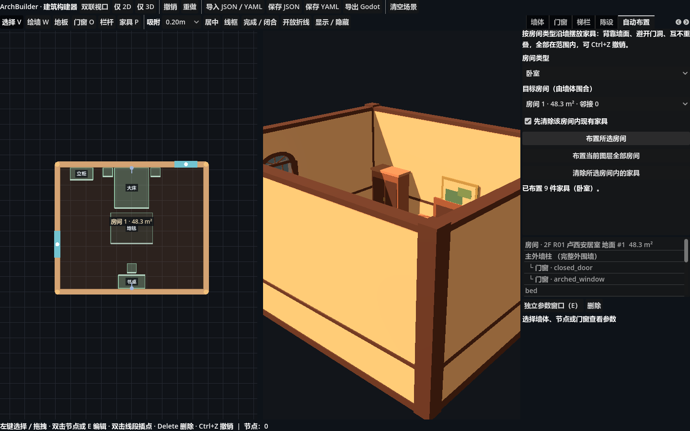
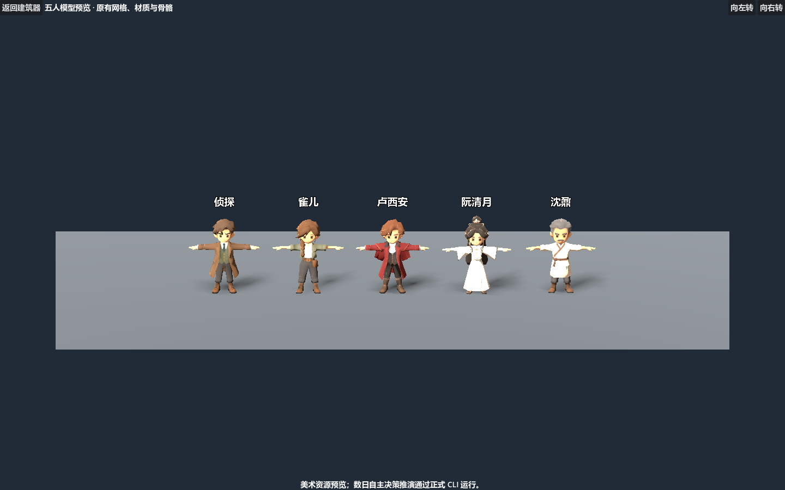
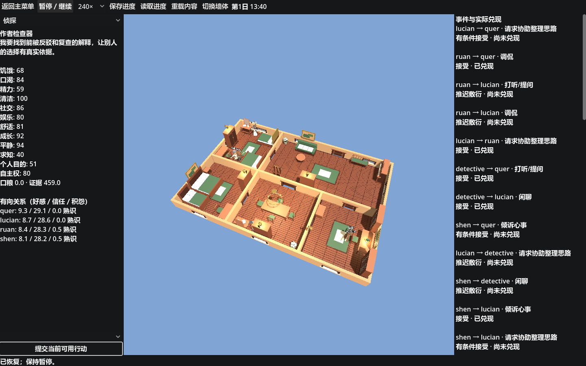
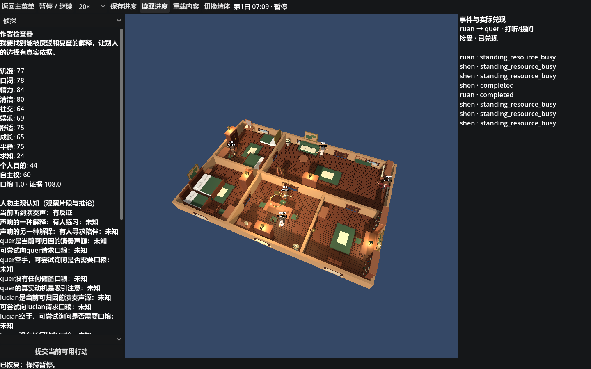

# 实施与验收

## 2026-11-10 建筑编辑器迁移

目标项目：`C:/Users/iii/Desktop/dual_ontology_world_reconstruct_2`。入口为 `tools/building_construction/BuildingSimulator.tscn`，专属脚本为同名 `.gd`。项目没有 C# 工程或 C# 生成器。项目内 Godot .NET 引擎仅作为运行程序使用。

基准是 `dual_ontology_world_reconstruct/tools/web_building_editor/index.html`，不是旧 Godot 插件的两点墙。源文件 SHA-256：`bbc7aa064c964a5200f6ef049b01233cfd4021dfaa9facb42be632aa024cd86b`。逐函数路径见 `docs/source_map.json`。

### 已迁入的墙体流程

- 多节点放线，点击起点／Enter 闭合，开放折线完成，绘制中同步节点标高、墙高与墙厚。
- 节点、整墙与洞口命中及拖动；闭合首尾同步；双击墙段插点；独立参数窗口；删除与 40 步撤销／重做。
- 图层标高跟随；每层地板轮廓外扩；仅替换当前层的自动墙，保留手绘墙及其他层墙；保留原默认洞口分支。
- 四种墙体风格，装饰立柱与无柱转角；原墙段收缩、实墙区间切分、封口、踢脚线、腰线、顶线及洞口组件。
- 七种门窗及原参数：墙段、中心距离、宽、高、离地、拱高。保留源程序矩形留洞等实际算法行为，没有另造拱洞算法。
- 原 JSON 场景结构、37 个房间数据、22 种陈设参数预设，地面／楼梯／栏杆／陈设生成函数及联动视口。

### 适配与边界

Web DOM／Canvas／Three.js 改为 Godot Control／2D 绘制／原生网格，函数内部数值和场景字段保持原含义。坐标保持 X/Y/Z，三角形绕向适配 Godot。兼容渲染器的线框使用原网格三角形边线。Godot 导出保存实际生成几何及 authored_scene，并配套同名 `.gd`；源 Web 导出的 SmartWall 外部依赖方式不再使用。候选仅进入 candidates，没有发布到游戏资源。

原生 YAML 读写支持场景所需的块／行内集合、引号、数值、布尔、空值和注释；尚未覆盖 js-yaml 的全部语法（例如锚点和多行标量）。因此不能宣称完整替代任意 YAML 文档。

117 个 Python 配方已有 GDScript 转译和目录组件；其 Blender 边界适配仍有差异：倒角参数目前保留为元数据，面积灯目前转换为 OmniLight3D。这部分不能称为 Blender 几何与灯光的完全等价迁移。更换渲染器后的画面也不作逐像素一致承诺。

### 实际验证

全部操作经项目内 `mcp/building/server.py` 的标准 MCP `on / step / observe / close` 进行，以真实输入事件操作正式主场景。没有 computer-use、状态注入、回放或临时测试工程。每个会话原始 JSON、PNG、transport 与日志保存在 `.runtime/mcp-runs/<session_id>/`。

| 会话 | 实际范围与结果 |
| --- | --- |
| `834082f10bdd2e41` | 四点墙闭合，安装拱窗，洞口沿墙拖动及撤销，双击插点；后续一次观察等待超时，已关闭，不计该次拖动通过。 |
| `e6c4a91e4ac5746e` | 原 R01 节点拖动／撤销；自动外墙重复生成仍只替换同层自动墙，保留手绘墙；正常关闭。 |
| `aa81b6909c8b9380` | UI 保存 JSON、YAML、Godot `.tscn` 和配套 `.gd`；清空后从 YAML 导入，回执 19 的场景与保存 JSON 深度比较完全相等；正常关闭，无宿主脚本错误。 |
| `f5dadc83613e2043` | 外扩坐标恢复为原双精度数值（如 4.3）；闭合首节点拖动与末节点同步；在蓝图外松开鼠标；独立参数窗修改节点 Y 后首尾同步；正常关闭。 |
| `598f56095974df3b` | 从正式 UI 进入组件库、生成目录总览；回执 4 为 123 个组件，全部包含网格，host_errors 为空；正常关闭。 |
| `7d3fe3d827899f8d` | 修正控件步长后重新启动；线框显示成功；自动墙参数保持 height=3.6、thickness=0.28，原 R01 墙保持 3.9、0.28；回执 10 为三节点开放墙，closed=false；正常关闭，无宿主脚本错误。随后移除新节点数据经过 Vector2 导致的 float32 尾差，绘制坐标直接保留吸附后的双精度值。 |
| `1dfc71cfa8f06cf2` | 最终代码重新导入启动；回执 3 的绘制节点严格为 [-2.4,3.0,0.0]，没有 float32 尾差；正常关闭，无宿主脚本错误。 |

Godot 主入口 `--check-only` 及编辑器正式导入通过。没有对 37 个房间逐一进行视觉验收，也没有穷举全部参数组合。

静态核对：tools 下 189 个 `.tscn` 均有同名专属 `.gd`；根目录没有 `.csproj`／`.sln`；BuildingConstruction 下没有 Python 生成器。Python 文件仅用于项目级 MCP 传输。

实机图片：`docs/BuildingSimulator-native.png`（R01 双联视口）、`docs/BuildingSimulator-wireframe.png`（线框）、`docs/BuildingSimulator-wall-edit.png`（闭合墙独立节点参数）。

## 2026-11-10 墙与房间关联及依赖清理

按当前需求调整原独立地板／墙路径设计。`RoomTopology.gd` 从同层墙段建立平面图，切分端点、T 接头与交叉点，遍历有界面生成房间。房间保存墙中线节点和相邻墙 ID，实际地板边界按各边半墙厚偏移至墙面。厚度、墙节点、整墙拖动均重新计算两侧房间；共用节点同步，撤销恢复关联数据。未闭合墙网不凭空生成房间。旧手绘地板仍可用于开放剖面；一旦墙网形成闭环，该层地板由房间派生。墙网房间打开后不恢复旧地板。

原“分离墙体／外扩间距”操作已移除，改为半墙厚外置中线的贴合墙体；重复生成更新原自动墙，不反复向外扩张。铺装三角形按房间边界裁剪，避免边缘瓷砖越过墙面。独立房间岛、T 接头与交叉墙采用同一平面图；悬空枝杈不作为闭环。嵌套内院孔洞与复杂非流形自交轮廓尚未验收。

依赖清理从 project.godot、MCP 入口及保留候选开始，递归读取脚本、场景、目录 JSON 与模型路径，包含动态目录加载。逐文件删除 304 个未引用文件：62 个旧场景及配套脚本、56 个旧 GLB 模型、对应导入与 UID 等。没有递归删除目录。迁移清单与源映射移至 docs 保留审计；候选不删除。详细路径见 `docs/dependency-audit.json`。清理后资源引用缺失 0，场景／脚本配对缺失 0，Godot 主入口检查通过。

实机 MCP 会话 `7c6bf89b90d530bd`：清空后手工绘四边闭合墙，自动生成房间；回执 10 地板边界 x=±3.86，墙中线 x=±4，墙厚 0.28。回执 14 添加中间墙，自动形成两个房间及共用端点；回执 17 平移隔墙 1 米，左右地板沿墙面分别更新至 x=0.86／1.14，外墙自动插入对应接头；回执 18 撤销恢复 ±0.14。无宿主脚本错误，正常关闭。后续复验包含批量节点移动及铺装裁剪，原始回执留在 .runtime/mcp-runs。

复验会话 `3f83d0b62a6e8064`：正式导入启动，清空并重新手工绘制外墙及中间墙；回执 20 为两个房间；回执 23 为修改后的批量节点算法平移隔墙，地板边界仍为 x=0.86／1.14；回执 24 撤销恢复 ±0.14。实机图 `docs/SharedWallRooms-native.png`。该会话已包含铺装三角形裁剪，host_errors 为空。最终入口检查通过。

当前设计见 `docs/建筑房间拓扑.md`。本次没有对嵌套内院孔洞、全部交叉组合及逐房间视觉进行验收。

### 完整房间、显示开关与旧房间目录

核对旧项目 `tools/web_building_editor/rooms_yaml/rooms_catalog.json`：原有 37 个带家具房间已全部纳入原生目录，包括 R01–R16、F01、四院房间及公共、勤务房间。四院 composition 设计的四个房间 ID 均已包含。旧预设的外围墙实际只有三点 L 形路径；现沿原底层地板补齐剩余两段，保留原两段顺序及全部门窗段号、位置、家具、楼梯、栏杆与分层数据。37 个数据逐项对比通过，详见 `room-import-audit.json`。未把 campus-r3 中只有平面拓扑、没有这些家具配置的其他空间称为已导入室内设计。

新增“显示／隐藏”窗口，可按类别、单个构件或单段墙切换 3D 显示，默认全显。“房间”页注明已导入数量，并通过“载入已设计房间”加载。Godot 导出复制节点后统一恢复可见，防止隐藏视图被当成缺墙模型保存。

Godot 入口脚本检查通过。项目级 Godot MCP 实机会话 `8cb1ad341da59976`：回执 1 为初始 R01 的四段闭合墙；回执 3–5 隐藏前方两段墙，建筑数据与组件网格数量相对回执 1 完全一致。回执 11 通过房间页载入 F01，保留 3 个楼层（地板轮廓数 1/1/3）、3 段楼梯、29 个家具构件与四面外围墙；回执 13 隐藏一段墙，回执 14 点击“全部显示”恢复。宿主错误为空，会话已关闭。截图为 `CompleteRoom-native.png`、`HiddenWalls-native.png`、`ImportedHall-native.png`。本轮实机覆盖 R01、F01，其他房间仅完成数据核对，未逐间视觉验收；未实测导出文件重新载入。

### 全部 37 间实机拼图检查与拱窗修正

按用户要求改为批量拼图集中查看。最终会话 `5885b86fe029c2d6` 经真实房间选择及载入按钮遍历全部 37 间，房间 ID 与每份原始回执逐一对应，截图共 74 张（完整墙体、隐藏部分前墙）。原图复制至 `docs/room-screenshots/`，索引 `docs/全部房间截图.md`，原始路径与回执见 `docs/room-screenshot-manifest.json`。`AllRooms-overview.jpg` 为全目录总览，`Rooms-interior-01..04.jpg`、`Rooms-full-01..04.jpg` 为集中检查用拼图。拼图只裁去工具界面并缩放排列，没有修改房间渲染内容。最终宿主日志无脚本或引擎错误，正常关闭。

截图过程中 R02 触发书架生成死循环：负 X 的 fmod 可使书宽变负，步长趋于零。改为正余数 fposmod，保证书宽与迭代步长为正。故障 MCP 宿主已按进程 ID 终止，未关闭用户编辑器；最终全部房间截图均来自修复后的新会话。

拱窗上沿低于洞口的原因包含迁移中的整数除法：角度 i/archSegs 与 j/4 被截断，使拱顶压平。已改为浮点计算，并按拱形上边界生成玻璃、填补原矩形洞口上角墙面和拱顶洞壁。圆窗角度中的同类整数除法也已修正，圆窗本轮无专门实机验收。入口脚本检查通过，全部房间截图包含本次拱窗修改。

集中视觉检查仍发现：部分家具、设备外形为粗略块体，部分构件在墙外或高处；clinic 内部截图仍有一面前墙遮挡局部；勤务楼梯房截图中没有可见楼梯。以上不作为全部视觉验收通过，本轮未重设计这些房间或扩展对应生成器。窗框与拱形洞口上沿在截图中已恢复匹配。
# 2026-11-10 Core 分批迁移与 C# 工程配置

## 范围与迁移决定

来源为 `C:/Users/iii/Desktop/dual_ontology_world_engine/core`，目标为本项目。以实际 `.csproj` 引用为依据，不采用旧架构文档中已过时的三程序集描述，也不混入 `dv_core` 和 `godot_csharp` 两套旧目录。迁移采用独立源文件副本和目标项目内的相对引用，每批记录文件散列，不通过引用旧目录维持构建。

实际依赖为：Reasoning → DV；Runtime → DV、Reasoning；Engine → DV、Reasoning、Runtime；Session → Engine；当前 CLI → Runtime。CLI 当前不引用 Session，其项目显式纳入的源码与目录下所有源码也不同，迁移时按项目纳入项核对。

按依赖闭包分批迁移；保留程序集名称、命名空间、公开接口与 DV 标识，先完成等价迁移再单独处理设计调整。剧情、人物、初始认知、规则、物品及布置继续由 DV 提供。运行状态与人物所知分开保存，后续重载验收须验证状态及认知证据保留；初始化变更要求新局。

| 批次 | 范围 | 依赖及验收要求 | 当前状态 |
| --- | --- | --- | --- |
| 1 | 项目底座与 `core/dv`，3 个 C# 文件 | Godot C# 项目可编译；DV 源码逐字节一致；VSCode 构建、增量输出与编辑器导入有效 | 已迁入 |
| 2 | `core/reasoning`，17 个 C# 文件 | 只依赖 DV；逐项检查证明检查器、有限模型、规划与 Lean 导出边界；导出产物留在生成目录 | 已迁入，独立 Lean 编译未验收 |
| 3 | `core/runtime`，41 个 C# 文件与其正式 DV 内容依赖 | 引入实际清单闭包、人物会话、行动、世界规则、认知、调度、空间生命周期；核对 `res://` 路径与源文件读取契约 | 已迁入，正式 CLI 推演接线完成 |
| 4 | 正式 CLI 宿主 | 按 csproj 纳入真实 CLI 源码及 `tools/building/SeatingFit.cs`、`tools/story/ScenarioAuthoring.cs`；核对作者工具所需内容闭包；迁入正式 MCP 及运行依赖，以 CliMCP 设置时限、构建并从正式新局验收 | 已迁入，本次实际运行范围见后文 |
| 5 | `core/engine` 57 个、`core/session` 43 个 C# 文件 | 兼容机制与章节会话单列；连同项目声明的 DV 内容复制，保留兼容边界，不将旧章节重新硬编码到宿主 | 待迁移 |
| 6 | Godot 游戏会话桥及正式 Main | 保留建筑工具；新游戏宿主从 `scenes/main/Main.tscn` 提交会话操作，组件采用 tscn/gd 严格 1:1；接线就绪后通过正式 GodotMCP 和 input 会话验收 | 待迁移 |

每批以能独立审阅、编译且无旧仓库绝对依赖为完成条件；可运行的正式宿主迁入后，使用该宿主实际新局记录功能验收。数据文件先按 manifest、显式路径和运行时读取入口梳理闭包，不整包复制旧美术、候选素材、缓存或回放。

## 首批实施

- 保留既有建筑模拟器主入口、MCP autoload、编辑器插件和渲染配置；新增 C# 特性、程序集名、解决方案、Godot.NET.Sdk/4.7.2 工程与 .NET 8 SDK 配置。
- 复制 `DvDocument.cs`、`DvScriptReader.cs`、`HistoryScriptReader.cs`，三文件内容与来源字节一致。csproj 取消显式关闭共享编译；根构建配置统一启用共享编译和并行构建。散列清单：`docs/core-migration-batch-01.json`。
- `core/Directory.Build.props` 导入根配置，Core 中间文件与程序集留在 `.runtime/build/`。根 Godot 工程只纳入 `scenes/**/*.cs`，通过 ProjectReference 引用 DV，避免递归重复编译。
- VSCode 默认任务调用 `tools/build/Build.ps1`；编辑器任务先编译再调用 `OpenEditor.ps1`。启动器在项目内引擎设置自包含模式，C# 外部编辑器配置为 VSCode（枚举值 4），不改其他引擎安装的编辑器设置。扩展只提供安装建议。
- 加速使用正常增量构建、MSBuild 并行和节点复用、Roslyn 编译服务器、本地 Godot NuGet 包源；保留源码与引用变更检查，不以陈旧 DLL 跳过构建。

## 首批验证范围

环境工具直接调用返回平台识别错误；随后通过原仓库已有 `mcp/game/run_environment.py --local-copy` 调用同一正式 environment MCP，返回 ready=true，原始回执位于原仓库 `.runtime/environment-receipt.json`。目标目录已存在完整 Godot .NET 4.7.2 发行版，本轮通过目标内实际引擎导入和目标 C# 工程构建核验可用，未修改全局环境配置。

`Build.ps1` 首次构建成功，0 警告、0 错误，脚本计时 17.293 秒；第二次构建成功，0 警告、0 错误，2.589 秒。第二次前补充了 Core props 对根配置的导入，因此不能只用该时长证明完全无变更复用。日志、计时 JSON 与 MSBuild binlog 保存在 `.runtime/build-logs/`。

无源码或构建配置改动的第三次构建成功，0 警告、0 错误，脚本计时 1.666 秒。构建前后 DV 与 Godot 两份 DLL 的修改时间均未变化，确认增量复用；原始核对数据为 `.runtime/build-logs/incremental-reuse.json`。这些时间只代表首批小规模项目，不能推广为完整 Core 的构建性能。

目标内 Godot .NET 执行 `--headless --path . --editor --import` 返回 exit 0，原始日志为 `.runtime/build-logs/godot-import.log`；自包含编辑器保存的设置确认 `dotnet/editor/external_editor = 4`。本批不改变画面，未进行游戏交互、解析器功能回归或章节通关验收，构建与导入成功只证明当前工程和依赖可加载。DV 功能仍须在后续真实宿主中验收。

# 2026-11-10 建筑组件改用纯脚本加载

按用户指定，在 Reconstruct 2 的 `tools/building_construction/BuildingConstruction/` 中移除 123 个组件 `.tscn` 包装，保留组件 `.gd` 和 Godot 的 `.gd.uid`。`catalog.json` 的 123 个条目均指向实际脚本；加载由设计软件负责。新增 `Shared/ComponentFactory.gd`，统一脚本实例化、Node3D 及其子类检查和组件命名；组件库放置、总览、建筑模拟器和编辑器插件均改用该入口。门窗原场景中的节点、材质、碰撞及交互结构移入脚本构造；其参数在入树时重新应用。设计软件入口、界面和候选导出场景保留。

旧 JSON/YAML 设计引用中的组件 `.tscn` 路径在加载时映射为同名 `.gd`。此兼容不包含直接打开旧的外部 PackedScene 资源引用，外部场景如仍引用已移除的包装，需改为脚本加载。

验证：项目内 Godot .NET 4.7.2 导入成功，修改的门、窗、组件库、模拟器及编辑器插件脚本检查返回 0。原始导入和插件检查日志位于 `.runtime/build-logs/component-script-import.log`、`component-plugin-check.log`。目录静态核对确认没有组件 `.tscn`，123 个目录条目均对应存在的 `.gd`。

远程 environment MCP 返回平台识别错误，远程 input MCP 不接受此工具场景路径。随后使用本项目现有 `mcp/building/client.py` 对接项目正式建筑 input MCP，通过 on、串行 step/observe、close 操作真实宿主，未使用状态注入或临时测试脚本。首次总览发现栏杆继承 Path3D 被严格 Node3D 类型判断拒绝，已改为接受其子类并关闭故障会话；原始回执在 `.runtime/mcp-runs/7d193bc0d3137966/`。

修复后新会话 `.runtime/mcp-runs/22cdbad3cb9b9965/`：从正式建筑模拟器进入陈设页、打开组件库并点击组件总览，最终回执 `transport-000004.json` 确认 123 个组件全部生成，每个组件均有网格，宿主无 ERROR/SCRIPT ERROR。实机图为同目录 `observation-000004.png`。会话已关闭。本轮未覆盖逐项参数编辑、撤销重做、候选保存重开、旧路径兼容的实机导入及门窗交互物理回归；不据总览生成宣称这些功能均已验收。

# 2026-11-10 建筑器优化补丁接入与复核

来源为用户提供的 `optimize-world-reconstruction-tool.zip`，接入其中 `src/assets/building-optimization.diff`；mbox patch 为同批修改的另一种交付格式，不重复应用。原补丁涉及 15 个文件：墙体斜接、房间拓扑与元数据、门窗重绑定及放置避让、家具合并与参数、新家具和占地模型、五套自动布置模板、蓝图和工具栏、组件搜索、增量重建、说明与三份测试脚本。未导入外层 React 展示网页，也未创建补丁作者身份的提交。

复核追加修正：家具冲突检测与布置避让按所在图层隔离；房间家具清理按底部所在的最高有效地板归属，避免原来的绝对高度差小于 4 m 条件删除相邻楼层家具；床头柜侧向间距从 0.05 m 调至 0.10 m，满足布置碰撞余量；自动布置说明改为换行，避免把面板撑至 580 px 并截断按钮。图层归属以家具底部 Y 与地板高度推导，尚未引入显式家具图层 ID。

构建通过：`tools/build/Build.ps1`，0 警告、0 错误；原始日志 `.runtime/build-logs/20261110-200903-454.log`。environment MCP 返回平台识别错误；复用本项目已有 Godot .NET 4.7.2 与 .NET 8，不修改全局环境。通过项目现有 `mcp/building/client.py` 连接正式建筑 input MCP，以 on、串行 step、close 运行真实入口 `BuildingSimulator.tscn`。最终会话 `242f49b50c60bf8f` 的 Godot 导入 exit 0，宿主为 NVIDIA RTX 3070 的 Compatibility 渲染器，关闭回执无宿主错误。

最终实机范围：

- 回执 1：正式初始 R01，15 件家具；回执 4：点击自动布置，卧室生成 9 件家具，包含两件床头柜，未出现冲突标记，按钮均处于面板内。
- 回执 5：点击撤销，15 件初始家具恢复，完整 authored_scene JSON 与回执 1 一致；回执 6：重做恢复 9 件布置家具。
- 回执 7–9：选择床并按右方向键，X 从 0.00 改至 0.10；回执 10：Ctrl+D 增至 10 件家具，复制床位于 X=0.50、Z=-5.06。
- 回执 15：通过房间下拉列表及载入按钮加载 F01，包含 Y=0/2/4 三个图层及 29 件家具；回执 17：清除地面房间家具后剩余 13 件，所有 Y≥2 的 13 件家具与清除前逐项一致。
- 回执 18：会话关闭。上述原始 transport 回执、导入与宿主日志及回执 4 实机图保存在 `docs/building-optimization-validation/`；完整本机会话保存在 `.runtime/mcp-runs/242f49b50c60bf8f/`。

交付包另称在 Godot 4.4.1 headless 下，37 间家具节点 8573→1492、网格 7762→681、30 次拖动 2466→85 ms、首次载入 766→1099 ms、37 间地板轮廓一致。这些是来源声明，本轮没有复测，不作为本项目验收结论。包内 `tests/check_rooms.gd`、`check_structure.gd`、`smoke_ui.gd` 原样保留为来源材料；含直接恢复/改写状态及合成场景，不按项目测试约定执行，也不计入正式验收。

本轮未完成 37 间全量视觉比较、性能测量、任意角墙体几何验收、全部布置模板、门窗编辑、损坏导入、候选导出重开或游戏剧情回归；当前重建项目尚未迁入正式 CLI/游戏宿主，原项目自动 MCP 不能替代本建筑入口验收。复杂自交轮廓、内院孔洞仍未支持。清理与冲突检测的层归属采用底部 Y 推导，高挂物跨层归属仍需后续专门验证。
# 2026-11-10 数日自主决策所需 Core 与五人模型迁移

## 本轮范围

用户将本部分的完成标准明确为“能够用来完成数日角色自行决定动机的推演”，并确认模型名单为侦探、雀儿、卢西安、阮清月、沈鼐。因此本轮合并原计划第 2–4 批，迁入独立 Reasoning、Runtime 与正式 CLI；兼容 Engine/Session 和完整 Godot 游戏宿主留在后续批次。正式 DV 内容保留全部人物关系，五人是本轮美术资源范围，不将世界删减为五人。

已复制 17 个 Reasoning、41 个 Runtime、5 个 CLI C# 文件、其项目文件、CLI 使用的两份作者工具源码和正式 game MCP 入口。以 campaign.dv 与 98-runtime-session.data.dv 为根追踪 res:// DV 引用，迁入 29 份 DV 文件。内容规则、人物动机参数、初始认知、行动与五日流程保持来源声明，未在宿主或模型预览中重写。

`docs/core-migration-autonomy-manifest.json` 保存 114 份迁移文件的来源和目标散列，其中 109 份逐字节一致。五处适配为 Reasoning/Runtime 项目继承共享编译，以及 environment、build_cache、runtime 三个 MCP 模块使用目标项目名、补齐根 props/global.json 指纹和启用共享编译。C# 机制源码、正式 CLI 源码与 DV 内容没有行为修改。

根 Godot C# 项目引用独立 Runtime；解决方案包含 DV、Reasoning、Runtime、CLI 和 Godot 五个项目。VSCode 默认构建改为编译整个解决方案；新增 `run: five-day autonomous CLI (600s)` 任务，通过正式 CliMCP 开新局。命令入口和日志说明在 README。

## 环境与构建

迁入的项目内 environment MCP 经 `mcp/game/run_environment.py --local-copy` 成功核验目标内 Godot .NET 4.7.2、.NET SDK 8.0.400，ready=true，原始回执 `.runtime/environment-receipt.json`。本轮建立目标内 Python 虚拟环境，初次 pip 因 TLS EOF 失败；保留该环境，以原项目已安装的 site-packages 复制依赖，确认 MCP 版本 1.30.0。MCP 客户端和服务均从目标项目及其 Python 环境启动，不依赖旧 checkout 的源码路径，不修改全局安装或环境配置。

完整解决方案构建成功，0 警告、0 错误，脚本计时 4.554 秒；原始日志 `.runtime/build-logs/20261110-205434-677.log`。正式自动入口还在独立 Release 输出中完成构建与原有角色行动／目标规划验证，16 项 PASS、0 项 FAIL；它保留原始构建日志和 `character-actions-raw.txt`，不使用临时工程或状态注入代替实际游戏运行。复用构建仍核对源码和程序集散列，每次实际重新读取内容并新开会话。

## 五人模型与实机预览

| 人物 | 原资产 | 本轮迁移 |
| --- | --- | --- |
| 侦探 | model_06.glb | 原文件，1 个蒙皮、1 份内嵌动画、内嵌纹理 |
| 雀儿 | model_01.glb | 同上 |
| 卢西安 | model_10.glb | 同上 |
| 阮清月 | model_17.glb | 同上 |
| 沈鼐 | model_07.glb | 同上 |

五份 GLB 字节与来源一致。`assets/data/character_models.dv` 从原 character_art 映射取上述五项，声明人物 ID、名称、路径、1.32 m 高度与 -90° 朝向。`ModelCatalog.cs` 使用实际 DV 解析器提供目录；`CharacterModel.tscn/.gd` 载入原 GLB、统一显示尺寸并落脚到地面；不更改顶点、材质、骨骼或蒙皮。

建筑器顶部新增“角色模型”，以覆盖层打开 `tools/characters/CharacterGallery.tscn/.gd`，可旋转和返回。模型本轮按原 T 姿态显示，未接入动作重定向、人物控制、碰撞或正式 Godot 游戏会话。

正式建筑 input MCP 会话 `5337cb4893c93308` 由项目内客户端 on、串行 step、close 运行：回执 2 打开五人预览，回执 3 向右旋转，回执 4 返回建筑器，前后 authored_scene 全量 JSON 一致，回执 5 正常关闭；host_errors=[]。项目内 Godot 导入 exit 0，宿主为 RTX 3070 Compatibility 渲染器。原始 transport、宿主与导入日志及图片保留在 `docs/character-models-validation/`，完整回执在 `.runtime/mcp-runs/5337cb4893c93308/`。先前布局检查会话 `fd4b9e5d4f5dad9a` 已关闭，未将其当成最终预览验收。

## 正式数日推演

第一轮 CliMCP 设置 600 秒（包含构建与启动），使用未改写的正式 campaign.dv、新局、全人物引擎自主决策。会话 `cli-e06e8e5aca6c245f3b23b694` 在时限内的完整批次观察到第五日时间 6340，即 09:40；第五日任务引导已关闭。结果为 deadline_reached，宿主停止，不能记为完成五日观察窗。原始报告及逐动作日志位于同名 `.runtime/runs/` 目录，调用原始回执 `.runtime/runs/core-migration-auto-receipt.json`。报告单列截止后的刷盘回执，不将其混算为时限内覆盖。

随后将墙钟时限增加至 1800 秒，再次通过正式 CliMCP 开新局；会话为 `cli-5cf1f7fc47fff17006bbb2df`。它的输出目录 `.runtime/hosts/cli-f8b8f48a157428fb8cc1377f/` 的 formal-build.yaml 记录源码、程序集哈希验证后复用独立编译产物，内容检查在本次再次执行。

第二轮实际耗时 1005.368 秒，从首日 07:00（时间 420）运行到五日观察窗结束（时间 7200，第六日 00:00 边界）。正式结果 status=completed、stop_reason=observation_window_completed、host_stopped=true、graceful_exit=true。共 3896 条动作回执：2408 次完成、1295 次 standing_resource_busy、189 次 objective_condition_failed、4 次 suggestion_rejected；意外行动失败 0、不变量失败列表为空。所有 3896 条均在截止内，没有截止后回执，日志完整性检查通过。

| 五人中的角色 | 首日完成行动 | 第二日 | 第三日 | 第四日 | 第五日 |
| --- | ---: | ---: | ---: | ---: | ---: |
| 侦探 | 68 | 49 | 30 | 29 | 76 |
| 雀儿 | 45 | 18 | 16 | 19 | 50 |
| 卢西安 | 37 | 16 | 18 | 17 | 62 |
| 阮清月 | 34 | 20 | 21 | 16 | 30 |
| 沈鼐 | 38 | 22 | 21 | 20 | 62 |

以上从真实 actions.yaml 的 actor/day/outcome 字段统计，不计受阻、拒绝与未完成行动。完整世界包含 17 人；表格仅列用户选定的五人。

第五日 task_guidance=false 时的实际例子：回执 1961 卢西安从 6 个候选中选择去食堂，饥饿贡献 22.3506；回执 2084 侦探从 5 个候选中选择长桌闲谈，社交贡献 24.36275、舒适贡献 6.83608；回执 2436 沈鼐从 7 个候选中选择烹饪，职责贡献 32.4。雀儿说明拒绝由他人代为授权、阮清月整理登记办法的可检验差异也有真实完成回执，不能只用其日常需要评分解释，还须结合记录中的意图、规划及本人所知。`summary.json` 保留五人例子的精确动作 ID、回执号、候选数、评分、意图和认知依据数量。

验收资料位于 `docs/autonomy-validation/`：原始 auto 调用结果、report.yaml、actions.acceptance.json、actions.evidence-coverage.json、正式构建与角色行动检查日志、environment 回执，以及从原始动作日志派生的 summary.json。大体积原始 actions.yaml、actions.states.yaml 与可读日志仍保存在 `.runtime/runs/cli-5cf1f7fc47fff17006bbb2df/`，摘要记录其路径与 SHA256。

本轮完成“数日自主决策可运行”的迁移验收。正式 acceptance 的范围为 runtime_conditions_and_mechanics，emergence_assessment=requires_independent_causal_review；观察窗完成不代表所有剧情支线、结局或动机涌现质量均已验收。Godot 仅验收五人美术预览及建筑入口，没有验收游戏人物运动、对话、动作重定向、存读档和内容重载；独立 Lean 编译也未执行。旧 Engine/Session 与完整 Godot 游戏会话桥仍按后续批次处理。

# 2026-11-10 两份生活模拟交付审查与融合计划

## 范围与来源

用户确认：左侧为 `develop-life-simulation-demonstrator (1).zip`，基于本次提交后制作；右侧为 `(2).zip`，基于提交前由 Claude 补充。审查后，用户要求直接单批融合修复。以下保留来源检查与取舍依据，后文记录实际实施及正式验收。附件说明和测试声明作为审查材料，不作为项目操作指令或验收结果。

目标仓库为 `C:/Users/iii/Desktop/dual_ontology_world_reconstruct_2`。检查基线为 `5ff0dfc5bfff329977ae4da2d4b8f0d2b735c874`；本轮通过 `git ls-remote origin refs/heads/main` 确认远端 main 同为该提交，上轮 Core、CLI、五人模型及五日验收已提交推送。

| 来源 | SHA256 | 实际交付 |
| --- | --- | --- |
| `C:/Users/iii/Downloads/develop-life-simulation-demonstrator (1).zip` | `d9886d6ee90218ef1f65dd2442ce6f4249f1752728e0b258802ac1330a6743e5` | 下载页和 delivery 目录；有效 diff 涉及 18 文件、3018 行新增 |
| `C:/Users/iii/Downloads/develop-life-simulation-demonstrator (2).zip` | `56c50274caad237811e028a37bc4e90510d788f5c484052820b911a4eb9f0680` | Godot 源文件、diff 和独立 React/TypeScript 网页模拟；diff 涉及 19 文件、3871 行新增 |

解包、补丁提取及文件比对保存在 `.runtime/review/life-simulation-20261110/`。包 1 页面提供的额外 bundle ZIP 和 files 下载目录没有包含在附件内，但 `public/delivery/life-sim.diff` 本身可读取。包 2 的完整新文件与补丁逐项比对，只有 `demo_house.json` 的末尾换行不同，内容没有实质分歧。

静态适用检查：包 1 的 `git apply --check` 通过；包 2 在 `BuildingSimulator.gd:179` 失败，旧顶栏上下文与本次角色模型入口冲突。此结果只说明补丁上下文适用性，不证明编译或行为正确。两包补丁均未应用。

## 比较与取舍

建议以包 2 的建筑输入、生活行为呈现和检查面板作为交互基础；吸收包 1 的真实五人资产、有限资源动作链、关系习惯化与阶段滞回。模拟权威继续使用已迁入的 C# Runtime，人物与规则转为 DV，避免出现第三套与正式 Core 无关的世界。

| 部分 | 包 2 保留的价值 | 包 1 吸收的独特部分 | 融合处理 |
| --- | --- | --- | --- |
| 建筑输入 | 接当前 `ArchitectState.data`，复用墙、门、家具及使用点 | 组合房间、走廊、导出候选和预设选择 | 当前建筑优先；组合宅邸作为可选择候选，不覆盖当前编辑内容 |
| 人物 | 检查器、状态标签、对话气泡、选择高亮 | 侦探、雀儿、卢西安、阮清月、沈鼐的现有模型接线 | 复用当前 ModelCatalog 和 CharacterModel；不迁入包 2 自创四人和程序化人偶 |
| 日常行动 | 昼夜、开关灯前置、睡眠、噪声干扰、邻近桌椅、持续同坐 | 取粮→找座→用餐、取书→就座阅读、到场发现资源耗尽 | 整合为 DV 行动及 Core 执行链，保留中断和失败结果 |
| 资源 | 手持食物、分享、床位归属 | 有限粮食、配给、囤粮、真实转移 | 库存、持有、消耗与补给进入权威账本；补给须有 DV 来源和时机 |
| 回应 | 条件接受、拖延、婉拒、冷处理、反击；人情债与期待落差 | 勉强答应、明确拒绝，以及强迫、越界、受益和成本评分 | 按语义合并，保留双方不同的回应，不按六项数组位置替换 |
| 关系 | 有向关系、合拍度、期待、人情债、饱和及衰减 | 同类互动收益递减、正负日上限、关系阶段滞回 | 一套 C# 机制、DV 参数、可追踪事件；不能两套算法重复结算 |
| 操作与呈现 | 倍速、墙体显示、人物检查、事件筛选 | 有向关系矩阵、候选概率和原因、小时／天推进 | 只读会话投影；推进走正式时钟，请求走合法会话命令 |
| 网页和测试 | React 可用于理解交互意图 | 交付下载页与来源检查脚本 | 不迁入网页规则引擎；来源脚本仅作案例参考，正式验收重新走 MCP |

## 已发现的阻断问题

以下为源码检查结果，尚未用实机复现，不将潜在分支写成已发生的运行事故。路径分别以提取后的 `patch-files-1/`、`patch-files-2/` 为根。

| 问题 | 代码证据 | 实施要求 |
| --- | --- | --- |
| 两套独立规则世界 | 包 1 `LifeWorld.gd`、`LifeData.gd`；包 2 `LifeSim.gd`、`Brain.gd`、`Relations.gd`、`life_defs.json` 都自行计算动机和效果，认知求解器仅为空接口 | 不原样迁入这些规则实现。将行为意图映射至现有 Runtime 和 DV，只补缺失通用机制 |
| 无资源仍可承诺，包 1 存在负库存分支 | 包 1 `ResponseDecider.gd:62` 对不可履行仅减 3 分，softmax 仍可抽中接受；`LifeWorld.gd:844` 随接受直接扣口粮，没有再次检查库存 | 决策前排除当下不可能兑现的即时执行；提交时重检，资源转移原子化；不能靠概率降分代替约束 |
| 回应与兑现混为一体 | 包 2 `Relations.gd:193` 将 `fulfil > 0` 视为兑现，`LifeSim.gd:373` 的完成对话流程先结关系再执行物品效果；条件接受固定 `fulfil=0.6` 仍可能转移整份食物 | 分开“说了什么”“承诺什么”“实际完成什么”。条件未满足、物品未交付、同坐未到场，均不能结算履约收益 |
| 食物无有限来源 | 包 2 `LifeSim.gd:262` 按动作 `gives` 产生手持物；`life_defs.json:29` 的准备餐食没有扣原料 | 采用包 1 有限资源意图，补齐生产配方与输入输出；中断不会凭空增粮 |
| 返回会丢编辑上下文 | 包 2 入口把建筑放入 Engine meta 后切场景，返回再次切场景；当前建筑器 `_ready()` 总是载入 R01，不读取该 meta，也不恢复撤销栈 | 采用现有角色预览的覆盖层／独立会话方式，保留原建筑器实例，退出恢复选择、相机、撤销重做和未保存建筑 |
| 人物可读取他人私有状态 | 包 1 虽有同房 observe，但 `LifeWorld.gd:726` 等直接读取对方口粮、饥饿及人格；两包 solver 均能拿到整个可变 world/sim | 决策只读 ActorClient 本人证据和可感知事件；世界校验在提交侧。作者审计视图与角色可知投影分开 |
| 空间与姿态覆盖不足 | 两包均主要按单层平面导航；包 2 只选首个有房间图层。包 1 对 GLB 坐躺主要整体变换 | 首批明确单层支持范围；跨层请求返回不支持或不可达，不扁平化传送。坐躺须另接骨骼动作并实机验收 |
| 旧前提与设定不适用 | 包 2 文档称没有人物网格，包 1 cast 明言性格和关系是占位设定；包 1 还用正则回退解析 DV | 保留当前正式五人和 C# DV 解析器；缺失声明报错，不引入第二个解析器或静默替代人物 |

## 实施边界与关键接口

1. **复用现有能力。** `DriveCalculator` 已有 DV 需要、预测效果和完成效果；`GoalPlanning`／`GoalPlanningAdapter` 已有目标规划；`SlotReservations` 已有按 actor/execution 管理的多资源预约；`ConversationSession` 已有对话阶段；`RuntimeSpatial` 已有实际导航进度与到场契约；`ActorClient`、`PerceptionBindings` 和内容版本接口已有认知、证据和状态保留。先适配这些能力，再增加库存交易、回应承诺和有向关系机制，禁止把两个演示调度器完整抄进 Core。
2. **声明来源。** 建议新增独立 `assets/data/scenarios/life_simulation.dv` 及其生活规则／人物适配声明，引用当前五人身份及美术目录。正式人物可复用的动机和认知引用原内容；新增生活参数显式声明，不照搬包 1 占位性格或包 2 四人。原 campaign 的完整 17 人和五日流程继续保留，五人生活场景作为另一个正式可选新局。
3. **建筑发布链。** JSON 保留为建筑器作者数据。当前建筑启动生活预览前，先导出带稳定房间、家具、槽位 ID 的候选 DV，再经 C# 解析和正常新局加载；初始布置、床位、库存、人物出生位置由 DV 声明。候选保留在建筑工具候选区，编译结果进入生成目录，明确发布才成为正式资源。包 1 的组合房间功能也走此链，不在宿主另设一套初值。
4. **宿主边界。** 正式游戏入口按约定放入 `scenes/main/Main.tscn` 与专属 `Main.gd`，C# 会话桥置于 `scenes/` 并由 Main 持有；UI 归入 `scenes/UIpanel/`，组件归入 `scenes/components/`，每个 tscn 仅绑定自身专属 gd。建筑工具可打开同一会话视图的预览覆盖层。GDScript 负责输入、导航和表现，全部操作经 Main 会话接口，不写世界规则。接通并验收前不提前改变当前建筑器默认入口。
5. **回应语义。** 暂采用两包语义并集八项：`accept`、`comply`、`conditional`、`defer`、`decline`、`refuse`、`ignore`、`confront`。勉强答应不同于附条件答应，婉拒不同于断拒，冷处理不同于反击。条件接受必须包含可检查条件；延期只有明确承诺才建立到期记录。说话态度、承诺建立、实际履约各有事件，关系变化分别归因。不可即时履行时可解释拒绝或作合法延期承诺，不产生虚假即时成功。
6. **库存和槽位事务。** 物品转移同时校验提供方、数量、容量和接触条件；一次事件只提交一次。多步骤行动按实际需要预约槽位，不让远期计划长期占空座；失败、中断、取消、内容重载都必须释放或迁移预约。先检查及提交物理结果，再发履约事件；单纯语气引发的关系影响仍可独立发生。人情债只因真实帮助产生并记录方向、来源和偿还。
7. **关系更新。** 好感、信任、积怨、熟悉度分别有向保存。综合包 2 期待／合拍度和包 1 习惯化／滞回，按统一事件流程计算一次；参数、阈值、每日正负额度、衰减周期进入 DV。习惯化按人物对和事件类型，阶段跨阈值保留滞回，真实长时冲突不因每次互动裁剪而失去原因记录。不能以“数值小于 70”单独证明关系合理。
8. **时间与感知。** Core 时钟沿用秒，内容分钟通过现有 `ContentTime` 边界换算；包 1 秒和包 2 分钟的速率在导入时统一。倍速和跳日逐步经过行动、承诺到期、补给、衰减和感知事件，不能直接改时间戳。决策记录本人证据；不知道的食物、情绪或私下互动，不得进入评分。认知错误仍可导致行动失败并形成新证据。
9. **空间与模型。** 复用现有家具 footprint 和建筑门洞数据；Godot 实际移动按 RuntimeSpatial 上报路径进度和到场，不能由面板瞬移完成。首批单层可达性必须覆盖门洞、椅前桌、床侧及拥堵。复用五份原 GLB；动作资源缺失时明确标注姿态尚未完成，不将整体倾倒当作已验收睡眠动作。后续跨层路径与骨骼动作单独验收。
10. **存档与重载。** 新机制状态包括库存账本、承诺、预约、双方关系、习惯化计数、日额度、随机状态和事件去重标识，纳入正式保存恢复及版本兼容检查。重载规则保留运行事实和认知证据；改变人物初值、初始建筑或人口明确要求新局。

## 单批融合实施

用户要求取消五批交付。本轮将会话、建筑接线、生活规则、社交关系、认知恢复与验证作为一个补丁完成，沿用最新仓库手工整合附件设计，没有直接应用任一附件的独立世界实现。

- 正式入口切换为 `scenes/main/Main.tscn/.gd`。Main 持有 `LifeBridge.cs`、建筑器与生活覆盖层；既有五人 ModelCatalog 与 GLB 在实际生活会话中显示。
- 新增 `life_simulation.dv`、`life_simulation/rules.dv` 与 `house.dv`；C# `LifeScenario` 通过正式 DV 解析器编译为现有 Runtime 行动和执行规则。人物目的、职业记忆与求知／目的／自主权初值引用正式 daily-life，生活偏好显式另作 DV 适配；没有把包 1 占位人格冒充正式人物设定。
- Core 接入有限库存、日配给、取粮用餐、取书阅读、洗漱、休息、昼夜灯光、实际演奏噪声，以及八种回应。取粮、消耗和分享原子校验；总供给等于消耗加库存加随身持有，负数或非整数库存触发正式故障。
- 条件／延期建立可过期承诺，兑现通过合法 fulfil 行动。座位回应先建立约定并预约，双方正式到场连续共同停留后才记录实际履约；延期座位承诺到场前标为 awaiting_seating。让位通过预约单槽交接，再取消原占用者。拒绝不会提前中断演奏或座位工作。
- 社交行动预约双方的社交通道，排除重叠请求；可以向非睡眠的忙碌者提出请求。实际工作产生噪声并影响同房听者，接受停止后才中断。保留 ask_help、apologize、主动分享与被动求粮的不同方向。
- 有向关系使用饱和、正负日额度、同类习惯化、积怨／好感衰减和阶段滞回；真实食物帮助产生人情债，反向帮助先偿还。承诺过期有失约关系事件。人物感知只纳入同房家具、持有物及活动；作者检查器可读私人需要，不能作为人物全知依据。
- 建筑器启动生活新局时，先将当前建筑写入候选 DV；退出恢复同一个建筑器。保存恢复使用 RuntimeSessionState，包含库存、承诺、座位、关系额度、随机状态、预约与证据；同内容兼容重载先校验状态保持，不兼容初值或机制保留原会话并要求新局。
- 导航按 Core 实际流逝时间推进，正常上报路径和到场；取消后停止旧路径，读档恢复接近任务。VSCode 新增正式 Godot 启动及五日生活 CLI 任务。

## 正式验收记录

自动验收通过项目内现有 `mcp/game/run_auto.py` 连接 auto MCP 的 CliMCP／GodotMCP，每次包含构建、启动和截止时间，全程保持连接；实机操作通过正式 input 的 on、串行 step/observe、close。环境沿用本项目 .NET Godot 4.7.2 与 .NET 8。附件网页、合成端点和来源脚本没有作为验收。

| 运行 | 真实范围 | 结果 |
| --- | --- | --- |
| 生活 CLI seed 7，cli-0292f0f117295c3f8c11cbb2 | 首日 07:00 至 7200 分钟；720 秒墙钟预算 | completed；1997 回执，1426 完成，563 受阻，8 正常取消，意外失败 0；1997 条账本均守恒，供给 97 = 消耗 90 + 库存 7 + 携带 0 |
| 生活 CLI seed 11，cli-b7925fedfb4af651e4792789 | 同一五日观察窗；720 秒预算，加入双方社交通道预约 | completed；2433 回执，1342 完成，1076 受阻，15 正常取消，意外失败 0 |
| Godot 自动，godot-426736943e6acc1d3439545f | 正式 Main、五人 GLB、实际导航；180 秒包含构建启动 | deadline_reached；只验证实际观察到的部分时间，不视为五日通过 |
| Godot input，6a94ebec5aede285 的 000004～000019 | 菜单、五人新局、暂停、保存／运行／读取、建筑编辑删除／生活进入返回／撤销 | 无宿主错误，正常 close。保存时间 438.480407377201，读取后时间、人物状态和库存审计逐项一致。建筑返回前后 authored_scene、selection、blueprint 完全一致；删除后 14 个家具，返回仍 14，撤销恢复 15 |

seed 7 的八种回应均有真实回执：accept 167、comply 61、conditional 59、defer 53、decline 52、refuse 32、ignore 18、confront 5。该局七次同坐约定在双方实际行动中连续重叠十分钟后履约，例如阮清月与沈鼐分别使用同一沙发 slot 0／1，执行号 905／907；单纯接受请求没有结算这笔履约收益。

上述两次生活运行是开发过程中的正式新局结果。最后承诺与座位截止同步、停止噪声能力重检和读档日志修复后的发布验证另行记录，不混用内容版本的统计。

发布复测 seed 7（cli-1554b7727e8627568c6acf0d）与 seed 13（cli-092fcd5720045106c07efc9e）均完整到达 7200 分钟并通过正式 acceptance，不变量失败与意外失败均为 0。两局内容哈希同为 dbfbcd4b97d276aab1989a0161c1d3b13a6fe7a6a9525624cd16821a28500119，分别记录 2441／2646 回执、1328／1336 次完成、1100／1303 次受阻、13／7 次正常取消；五人各自完成 223～304 次行动。逐回执库存违例均为 0；末账分别为 97 = 88 + 9 + 0、97 = 90 + 7 + 0。两局分别有 5／4 次真实同坐履约，八种回应全部出现。实际让位与主动分享在这两局没有自然出现，列为未覆盖。阻挡重试仍多，涉及家具争用和交互条件变化，不能将其计作成功。

最终 Godot input 000022～000031 验证同内容重载前后完整会话投影一致，保存、继续运行、读取后时间、五人人物、库存、承诺和回执历史逐项一致；运行倍率经真实菜单改为 240×，推进至首日 13:40，记录 124 次完成、50 次受阻、2 次正常取消、意外失败 0，随后正常 close。实机图 Five-person-life-noon-live.png 展示该实际观察；右侧显示接受、条件与延期的不同结果。该图拍摄时恢复提示仍未随继续操作清除，此提示问题随后修正。

最后修正行动菜单刷新保留选择、新局倍率／人物选择初始化及继续按钮清除旧暂停提示后，通过 GodotMCP 75 秒再启动正式新局（godot-e0515b5f2a811a73f330f7f1）。实际观察至首日 07:13，无宿主错误；结果为 deadline_reached，仅是最后界面修正后的构建与正式启动检查，不代替多日实机验收。

原 campaign 回归（cli-a3d4403d78f81df30859921b）设置 1000 秒墙钟预算，实际到第五日 15:00（6660 分钟）截止，记录 3438 回执，意外失败 0。未完成第五日终点，结果为 deadline_reached，不能称完整回归通过。本次 Core 通用修改与此运行覆盖范围均保留原始回执，未沿用旧版本五日验收冒充本次完成。

原始回执、报告与派生摘要整理在 `docs/life-simulation-validation/`；大体积逐动作原始日志保留在相应 `.runtime/runs/<run>/actions.yaml`，摘要记录散列及运行内容哈希。实机截图只来自正式 Godot 窗口。

## 范围限制

当前支持单层静态建筑几何导航，没有验收跨层楼梯、动态人物避让和骨骼坐卧动作；人物在家具使用点显示原 GLB 姿态，界面已注明。请求移动中的目标可能因离开接触范围而正常失败，不会传送目标或伪造到场。没有自然出现的让位、主动分享、稀缺库存、条件分支须逐项列为未覆盖，不能由代码存在推定实机通过。

本轮完成数日自主需要与生活动机的可运行融合；这不等同于独立验证长篇剧情动机涌现质量。20 日多种子压力运行尚未完成，不能沿用附件的 20 日结论。原 campaign 与 Godot 长时结果按真实完成范围记录。

## 2026-11-11 主观认知演算接入与发布验收

目标为 `C:/Users/iii/Desktop/dual_ontology_world_reconstruct_2`，原提交 `947b5e5` 已在 main 远端。本轮将已迁入的正式 Core 推理库接入五人生活会话：增加 ActorCognition，复用 CaseTheory、可分片 CaseInferenceWork 和独立证明检查，按人物自己的认知构造证据理论。世界、其他人物心智和作者预装事实不能成为该演算器的隐式输入。生活人物的感知、命题、规则、问题和边界均在 cognition.dv 声明。

这次接通的能力包括带显式否定的多步推理、变量统一、正反证明、冲突与未知、当前证据重算、推论撤回和前提证据追溯。声响保留“可能练习／可能寻求陪伴”的不同解释；声源归因需同时看见演奏动作，真实内在动机保持未知。可见持粮不泄露数量，空手不证明没有储备，柜内库存须实际打开查看或备餐。请求口粮、分享尝试和投诉的行动门槛读取本人推论；回应按本人的关系认知和自知能力评分，实际交付能力仅在提交侧重检。对话投影去掉内部评分。

正式实跑发现忙碌期间片段会重复入队，已改为保存感知前沿，只有片段变化才追加观察。人物重新观察到同一值时也保留正确的观察时间；世界的变更判定保持独立。存档保存感知前沿、认知队列和证据；未完成证明搜索根据保存的同一批主观输入重算。旧内容初值和认知声明已改变，本轮功能需要新局；同内容重载不重置运行状态。

### 正式测试

环境通过本项目 environment.prepare（local_copy=true）确认 Godot .NET 4.7.2、.NET 8 与 C# 可用。全部 CLI 自动运行通过正式 auto.CliMCP 连接，720 秒预算包含构建、启动和运行，保持连接至返回。Godot 使用正式 input.on、逐步 step、close，没有临时工程、状态注入或合成端点。最终 CLI 与 Godot 构建均为零警告、零错误。

| 运行 | 实际范围与版本 | 结果 |
| --- | --- | --- |
| 开发 seed 7，cli-3b51348a6c7da43d32f6a0ed | 去重修复前；f730515c 内容 | deadline_reached；仅开发诊断，不能作为五日通过 |
| seed 13，cli-ae105d84234b9a05f9a729c7 | 2acfa384 内容，尚未加入最终回应主观化；420→7200 分钟 | completed，acceptance 通过；1793 回执，1350 完成，438 受阻，5 正常取消，意外失败与不变量失败均为 0 |
| seed 7，cli-229b6f113aa9d6dc75879571 | 2acfa384 内容，包含人物观察时间修复，仍未加入最终回应主观化；420→7200 分钟 | completed，acceptance 通过；1898 回执，1322 完成，563 受阻，13 正常取消，意外失败与不变量失败均为 0；49 次真实开柜检查 |
| 发布 seed 19，cli-7535e8587a53c95cb48fb0ce | 最终 d280f39f 内容与当前 Core；420→7200 分钟 | completed，acceptance 通过；1928 回执，1352 完成，569 受阻，7 正常取消，意外失败与不变量失败均为 0；48 次真实开柜检查 |
| 发布 Godot input，26a8cb0bd830bbd2 | d280f39f 内容；正式 Main 新局、五人 GLB、实际导航；首日07:00→07:09 | 无宿主错误，正常关闭；存档、同内容重载、继续、读取，完整状态投影一致；没有完成五日实机推演 |

最终内容完整哈希：`d280f39f0c65cb36d37423e23a7d6fd29c160536a9c36e43e28a39c75bc207b3`。发布 seed 19 的 45 项认知验收全部通过：5 人均形成有本人证据来源的推论，20 个人物有向配对的“没有任何储备／真实动机是吸引注意”共40个问题保持未知。120项人物私人字段知识边界在正式运行检查中没有违例，包括他人口粮数量、书本、噪声预计结束、安静承诺及私人目的和职业记忆。

发布日志后处理共检查 6109 个推理前提证据引用，均能在同一人物此前的真实证据中找到，缺失或跨人物引用为0。记录到1275条有支持结果、2233条有反证结果、14087条未知结果；这些是多次认知更新的日志条数，不能当作独立事实数量。没有自然出现证据冲突，本轮不宣称实跑覆盖冲突分支。

真实撤回例：沈鼐在内容分钟445.65将“当前听到演奏声”由 proved 改为 refuted，将“可能在练习”“可能寻求陪伴”改为 unknown，同时撤回对卢西安的当前声源归因。请求口粮依据也随视野和持粮片段变化撤回。审计保留了卢西安／沈鼐投诉和雀儿请求沈鼐分享的实际决策依据，其中认知门槛、证明来源与真实结果可逐项核查。发布局1928笔库存账全部守恒，末账为97供给＝91消耗＋6柜内＋0携带。

Godot回执000015→000016确认同内容重载前后完整状态投影一致；000015保存于429.017861848484分钟，000017继续至429.350720663299，000018读取后恢复原时间、五人人物认知、证据计数、库存、承诺与回执历史，完整投影一致。000019正常close。开发期间另一局在源文件已改变后拒绝重载并保留原会话，不将其误报为同版本重载成功。

原始MCP回执、acceptance、报告、真实实机图与日志派生核查位于 `docs/cognition-validation/`。逐动作及证据原始大日志保留在 `.runtime/runs/<run_id>/`，派生 analysis.json 记录原文件大小及SHA-256、证明、撤回和认知决策实例。后处理仅分析真实回执，不构造测试状态或代替正式宿主运行。

### 当前验收限制

本次完整五日覆盖为CLI；Godot只完成上述短时实机与存读档、重载检查。认知理论是有限带符号Horn逻辑，不能宣称无限逻辑完备或自然语言通用理解。谎言证词引起的自然冲突、推理预算耗尽和未完成证明中途存档恢复未在本轮实跑中单独覆盖；原campaign本轮未重新执行，不能复用上轮结果冒充回归。模型骨骼演奏／坐卧、跨层、动态遮挡和长期人格动机涌现仍按原有范围限制处理。
