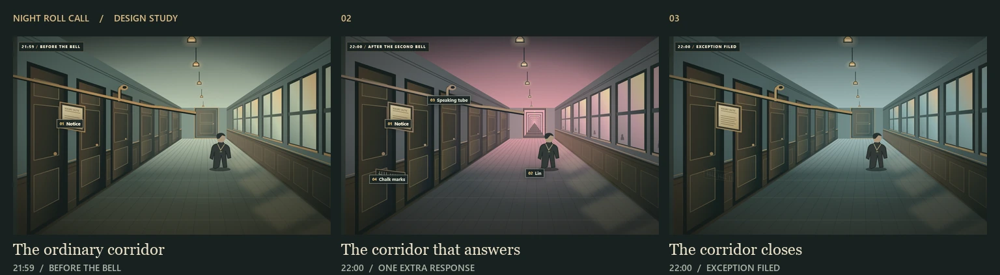

# 《安眠者有福》新设计方向：夜点名与学园规则

**方向提案 · 2026-11-18** ｜ [可玩原型：Night Roll Call](prototypes/night-rollcall/index.html) ｜ [参考素材与来源](prototypes/night-rollcall/references.md)

> **16 个人住在一座有校规的学园里。每天有人做饭、值守、点名。到了晚上，同一份校规开始对看不见的东西也生效。**

## 1. 玩家先认识这座学园，再认识世界

沿用《33 号远征队》的优先级来分配设计资源：前台先给玩家一个能参与的制度和一件要做的事；中层让空间与群体生活为它提供具体后果；底层用人物历史和世界观解释制度为何存在、谁从中得益、谁在承担代价。对本作，前台是 **16 名学员的生活与校规**，中层是四院、宿舍、厨房、勤务管网与各人的习惯，底层是岛、导师、四锚、源质与契约。

三个类型各承担一个工作：

| 类型 | 在游戏里承担什么 | 夜点名的例子 |
| --- | --- | --- |
| 规则怪谈 | 给玩家任务、可查证的冲突和可执行的选择。 | 点名表有 17 次应答；校规允许证人复核实际人数。 |
| 梦核 | 用熟悉的色温、物件和动线建立「我来过这里」的感觉，再让其中一项做不到。 | 同一扇门、同一机位；铃后门框内多出一条走廊，窗里的人影没跟着人移动。 |
| 克苏鲁式恐怖 | 局部现象可复验，整体尺度和意图难以穷尽。学员得在信息有限时继续生活。 | 玩家能证明有一次重复应答；回声沿哪一段不可能存在的建筑传播，可以推迟到后续章节调查。 |

**代管者（恶魔）是超自然力量有礼貌的接口。** 优先用它所维持的管网、校规生效的瞬间、一次精准的答复来塑造存在感。若将原型写入正篇，一句诸如 “Seventeen responses were recorded.” 的答复可以字面真实，同时留给玩家核查「应答」与「在场」的区别。低频保留它的人格：替夜班学员摆好茶杯、把门口倾斜的画扶正；关键场次再用黑燕尾服和琥珀色显形。延续现有契约里的公开可行路径、如实答复、学员自主，以及虚体／凝聚实体的区别。回声的来源先保持开放，保留人造谣言、源质现象和代管者履约三种已有设计资源。

## 2. 玩法循环：做事 → 对照 → 作证 → 过日子

1. **接一项真正需要完成的日常差事。** 点名、留饭、交接钥匙、熄灯。先给一次普通例行版，让玩家亲手摸清空间、用具和同伴的职责。
2. **出现可描述的矛盾。** 每条怪谈先挑一条容易说出口的差异，例如「人在楼梯口，管里却响起他的第二次应答」。用一个可回看的物证和一个独立的人证或动作为主。声音和颜色可帮助定位，保留可重读的替代线索。
3. **用现有操作查证。** 可询问当事人、重做一个动作、对照台账、复演顺序。来源分清：张贴程序告诉你怎么做，临时便条是某人的主张，物证和当事人让你检验发生了什么。程序有适用地点、时段与条件；角色可以误解一条正确的规则，也可以凭正确观察得出一时错误的解释。
4. **提交一个有后果的决定。** 照常执行最省事；按例外条款处理要耗时间或请人担保；暂缓会把责任留给下一班。把后果落在一位同学、一个位置或下一顿饭上。让玩家回来时能看出自己的记录换来了什么。失败先保留行动空间：误报可形成次日待调查条目；只有已经演示过的高风险规则才承担不可逆后果。

### 机制的最小形状

| 作者定义 | 玩家能观察和操作的内容 |
| --- | --- |
| 适用条件、可见来源、权限范围 | 时钟、地点、签章；能查到哪一版在当班生效。 |
| 常规输入、例外条件、可重演证据 | 正常点名；请证人清点、查下划痕、复现管道回声。 |
| 选择、立即变化、延迟代价 | 本夜登记结果；看看门和同学的反应；次日再看到餐位或值班变化。 |

正篇可沿现有 `DualEngine` 节拍、现场交互、证物、复演、案卷和分工扩展。概念上区分 **现场状态／制度记录／个人证言**：例如「有人在场」「有一声应答被记下」「某学生说自己看见了谁」。场景脚本据条件让三者重新对齐；在实机验证前先用现有事件与证物表达，保存的 ID 和契约保持原样。暂缓全局理智条、随机规则洗牌和独立战斗系统。长期变化按现有体验减法来做：保留五日结构，每一日先有一条玩家知道怎么执行的新规，再加一处旧规后果的回访。

### 用三种差事测出机制是否可复用

| 候选 | 一句怪谈 | 玩家动手解决什么 |
| --- | --- | --- |
| **宿舍夜点名**（原型已做） | 16 人在场，登记 17 声。 | 发现一次应答被算作一个人，决定怎样入账和值守。 |
| **厨房留饭**（第二个候选） | 同学尚未回来，有人已经用过他的碗。 | 沿用 B-P 的灶台、器皿、动作复演，查出谁移动过碗；决定是否继续留饭、要不要叫当事人回来确认。 |
| **风窗交接**（第三个候选） | 窗闩在眼前没有动，楼下却传来开窗声。 | 一人看闩、一人听管；复验异地声源，把搭档的班次与自己的下一站一起安排。 |

16 人靠重复出现的习惯和职责建立辨识度。每次重点给一位同行人和一位受影响者；其余同学可以通过吃饭座位、房门、杯子和晚班名录逐渐熟悉。作者为核心角色明确一个可见习惯、一个可信专长和一个冲突时的优先事项，供选择和复盘使用。

## 3. 美术与声音：记忆里的旧学园

| 层次 | 视觉规则 | 声音规则 |
| --- | --- | --- |
| 白天／值前 | 保留温木、釉砖、搪瓷、铜口传声管、磨损把手和可辨方向的窗。日常动作先占画面：收碗、擦板、等同学。 | 木底脚步、瓷碗、锅盖、灯丝，保留站位与房间距离。配乐可用低声部风琴、钟琴或独奏弦乐，由短小的学校铃声动机发展。 |
| 梦核换相 | **锁住机位、锚点和曝光可读性。** 从鼠尾草绿、旧纸黄过渡到灰玫瑰和洗淡的紫；先改变一个实体关系（门深、窗反射或灯距）。颜色变化辅助辨识，几何关系提供证据。 | 同一组音型按原节拍从错误方向返回；给关键回声和落闩留空，优先保证辨位和复听。 |
| 代管者干预 | 黑燕尾服与琥珀留给已确立的显形语汇。环境可以先出现极准确的整理动作和身体不可达的声源。 | 真正开口前先撤掉底乐，短句保持干净、礼貌、位置明确。 |

主镜头承担导航、人物调度和日常取证。现有 `2F-cross-M` 的 Forward+ 定点实景使用俯视剖面，能读到人群站位、窗、灯与木地板；概念原型用同机位的眼高走廊画面来验证纵深与反射。进 Godot 时优先保留既有主镜头和房间拓扑；必要时在公告、窗或门上的现有交互近景里用一组可往返构图，验证回到主镜头后仍能辨识同一证物。异常纵深可先放在尽端门洞后的前景层，保证可行走碰撞、出入口、证物位置一致。若改为可走的真实空间变化，单独验导航和回退行为。控制畸变、闪烁和颗粒；先做纯几何／光影版，再决定需要多少后期。

### 宣传片第一支：35 秒，一次值班

| 时间 | 镜头与声音 |
| --- | --- |
| 00–07 | 给碗排位置、关窗、同学匆匆跑过，低成本三帧交代生活。用实景录到的晚铃压下音乐。 |
| 07–13 | 拍公告上的 “After the second bell, enter the number present.” 镜头退回木廊，第二声铃由原发声位置传来。 |
| 13–23 | 手里的台账多了一格。两次敲同一处铜口，从走廊深处回两声。对切同一机位的关门／延伸门洞；给观众一拍自己认出空间。 |
| 23–31 | 同学把手按在账簿旁：*“I counted sixteen.”* 玩家动作：握笔、把记录翻回上一页。切到标题前留出落闩声。 |
| 31–35 | 标题，副句：**Sixteen students. Seventeen responses.** |

## 4. 原型和下一次关卡决策

[`Night Roll Call`](prototypes/night-rollcall/index.html) 是离线浏览器体验。点击公告、等铃、查证，再选择登记方式。可对比同构图的例行、回声、联署状态；开启声音可听双铃与两次敲击的异向返回。Lin 是原型占位，17 次应答及本夜后果是试验情境，正式名单、剧情、关卡与存档未改动。

**下一步只做一个 Godot 实机场景切片**：在现有宿舍或二层走廊的一个隔离夹具里接入真实同学、公告、传声管、账簿，配置三种局部结果。先保住主相机中的路径和取证位置。使用 Godot 4.7.2 .NET Forward+，从夹具的前一拍开始用 MCP 验站位、证物视线、可重复音响和回访。该切片通过后，再选厨房留饭做第二题来检验复用性。

建议先请五位第一次玩的测试者，各自做一次夜班；目标是至少四人能用自己的话说出差异及一条核验路径，三人能描述至少一个画面或听觉细节。记录首次看公告、发现矛盾、提交结果的时间；把错误选择归因到看不到、理解错，还是主动承担代价。分别验证静音与正常听音的完成路径。然后剪一版不讲设定的 35 秒，询问观众他们以为自己在游戏里会做什么。验收标准是观众先说出日常职责与超自然异常。以上为待执行的验证；本轮只完成浏览器渲染与分支检查，以及现有二楼场景的实景观察（定点记录 `c3fca4914f3bd8c2 / step-0001`）。
