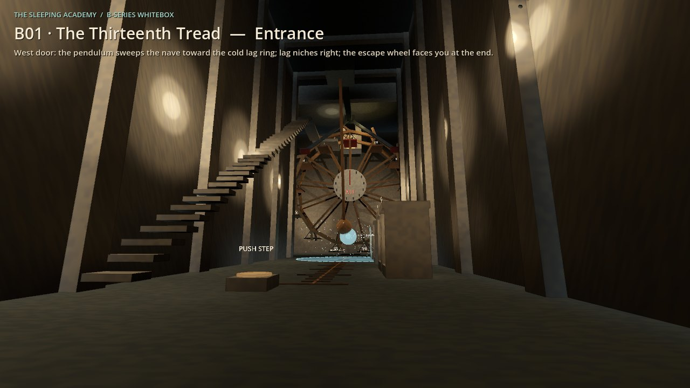
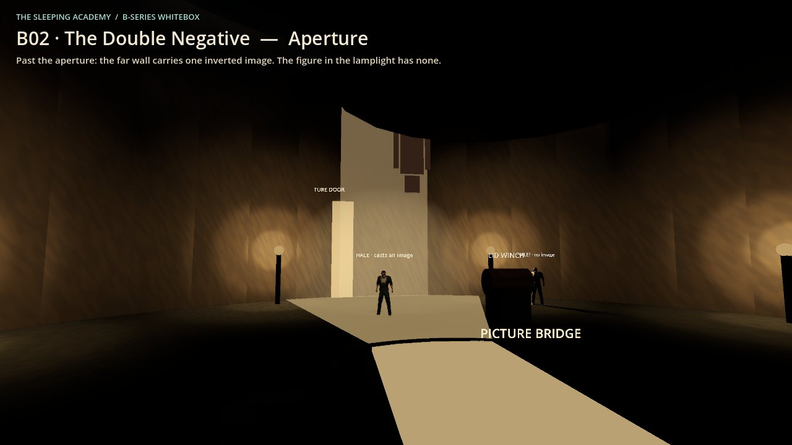
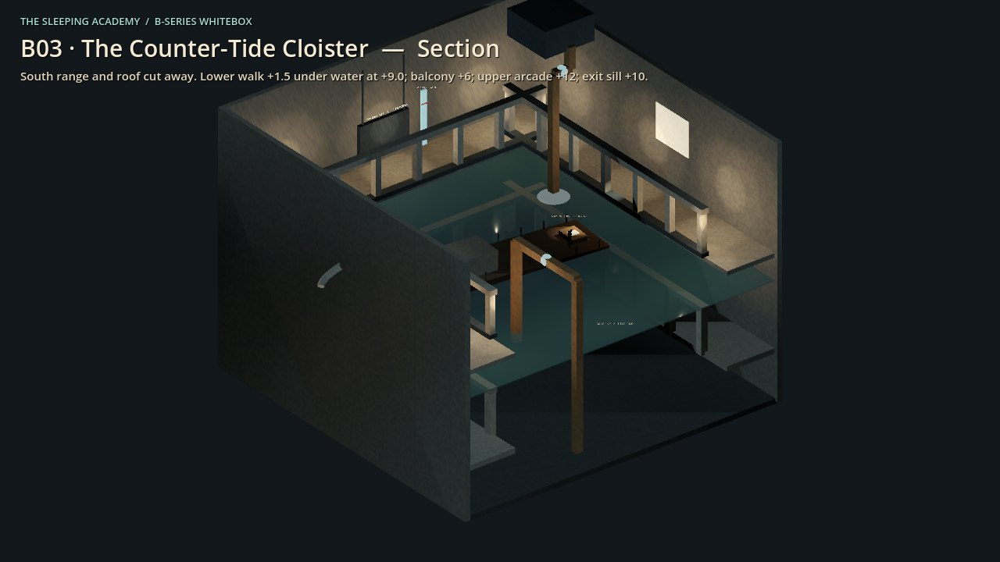

# B 系列关卡｜从终局倒推的规则怪谈房

A01–A10 在 41–147 秒内被白盒红队合法通关，原因见[规则怪谈关卡复核](../rule-horror-review.md)。B 系列换一套出题法：先定一个「按自己手册看来不可能」的终态，再逐步往回加约束；每个前提都来自一条反直觉的副作用，或一次必须触犯的禁忌。三间房都由巨物、时变力场和队友的异版手册共同决定结果。只读源码、离线排一条动作带，解不出来。

| 房 | 房牌位置 | 目标类型 | 巨物 | 不可估算的力场 | 必须触犯的禁忌 | 队友与你的认知差 |
|---|---|---|---|---|---|---|
| [B01 第十三齿](b01-thirteenth-tread.md) | 试验房，候选升级折返闸 | 护送＋时相 | 24 m 擒纵轮（齿即踏板）与 18 m 巨摆 | 迟滞场：随混沌副摆移动，改变队友的表速 | 停轮、站红齿、应第十三响、让同伴离开视线 | 队友按**自己的表**数刻；他的第十二刻不是你的第十二刻，你的禁忌由他的规则执行 |
| [B02 双底片](b02-double-negative.md) | 暗房 Fixing Room | 辨认冒充者＋拒绝＋护送 | 12 m 暗箱转鼓，扫过全房的显影带 | 曝光剂量：倒易律失效，短曝光反而更伤 | 看进光圈、离开石面、把一个人形封进罐里 | 真 Hale 守 Ochre 版，冒充者守**你的** Ivory 版；你一犯禁，守你规则的那位就弃你而去 |
| [B03 逆潮回廊](b03-counter-tide.md) | 泵房 Pump Archive | 把证物交到对的人手里＋存活到高水位 | 26 m 浮闸驳船，随水位升降、随水流摆扫 | 间歇虹吸三联振荡，再加旱档案室这只「毕达哥拉斯杯」 | 淹掉旱档案室、交出湿图纸、在船移动时登船 | Ochre 队友守着晾纸盘寸步不离，他的体重是配平压舱；你的 Ivory 晾纸法会把真图送进将被淹的抽屉 |

## 白盒实机图

审图场景 `scenes/physics_lab/b_series/BSeriesReview.tscn` 用主线 HallFinish 着色器、Hall04 大气、0.40 墨线和 SDFGI 在 Forward+ 下搭出三间房的关键时刻，人物使用 Hale 与侦探的英雄模型。每间房拍布局规范要求的入口、操作位、出口回望三个机位，另加一张剖面。这一版只用于构图和尺度审查，房内规则尚未运行；可读性标签与半透明的场效属于审图用的特殊材质。

| B01 第十三齿 | B02 双底片 | B03 逆潮回廊 |
|---|---|---|
|  |  |  |

重拍：`& .runtime/python/Scripts/python.exe tools/b_series/capture_review.py --publish`。脚本通过 Game MCP 启动实机窗口，逐房逐机位截图，并校验 1280×720、Forward+、MSAA 2×、SDFGI 和墨线不透明度；原图、帧哈希清单写入 `.runtime/b-series/review/`，加 `--publish` 时把缩小后的 JPG 和接触印样写入 `media/`。Tab 切换机位，N 切换房间。

## 一、出题方法

| 步骤 | 做法 | B 系列的落点 |
|---|---|---|
| 1. 定终态 | 写下胜利那一刻所有人站在哪、巨物处于什么相位、谁按了什么 | B01：第十三响时，队长站在顶位红齿上，与队友牵手过灯门 |
| 2. 逐步倒推 | 对终态的每个条件问「什么让它成立」，直到开局；每一步的前提必须来自副作用、队友规则或禁忌，而不是上一步的直接产物 | 停轮是你的禁忌，却由队友的规则执行；队友何时执行，取决于他在场里待了多久 |
| 3. 双向检查 | 正推：玩家按直觉顺做，能否绕开某一步？倒推：除核心约束外，是否只剩一类解？ | 每房列出伪终态和守规则的天真路线，并用数值原型证明它们失败 |
| 4. 证明可解 | 对种子分布做全量验证：存在一条只用玩家可见信息的反馈策略，所有种子都能在期限内通关 | B01 原型：参考玩家 97.5% 首次通关，余下种子换安全余量后全部可解 |
| 5. 证明不可背 | 用训练种子选出最佳固定动作带，在留出种子上测成功率；高于 20% 就收窄窗口或拉开种子散布 | B01 最佳固定动作带：训练 27%、留出 20% |

## 二、五项要求如何落地

| 要求 | 共同做法 | 为什么白盒难推 |
|---|---|---|
| 从终局倒推，确保通关 | 每房附倒推链表，先写终局条件；数值核心先在原型里跑种子分布，验证存在解再建房 | 设计方先用倒推跑过一遍；凡是倒推能绕开的步骤都已被封住 |
| 巨物改变通行几何 | 擒纵轮踏板、扫过地面的巨摆、显影带、浮船；通路按巨物相位开合 | 几何随时间变化，俯视图只是某一瞬间的快照 |
| 不可简单估算的力场 | 混沌副摆、倒易律失效、间歇虹吸耦合；每房都给**可读的仪器**（尘埃、报数、银化皮肤、纸色） | 状态本身可见，但未来不可预测，只能边看边修正。李雅普诺夫时间短于一次决策所需的时长 |
| 逆向思维：触犯禁忌才能通关 | 你的手册每条都对应一个必须打破的禁忌；禁忌有真实代价，只在对的相位触犯才是解 | 照单遵守的路线在原型里成功率为 0；在错的相位犯禁，代价是吃掉期限 |
| 队友与你的规则怪谈不同 | 队友按自己那版手册独立行动，他的规则会执行你的禁忌、否决你的应答、充当压舱或筛出冒充者 | 队友的行为取决于他所处的相位和你给他的信息，无法与机关拆开单独求解 |

## 三、红队门槛的配套改动

旧台账允许红队直接调用权威模型并离线快进。B 系列的难度建立在「只能边看边改」上，所以门槛相应调整：

| 项 | B 系列规定 | 理由 |
|---|---|---|
| 种子 | 由裁判每次开局（含按 R 重开）重新抽取，不暴露给红队 | 去掉「读出种子→离线求解」这条捷径 |
| 观测面 | 只开放玩家看得到的量：钟面分拍、报数整数、3 m 内的表盘、摆锤位置（0.1 m 量化）、尘埃密度档位 | 与人类玩家的信息量一致 |
| 时间 | 通关必须在实机 1× 时间上复现；权威模型可读，不可快进求解 | 一次尝试约 8 分钟，20 分钟里最多两到三次 |
| 状态克隆 | 禁止 | 混沌部分只能靠反馈跟上，不能靠回溯试错 |
| 自检 | 交题前提交：倒推链、伪终态反例、种子分布可解率、最佳固定动作带留出成功率 | 复核报告第三节的新增自检 |

诚实地说，参考控制器本身只有几十行。白盒红队一旦完整推出倒推链，仍有可能写出它。B 系列的防线分三层：一是**看懂链条**，要同时识破四条禁忌、读懂队友手册并认出迟影；二是**在部分可观测下执行**；三是**每次尝试都有真实代价**。能不能撑过 20 分钟，要等红队真打一轮才知道。

## 四、制作顺序

| 优先级 | 内容 | 现有部件 |
|---|---|---|
| P0 | B01 权威模型（`layout/apply/snapshot` 接口，同 Meniscus）+ 白盒房，数值取自 [b01_core_sim.py](../../../tools/b_series/b01_core_sim.py) | Hale 指令轮（Q 作用于瞄准目标）、A06 凝视冻结与姿态、A05 残影、Gyro06 巨型动力雕塑、ArchBuilder |
| P1 | B02 显影带与剂量模型；双 Hale 外观共用英雄模型管线 | A04 光束遮断与假影、A01 物态过滤、hero GLB |
| P2 | B03 水力模型扩成三池虹吸与浮船配平 | Meniscus Court 液压机会成本与相位历史、Rooms.gd 的 Ochre 晾纸规则 |

数值原型运行：`python -I tools/b_series/b01_core_sim.py --seeds 200`，结果写入 `.runtime/b-series/b01-core.json`。
