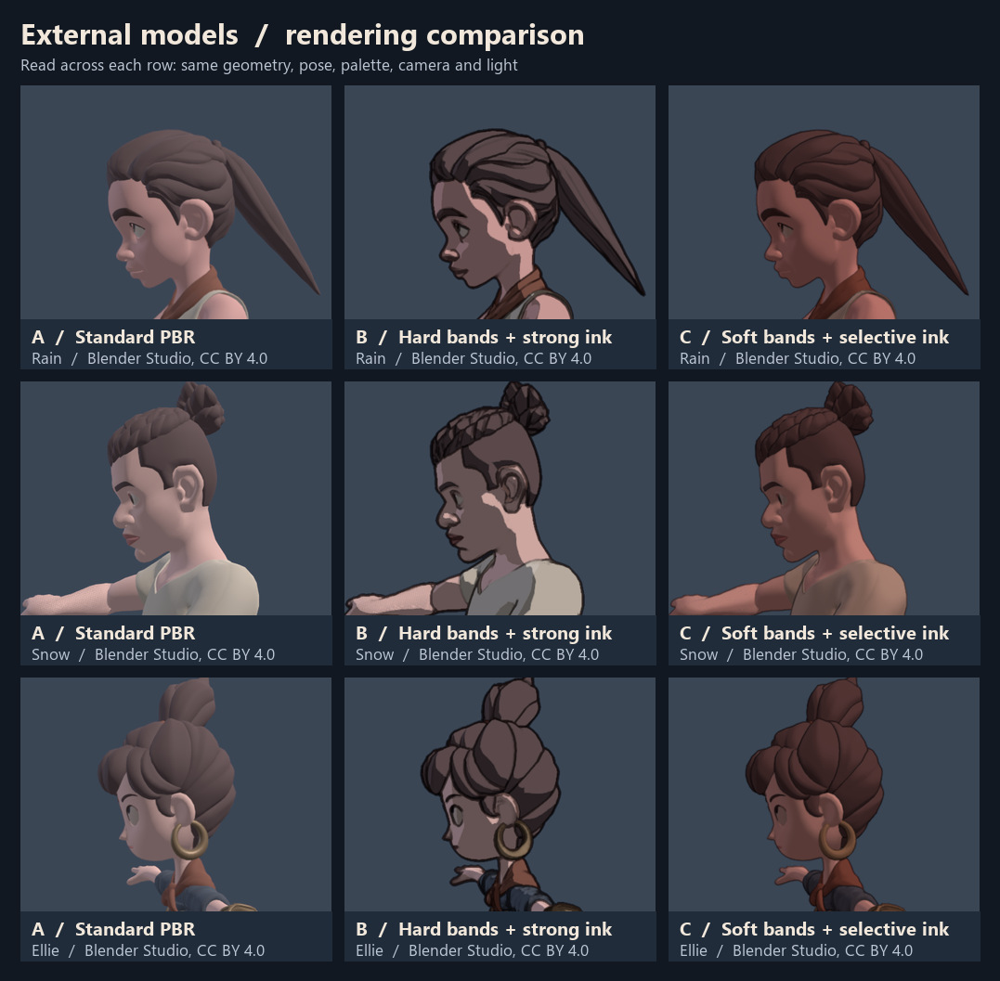
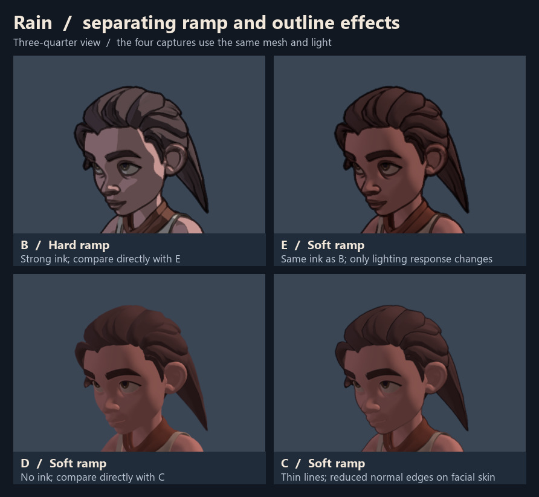
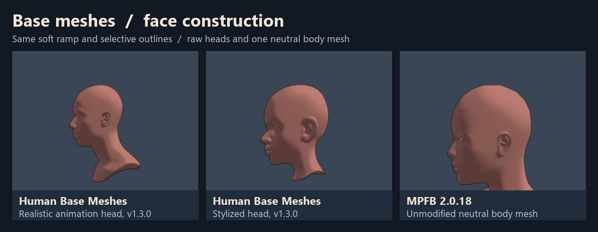

# 《蓝图王子》人物建模：外部资产试片与事实核查

核查日期：2026 年 11 月 21 日。行号对应用户提供的 296 行文本。文中的问句与制作指示按讨论对象处理。实机对照只使用文中点名的外部资产。本文所说「最接近」指所试方案与用户提供的预告单帧在造型与光影上的视觉匹配。

## 实机结论

**渲染选 C：保留面部几何法线，使用有软过渡的色阶，给发束和剪影留细线，并降低脸部的法线边缘响应。成品参考先看 Rain，正式改模先看 Human Base Meshes 的 Realistic Animation Head。**

| 候选 | 同机位观察 | 推荐用途 |
| --- | --- | --- |
| **Rain v3 下载包（`rain_v3.2.blend`）** | 三个成品 rig 里，头顶到鬓角的大块发束过渡最像供图，也能在 C 下保留鼻梁、脸颊和颈部受光。额前发束走向、眉眼与长马尾仍和 Simon 有明显区别。 | 只选一个成品做材质打样时先用 Rain；以其发块截面和叠层为参考。 |
| **Snow v4（`snow_v4.2.blend`）** | 男性颌颈关系可作参照，侧脸鼻尖外凸、鬓角剃薄、头顶绑发及短袖形成另一种剪影。 | 拆解男性青年头颈和五官绑定；服装和发式需要独立设计。 |
| **Ellie v1** | 发团、耳饰和接缝的分隔非常清楚；圆头、大眼、小鼻及厚发团在三个成品里最夸张。 | 看发块体积、折痕和配饰层次。 |
| **Human Base Meshes v1.3.0** | 实测写实动画头与风格化头。写实头的眉弓、鼻颌和耳廓关系更接近目标，风格化头给眼眶、鼻口留出了更大的夸张空间。包内也确有写实及风格化男女身体和独立的头、手、脚。 | 写实动画头作原创角色的改型起点；先调形再制作眼睑、发束、卷袖、马甲、背包。 |
| **MPFB 2.0.18 原始中性网格** | 只导出了官方扩展自带 OBJ 的 `body` 组，去掉助手组，未套体型 preset、眼球、衣服或绑定。能看中性脸型和比例。 | 作为批量体型的备选；本试片未验证参数化体型或导出绑定。 |

- **A：标准 PBR 参照。** 同一色板上的连续亮面保留体积，不过发束和衣领边界相对柔散，脸与袖口比参考帧亮。这是统一色板下的普通引擎 PBR 材质，不是带扫描皮肤和 SSS 的完整数字人对照。
- **B：硬色阶 + 强描边。** 发块画得很清楚，眼鼻耳、颈部、发际线也被同样强的线和硬色阶切开，离目标的柔和脸部体积更远。
- **C：软色阶 + 选择性细描边。** 对着参考看发际、鼻梁和袖肩：大轮廓和发束之间还有暗线，脸部保留明暗起伏，五官周围较干净。这是本轮最接近的组合。
- **消融：** B 和 E 使用相同强描边，软着色组（C/D/E）共享着色响应；B→E 同时放柔色阶和使用有色阴影配比，可看脸颊、鼻梁及发块明暗的变化；D→C 加细线后发束和轮廓更分明；E→C 降低线宽和脸部敏感度后眼下、鼻口和耳内较干净。具体的 SDF、手绘眼睑遮罩、AO 烘焙、多 UV 笔触、反壳和完整 SSS 留给各自的对照试验。

### 复现口径

Blender 4.2.1 LTS 无脚本自动执行模式读取下载文件：将成品 rig 摆成轻微低头姿态，将评估后的静态网格转 GLB，用统一规则按部位赋近似色板。用简化的眼球和网格头发版本，限制细分，保留建模轮廓。以头网格包围盒归一化，侧脸及四分之三视角各取一帧；同一资产同一机位切换材质和深度／法线后处理，固定灯位、曝光、背景、画幅。Windows、Godot 4.7.2 .NET、Vulkan Forward+、RTX 3070，624×456，60 个实际 GPU 视口捕获。分辨率和各模式输出在运行日志中核对；图版仅做裁切、缩放和加标签。浅色眼部、基色、光位等属于测试设置。没有把可选 SDF、完整灯光扫掠或原作引擎材质写成已经测过；动作中的形变和描边闪烁留待转头、握持及不同距离复查。这里的判断以结构相似度为主；用户供图的握持、卷袖、马甲和背包是下阶段造型目标。

临时下载、GLB、姿态脚本、着色器、完整 PNG、带用户供图的图版均在 `.runtime/character-look-check/`；供图和第三方资产文件不入库。关键入口为 `export_all.py`、`capture_external.gd`、`make_plates.py`。图版署名：Snow Rig、Rain Rig 和 Ellie © Blender Foundation／Blender Studio，按 [CC BY 4.0](https://creativecommons.org/licenses/by/4.0/) 使用；这里改变了姿势、着色和输出网格。Human Base Meshes 两个头按资产包内 `README` 标注的 CC0 使用，MPFB 的裸网格按官方资产许可使用。

## 逐项核查

**已确认**：有一手来源或本轮实测。**成立有条件**：技术可用，需写明适用条件。**纠正**：给出原断言的正确范围。**未证实**：本轮找到的公开材料缺少该镜头、测试或统计所需证据。

### 1. 通用原理、三渲二与写实（3–94 行）

| 行 | 原断言 | 核查 |
| --- | --- | --- |
| 3–11 | 两类共用网格、骨骼蒙皮；写实靠高密度和 PBR，NPR 靠「反物理」；表中的造型、法线、灯光、毛发、衣服与工具相互排斥 | **成立有条件。** 角色可以共用网格与蒙皮；PBR 是着色方法，写实是视觉目标。远景写实也可用低模和烘焙，风格化也用受光、阴影、模拟和 PBR 高光。表中列的是常见做法，眼、皮肤、衣料和头发可单独选择。 |
| 13–19 | 固定五阶段；脸部必须围绕眼口与鼻唇沟形成四边面封闭同心圈，自动得到真实褶皱和干净法线 | **纠正。** 流程是常见框架：现成可动画底模可复用拓扑，LookDev、绑定和变形测试可以交错。眼口环线利于闭合和表情；鼻唇沟常需布线支持，是否封成同心环取决于设计。变形由权重、形态键、拓扑共同决定；光影由曲率、三角化、顶点／分角法线和着色共同决定。 |
| 17–18、35–36、68–69 | AI 示意图配 CSDN、Unreal 图注 | **未证实。** 文本未附可追溯原图或文章链接。示意图可帮助理解术语；工程依据用第一方文档和资产本体。 |
| 22–31 | 单加 toon 永远无效；削弱脸部曲率、整理发束、转移法线 | **成立有条件。** Arc System Works 确有专门围绕二维风格的 3D 流程；干净的大体块与法线取样能减少乱跳的明暗。代理头法线可改善某些脸颊和毛发，保留写实体积时局部调整。成型资产可直接从 shader 开始试片，改模由读图问题驱动。 |
| 33–37 | 面部 SDF 是绝对主流；多角度二值图烘为单通道距离，用角度比阈值，表情自动吻合，拥有绝对控制 | **成立有条件。** 可将多个光向遮罩保存为遮罩集，或合成为每像素的受光角阈值；二值遮罩也可先做 signed distance transform。「对光向的阈值」与「到某一条二维边界的有向空间距离」是不同量。做成 UV 遮罩会随表面移动，闭眼、张嘴或 UV 拉伸仍需检查。SDF 的使用率和 Simon 的实现未证实。 |
| 39–42 | 半兰伯特、色带偏色、红边、发环与屏幕深度 rim | **成立有条件。** `0.5·dot(N,L)+0.5` 是常见包装；也可直接用 `dot(N,L)` 配 soft ramp，本试片采用后者。暗部着色、高光和窄红边都是美术参数。Kajiya–Kay 类各向异性或 UV 遮罩能做发环；偏移采深度可做边缘光，也会读到遮挡与远处背景。 |
| 44–47 | 反壳绘制背面；硬边和 UV 缝必裂、必须写顶点色／切线；ILM 手绘能保证内线无闪烁 | **成立有条件。** 反壳让扩张网格的背面露出为边线。裂缝来自实际分裂顶点在两侧的挤出方向差，UV 接缝本身不足以推断方向差。用独立壳或平滑扩张法线均可，线宽数据可放顶点色或遮罩。手绘内线仍受纹理分辨率、mip、抗锯齿和透视影响。ILM 不是通用内线贴图命名标准。 |
| 49–50 | 2025–2026 全行业转向 NPR+PBR 和实时笔触 | **未证实行业趋势。** 两者可以混用，一件衣服的棉布、皮带与扣件可使用不同高光或 ramp；本试片没有统计行业采用率。 |
| 53–58 | 写实依靠解剖高模、真人扫描普及、TexturingXYZ/ZWrap 投射 | **成立有条件。** 解剖结构和尺度细节重要；雕刻、扫描投射、贴图清理是可选路线。ZWrap 的拟合服务于几何／坐标对齐；反照率和置换还依赖扫描、投射和清理。微细节预算由机位和风格决定。 |
| 60–63 | 写实服装全面切 MD；Groom 逐根物理解算，发片一定降低面数且需要全部通道 | **成立有条件。** MD 支持版片、缝合和布料模拟，输出后可保留或重构拓扑；手工造型同样可用。Groom 支持 strands、cards 或 meshes 及 LOD；发片用纹理换曲线复杂度，透明过绘与材质成本仍需测。Flow、深度、ID 各自取决于着色方案。 |
| 65–70 | 写实必开 SSS、厚度图、双高光、动态皱纹、折射角膜及专门泪线 | **成立有条件。** 近景皮肤可用 SSS、透射、双高光和按表情混合的皱纹；角膜、虹膜、泪线与遮蔽提供眼部层次。它们是照片级近景手段，适当 LOD 与眼部简化可服务其它镜头；真实的次表面散射是光在组织内部散射，血色主要来自吸收和组织性质。 |
| 72–75 | MetaHuman 5.8 千人级群集、全身捕捉、MIT 开源、任意头模自动套完整 FACS | **已确认主要功能，纠正范围。** Epic 2026-06-17 发布公告：高端配置上的千人级是实验性 Crowds 与按距离降级的路径；单机位全身捕捉有实验性功能；Mesh to MetaHuman 5.8 支持头／身体的合适人形输入，目标拟合质量依赖模型与流程。MIT 范围是 OpenRigLogic 中的 RigLogic 与 DNA 库。 |
| 77、94 | CC5 + Headshot 3；高清形变、眼、动态皱纹，Blender/UE/Unity 无缝同步；某个视频完整演示 | **产品已确认，互通有条件。** 官方确认 CC5 + Headshot 3 的照片、扫描／网格、皱纹等工作流；各引擎和 DCC 的 Auto Setup、链接及导出需分别按版本和目标核对，Godot 的材质和 rig 迁移应单独测。原文没有给具体视频链接。 |
| 82 | 4.5、5.0–5.2 都是 LTS；Vulkan、HDR、ACES 2.0 全面支持；雕刻撤销和原生 NPR | **纠正。** 4.5 和 5.2 是 LTS；5.0 2025-11-18、5.1 2026-03-17、5.2 LTS 2026-07-14 发布。5.0 改善 OCIO ACES 2.0 配置兼容；HDR 显示依赖系统、后端和屏幕。原文未给雕刻撤销或原生 NPR 的具体功能／版本；本方案用 Godot 自定义着色，与该路线图无绑定关系。DCC 组合可按项目更换。 |
| 84–92 | Hunyuan3D 3.0/Studio、Tripo 3.0、Rodin Gen-2、Meshy 5；自动分件、UV 和绑骨普遍改善；已实测碎面、权重崩、只能做白模；写实成本指数增长 | **产品系列可查，性能概括未证实。** 厂商各自发布建模／贴图等能力，部分版本另有拓扑或自动绑定路径。原文没有测试资产、导出设置、角色权重或动画记录，不能复核「实测」或指数成本。若试作，用闭眼、张嘴、弯肘和重定向结果验收，而非用静态截图筛选可动画模型。 |

### 2. 《蓝图王子》供图和开发归因（96–207 行）

| 行 | 原断言 | 核查 |
| --- | --- | --- |
| 98–122 | 欧美图像小说／半写实三渲二；6–7 头身；柔边；黑结构线；低饱和且无微纹理；日式统一走硬边大眼 | **画面描述大体成立。** 供图中看得见鼻颌体积、袖褶大色块、深色发缝和背包缝，鼻底／衣领与袖面有硬软并置，扣件与背包有局部反光。该机位没有完整身高，6–7 头身与实际纹理清单未知。「日式」一列是某些作品的处理方式。 |
| 125–145 | 简化五官、C/Y 耳朵、体块发簇、手雕袖口和背带；全角色情况下 1–2.5 万面理想、面多必油腻 | **成立有条件。** 脸部保留少数骨点、发束用少而宽的团块、衣褶按肘部动作方向造型，符合参考。参考看得见发块和褶皱结果；其制作工具、发片与几何分工和实际三角数未知。三角预算由轮廓、变形、LOD、同时显示数量决定；描边细碎主要来自几何曲率频率和检测设置。 |
| 148–156 | 不必 SDF 或 4K；面部主要几何法线；Weighted Normal 消除脸颊锯齿 | **本轮 C 证实这条替代路线可用。** Blender Weighted Normal 按面权重处理法线，适合大面和倒角；脸先修顺曲率和拓扑，再用局部法线修整。屏幕混叠还需采样修整。 |
| 158–163 | Quest Fox Studio 给 Simon 修脸并压暗眼睑；AO 与曲率用于局部压暗 | **原作归因已确认。** Quest Fox 的一手案例明确写出 Blender 到 Unity 后用更深的眼睑颜色模拟阴影。AO／曲率烘焙是独立的可行建议，不能用案例认定其他暗线也来自 AO。 |
| 165–169 | Tonda Ros 说 99% 共享材质、贴图，多套 UV 各指向共享图集；UV1 色板、UV2 纸纹，Simon 用同方案 | **前半已确认。** Tonda Ros 在 Unity 访谈中给出 99% 的说法，并描述每套 UV 对应一个图集。Davide Pellino 在 Blender Conference 说房间用了一个 shader、四张贴图。具体的通道顺序、纸纹内容以及该角色、该预告帧的材质采用方式未由这些资料确认。 |
| 173–184 | 默认 PBR 只会塑料；半兰伯特 + 2–3 阶软色带、阴影必偏色，皮肤／棉布关 GGX | **C 较贴近，具体设定由目标决定。** A 仍有体积和清楚轮廓。B/E、D/C 支持把亮面和线条分开设计。棉布、皮肤可以用压低的镜面；有色阴影在本图有用，采用何种光照模型未知。 |
| 186–202 | 参考用全屏 depth/normal 后处理；Sobel／Roberts、距离衰减、Material ID、脸上手绘线 | **机制可行，原作实现未证实。** 深度可抓遮挡／前后层，法线抓法向跳变；本项目 Forward+ 支持该缓冲。工程可加距离阈值与线宽管理，也可换选择性几何轮廓。正式方案应采用明确的遮罩或对象策略；试片用粗糙度信号临时代替材质标记来控制线强，保留深度轮廓。 |
| 205 | 统一材质使后续资产边际美术成本断崖式下降 | **制作假设。** 色板和材质规则降低重复调参；不合适的头、衣褶、权重和局部线条仍需逐件处理。 |

### 3. 下载资源与实操（209–295 行）

| 行 | 原断言 | 核查 |
| --- | --- | --- |
| 211、217 | CC0 素体改型等路线、Human Base Meshes v1.3 有标准男女／头手脚 | **下载实测。** 官方压缩包内 `.blend` 的 `README` 标明全部提供的 base meshes 为 CC0，包含相应项目；风格化男女身体的资源描述分别指向 Rain 和 Snow 系列原型。测试用的是头部版，精确布线和 UV 仍按具体资产检查。 |
| 218 | MPFB 2 免费、CC0 开源、2025 推出、内置人形控制 | **纠正授权。** 插件代码是 GPL，资产单独授权（扩展说明为 CC0 或 CC-BY；取样裸网格为 CC0），2.0 稳定版时间与项目起点是两件事。插件可调整体型和绑定；原始 OBJ 只是网格。 |
| 219–223 | Snow、Rain、Ellie 免费 CC-BY，Snow 最像 | **授权与下载确认。** 三个资产都有公开文件。图像实测 Rain 的发块体量最贴近，Snow 更适合看青年男性五官与头颈，Ellie 的夸张比例很直观。 |
| 224 | RetroStyle Games 参加原作 3D 角色与动画，有案例可参考，可获取模型 | **参与已确认。** 第一方案例展示建模、角色变体与叙事动画。公开的是案例和影像，未找到可用于此次渲染的授权角色源文件。 |
| 225 | 免付费 Mixamo 有角色与自动绑定；点名角色普遍 1–2 万面 | **官方确认服务，具体面数未证实。** Adobe 官方说明角色与动画可用于个人与商业项目、自动绑定限双足人形；本次未登录下载指定角色或用同一 GLB 比较。 |
| 226 | Sketchfab `5` 看线框、`2` 看纹理，任何模型可检视 | **快捷键确认。** `5` 切线框，`2` 循环材质通道；作者可关闭纹理检视，下载和使用按每项许可。原文仅给搜索词，未指定单个测试资产。 |
| 228–236 | 单人一周；6–7 头身；Grab、Scrape、Flatten 三类笔刷；硬切面自动变漫画内线 | **制作建议。** 先用侧脸、头肩比和头颈肩运动确定体块，再按笔刷处理；工期取决于动作与特写范围。硬切面是否成为线取决于阈值、距离与是否遮挡。 |
| 238–245 | 实色眼球、厚眼睑、眉毛加厚、口角和 Y 形耳 | **成立有条件。** 眼白、虹膜、睑缘值差和眼球视线配合即可先验证；眉可用面、UV 线或局部形体。耳廓与口角应在阴影和剪影里读得清楚，线宽再用媒介选择。 |
| 248–258 | 发帽、Bezier 截面、`Alt+S` 半径、`Ctrl+T` 扭转，15–30 发簇，转网格自然生线 | **流程可用，数量是起点。** 曲线编辑可调点半径、倾斜和 Bevel Object。先做大剪影和 4–8 组主发块，再按取景拆次级束；分裂的法线、几何落差和显式线条各有用，转网格本身不生成可靠内线。 |
| 261–273 | 抽素体面分离、沿法线膨胀、Solidify、3–5 道折痕，配饰用倒角 | **实操可用。** 抽面能起袖、领与贴身背心；宽松衣物需重新分配余量、衣片和部位厚度。折痕数量按动作，绑定后查握物、抬臂、屈肘。配饰造型优先检查接缝与折边剪影。 |
| 275–280 | 删除隐面彻底防穿，10–25k 理想；全局加权法线＋Mark Sharp；AO 或 Ucupaint | **纠正。** 删常遮挡素体有助于减少部分穿透，仍可能发生领口、袖口和各层之间碰撞；可换装角色需保留必要表面。锐边与法线跳变、材质和边缘可见度均要实测。Cycles 能烘 AO；Ucupaint 是纹理绘制工具，可做手涂遮蔽，AO 是遮蔽信息，染成深棕属于造型选择。 |
| 283–286 | Blender 内置 Rigify、Mixamo T pose；10–15 个表情够大多数叙事 | **成立有条件。** Rigify 是可启用／安装的插件，生成控制架之后还要绑定与检查。Mixamo 接受合适的双足人形，自动权重须以变形验收；表情集先按分镜列动作，数量由对白、情绪和左右不对称需求决定。 |
| 289–294 | 灰模少刻细节，360° 剪影；独立服装／头发可重复共骨架 | **适用建议。** 剪影检查要带机位、姿态和缩略尺度；灰模时先查眉鼻颌、手、卷袖、肩带的层次。共用骨架提高动作复用，模块还需尺寸、权重、遮挡、接口与穿插规范。 |

## 建模优先级

1. 用 CC0 写实动画头确定前、侧与四分之三面的鼻额转折、下颌、眼窝和眼睑；身材以角色设定与实测全身剪影定标。拿 Rain 的发束分组作参考，另做贴额的斜扫刘海和后脑弧线。
2. 在灰模先摆好低头阅图和屈肘握纸：背包重量、马甲边缘、肩带路径和袖口三处主要转折做成能读到的几何；再细化局部线条。以 Snow 作男性表情拓扑参考。
3. 用 C 定面部和衣服各自的色阶响应；用局部暗眼睑、发际线和衣缝确立墨线节奏。先验正、侧、四分之三与走动，再决定是否需要面部阈值图、AO 或环境笔触通道。

### 一手资料

- 《蓝图王子》：[Steam 商店及 Accolades trailer](https://store.steampowered.com/app/1569580/Blue_Prince/)、[Unity 对 Tonda Ros 的采访](https://unity.com/blog/blue-prince-why-dogubomb-watched-2000-hours-gameplay)、[Dogubomb 美术总监在 Blender Conference 的演讲](https://conference.blender.org/2025/presentations/3964/)、[Quest Fox Studio](https://questfoxstudio.com/helping-the-blue-prince/)、[RetroStyle Games](https://retrostylegames.com/portfolio/blue-prince-3d-character-modeling-animation/)。
- 资源：[Snow v4](https://studio.blender.org/characters/snow/v4/)、[Rain v3](https://studio.blender.org/characters/rain/v3/)、[Ellie](https://studio.blender.org/characters/ellie/v1/)、[Human Base Meshes 官方归档](https://download.blender.org/demo/asset-bundles/human-base-meshes/)、[MPFB 扩展](https://extensions.blender.org/add-ons/mpfb/)、[MPFB 资产许可](https://github.com/makehumancommunity/mpfb2/blob/master/LICENSE.ASSETS.md)、[Adobe Mixamo FAQ](https://helpx.adobe.com/creative-cloud/faq/mixamo-faq.html)、[Sketchfab 检视器](https://sketchfab.com/blogs/community/5-feature-easter-eggs-on-sketchfab/)。
- 渲染与制作：[Arc System Works 的 Guilty Gear Xrd GDC 演讲](https://www.gdcvault.com/play/1022031/GuiltyGearXrd-s-Art-Style-The)、[Godot 屏幕读取](https://docs.godotengine.org/en/stable/tutorials/shaders/screen-reading_shaders.html)、[Godot Spatial Shader](https://docs.godotengine.org/en/stable/tutorials/shaders/shader_reference/spatial_shader.html)、[Blender Data Transfer](https://docs.blender.org/manual/en/4.5/modeling/modifiers/modify/data_transfer.html)、[Weighted Normal](https://docs.blender.org/manual/en/4.5/modeling/modifiers/normals/weighted_normal.html)、[烘焙](https://docs.blender.org/manual/en/4.5/render/cycles/baking.html)、[Rigify](https://docs.blender.org/manual/en/4.5/addons/rigging/rigify/index.html)、[Ucupaint](https://github.com/ucupumar/ucupaint)、[ZWrap](https://faceform.com/zwrap/)、[Marvelous Designer](https://support.marvelousdesigner.com/hc/en-us)、[Epic Groom](https://dev.epicgames.com/documentation/en-us/unreal-engine/hair-rendering-and-simulation-in-unreal-engine)、[Epic SSS](https://dev.epicgames.com/documentation/en-us/unreal-engine/subsurface-profile-shading-model-in-unreal-engine)。
- 版本：[Blender 5.0](https://developer.blender.org/docs/release_notes/5.0/)、[5.0 色彩管理](https://developer.blender.org/docs/release_notes/5.0/color_management/)、[5.1](https://developer.blender.org/docs/release_notes/5.1/)、[5.2 LTS](https://developer.blender.org/docs/release_notes/5.2/)、[MetaHuman 5.8 发布公告](https://forums.unrealengine.com/t/metahuman-5-8-released/2729288)、[MetaHuman 5.8 发行说明](https://dev.epicgames.com/documentation/en-us/metahuman/metahuman-5-8-release-notes-in-unreal-engine)、[OpenRigLogic](https://github.com/EpicGames/OpenRigLogic)、[CC5](https://www.reallusion.com/character-creator/)、[Headshot 3](https://www.reallusion.com/character-creator/headshot/)、[Blender Auto Setup](https://www.reallusion.com/auto-setup/blender/)。
- AI 产品厂商资料：[腾讯混元 3D](https://3d.hunyuan.tencent.com/)、[Tripo 3.0](https://www.tripo3d.ai/blog/introducing-tripo-new-algorithm3)、[Rodin Gen-2](https://docs.hyper3d.ai/zh/get-started/changelog)、[Meshy 5](https://docs.meshy.ai/en/api/text-to-3d)。
