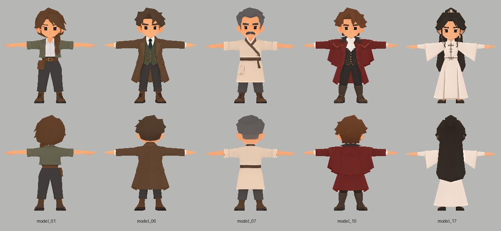

# 学院五人角色定案：同一套人体，五种观察习惯

状态：设计定稿，供角色、动画与游戏实现共用；尚未替换运行资产。

## 母版与造型

采用 **5 头身**。在无鞋、中立直立姿态下以颏底至颅顶为一个头高，头发和帽子不计。五人共享成人解剖地标、关节命名和动作接口；关节位置按个人实际身形拟合。保留各人的身高、年龄、发型、胸廓及自然肌肉差异。人物放松时肩峰自然下落，手落在大腿外侧；成年人年龄主要由颌面、眼眶、发际和颈肩转折表现。材质沿用原型的大片明暗与克制的颜色。

**本轮不使用 Tripo 重新生成。** 以历史提交 `5ff0dfc` 的五套 Tripo 造型为服装、头发和色彩原案。侦探沿用 `model_06`；其余四套在本定案中分配给现行队员，属于造型转用。历史原件各自保留。旧网格只作造型参考：按同一套成人解剖地标确定 5 头身后重新定位领口、肘、腰、膝与鞋口，避免直接拉伸一套穿好衣服的模型。

## 五人的造型和习惯

年龄和身高沿用试制设定。习惯取自正式玩法 `scenes/rogue_rules/FieldGuide.gd` 中的专长；下面的动作是本次设计，不是现有动画清单。

| 人物 | 身形与衣着 | 习惯：触发 → 动作 → 收束 |
|---|---|---|
| Detective，38 岁 / 177 cm | 06；棕大衣、墨绿马甲、白领深领带；常走路的匀称体态。后开衩供跨步。 | 玩家主动检查时，视线先到接触点，身体随后靠近；手收回，视线在原处稍留再回正。移动输入立即接管。 |
| Mara，32 岁 / 172 cm | 01；短绿夹克、侧辫、腰袋；肩臂略结实。 | 听见现场信号时，先让手中的东西安静下来，头略向一侧，让耳朵朝向声源；第二声到来时才转身。 |
| Elias，59 岁 / 183 cm | 07；灰发、须、斜襟浅外衣；身形挺拔。 | 查玻璃、湿痕或金属反光时，保持目光在同一点，横移半步换观察角度，再回到同伴身边；年龄不表现为弓背慢走。 |
| June，27 岁 / 164 cm | 17；深长发、白衣宽袖；袖口收束，操作端露手腕。 | 查遗留痕迹时，目光沿痕迹走到终点，指尖停在痕迹旁，随后记下一笔；纸笔只在记录时出场。 |
| Rowan，46 岁 / 180 cm | 10；酒红披肩、深色内搭；背与腿稍厚实。 | 遇到活动机构时，先看近处墙缝或门框，再沿它望向目标；离开前回看一次固定点，确认方位。 |

**动作调度。** 共用走跑、坐下、取物和普通待机。特色动作由世界事件或交互触发，一次事件演一次；没有相关线索就继续原任务。只在身体可达时播放接触动作。营地保留自主决策，出征跟随队长。眼、头和上身的观察可叠加在跟随上；横移、停步、使用道具只在安全站位且未收到新指令时发生。多人在场以相关队员为主，其余人保持原节奏。禁止习惯动作自行揭晓谜题、夺取玩家镜头或推迟操作。

## 服装及验收

人体、头发与衣件分别保存。按领肩、袖窿、腰线和下摆制作独立服装；用裁片缝合、重力与人体/衣层接触形成松量和褶皱。披肩压在外套上，马甲在大衣内，长发与后领单独检查。可遮掉衣下皮肤，保留领口、腰线和袖口的活动余量。轮廓干净与真实厚度并行；从侧面仍应看出翻领、衣摆层次和鞋口。

1. **母版试装：** 侦探正、侧、背中立位，加侧面迈步、抬臂取物。中立位看颈肩、手掌、腰线；运动中看腋下、后开衩、脚底接地，以及走停过渡。保留同机位 Godot Forward+ 截图。
2. **行为辨认：** 五人换同色试装、关姓名标签，在同一房间分别演出检查。由未参与制作的人按动作匹配五张角色卡，记录混淆项。若把 Elias 和 Rowan 混淆，优先区分“人横移、目光留在原处”和“人留在原处、视线连接两点”，再复测。
3. **实际游玩：** 在默认跟随镜头和普通室内照明下重看，途中发出移动指令，确认习惯动作即时让位。衣服穿透、眼部材质丢失、腰部断层或动作打断控制时退回对应工序。
