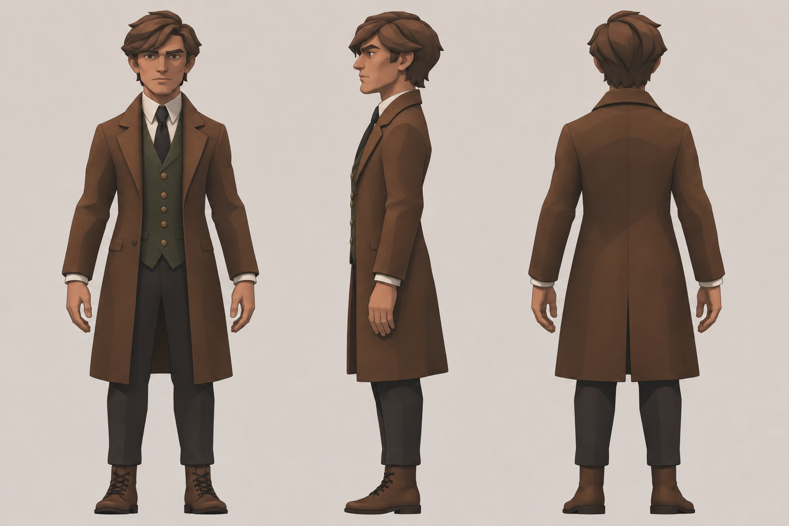
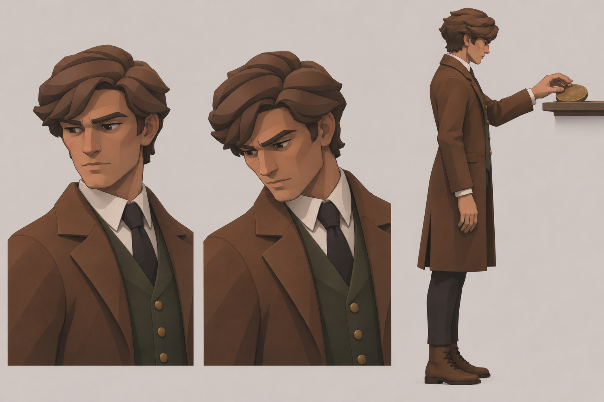
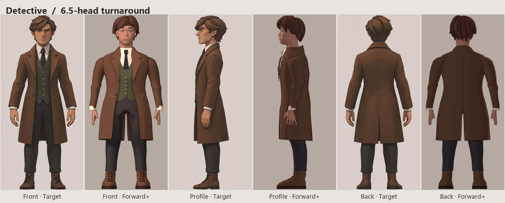
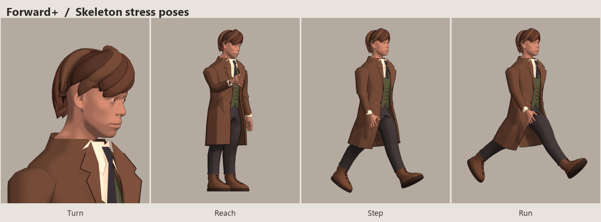

# 侦探 6.5 头身：目标图与外部底模试装

**当前规格：38 岁，赤脚 177.00 cm，6.5 头身，头高 27.23 cm。** 头高在中立直立姿态下从颏底量到裸颅顶。造型沿用 `model_06` 的棕大衣、后开衩、墨绿马甲、白领与深领带；服装原案只作图像参考。可编辑试装以 Blender Studio Human Base Meshes v1.3.0 的 Realistic Male Body（CC0）为人体起点，重塑了比例，另制发束、衣件、眼球和骨架。当前玩家模型没有替换。

## 生成并筛选目标图

用约定的 `image-2.6-sunburst`（请求 ID `gpt-image-2.6-sunburst`）、`quality=high` 和专用 `/v1/images/edits`。用户的《蓝图王子》帧只提供渲染参照：有体积的发束、成组的哑光明暗、克制的深色边线及干净的脸部；`model_06` 剪裁图提供服装与发型。生成 PNG 原件和过程稿保存在 `.runtime/detective-target-study/`。

| 轮次 | 检查结果 |
|---|---|
| 01–03 | 首张校核衣件，第二、三张试了较短的身形及动作。5 头身分支按用户更正退出验收。 |
| 04 | 以约 6.5 头身的布局锁住尺度，重绘同地平线的正、侧、背三视图。留作三视图目标，眼、眉、后开衩和衣件叠层可辨。 |
| 05 | 用 04 固定人物，重新出视线、低头、伸手的动作参考。手、肘、袖口、衣摆可用于骨架试装对比。 |





## 当前试装验收



- **比例通过。** 人体底模的裸足接地点 `6152`、颏底 `8064`、颅顶 `8063`（从零编号），实测 `1.76999998 m`、头高 `0.27230763 m`、`6.500001` 头身。目标图按头发下的颅顶与靴底内的足底近似评估，精确验收使用 Blender 网格地标。
- **结构已建。** 24 骨，独立头部、发束、白衬衫、领带、马甲、裤装、靴、大衣和左右衣尾。后开衩在正交背面和迈步姿势可见；保留编辑分件。当前导出为 42,237 三角形、99 个网格节点，它用于近景试装。正式资产还须按[五人重出模型规格](academy-cast-rebuild.md)分离身体和外衣，并重拓扑到每人 7,500 三角形以内。
- **视觉仍在试装。** 同机位看了普通 PBR 与软色阶加选择性细描边各 5 张。软色阶保留面部体积和衣件边缘。对照 04 和 05，模型前额发束的转折、肩袖就位、手指握姿、翻领圆折与衣料褶皱仍需细修。
- **动作只完成姿势压力检查。** 真实 Godot 4.7.2 .NET、Vulkan Forward+、560×768，通过 4 张捕获看转头、伸手、迈步和跑姿下的分件和衣尾。连续步态、足底接地、手指抓握、布料接触、正式室内照明和移动接管仍待验收。游戏运行时未集成此试装。



## 复现网格与截图

使用 Blender 4.2.1 LTS，输入 [Human Base Meshes 官方归档](https://download.blender.org/demo/asset-bundles/human-base-meshes/) 中的 `human_base_meshes_bundle.blend`。从仓库根目录运行，替换 `$bundle` 为已解压路径；`$blender` 和 `$godot` 分别为对应可执行文件。临时生成 `.blend`、`.glb` 和 `measurement.json`，原始第三方文件、凭据和用户供图不入库。

```powershell
& $blender -b --factory-startup --disable-autoexec --python-exit-code 2 `
  --python tools/detective_study/build_detective.py -- $bundle .runtime/detective-target-study
& $godot --path . --rendering-method forward_plus --script tools/detective_study/capture.gd
# 已有生图 PNG 原件时，重建对照图版（Python + Pillow）：
python tools/detective_study/make_plates.py
```

生图提示词保留在 `tools/detective_study/04-turnaround-prompt.txt` 和 `05-motion-prompt.txt`。04 的输入顺序为 01 矫正尺寸后的布局、02 材质参考、用户供图；05 的输入顺序为 04 三视图、用户供图。
