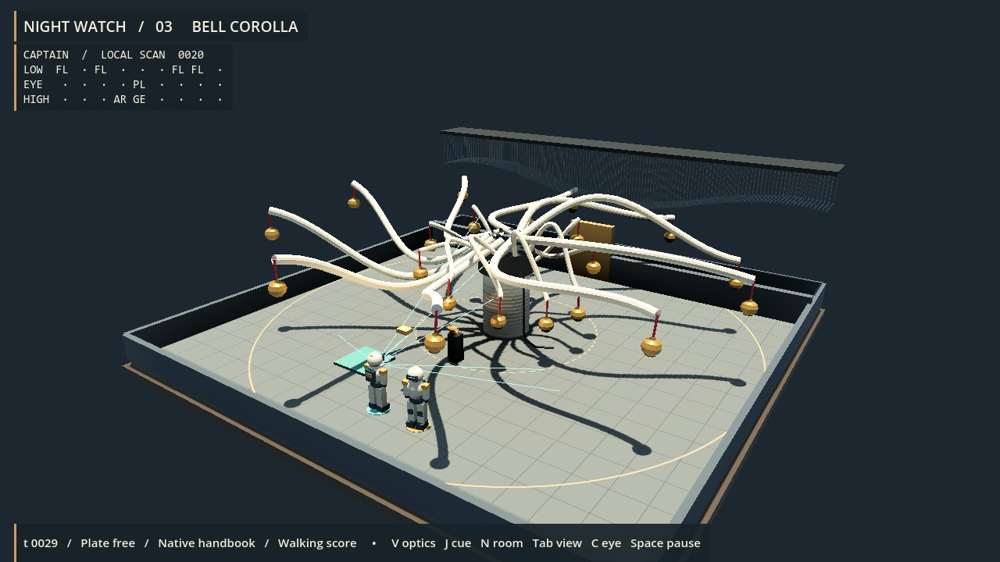
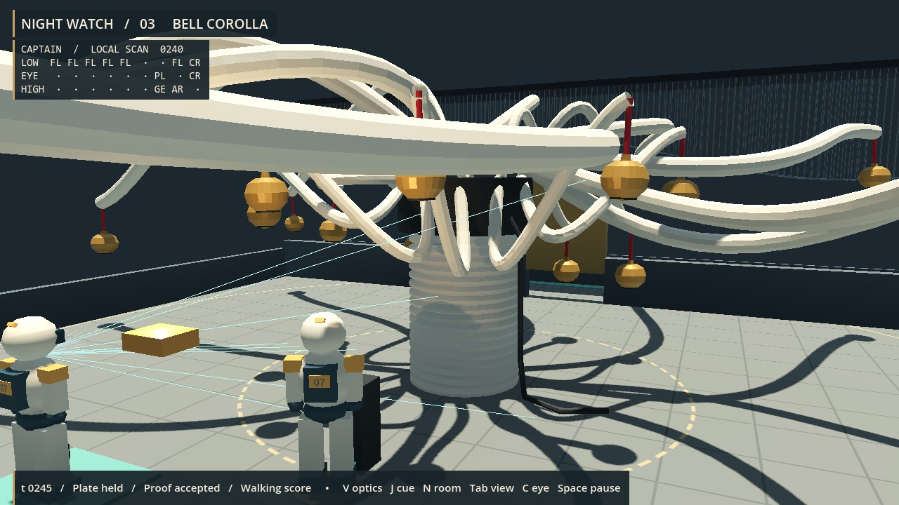
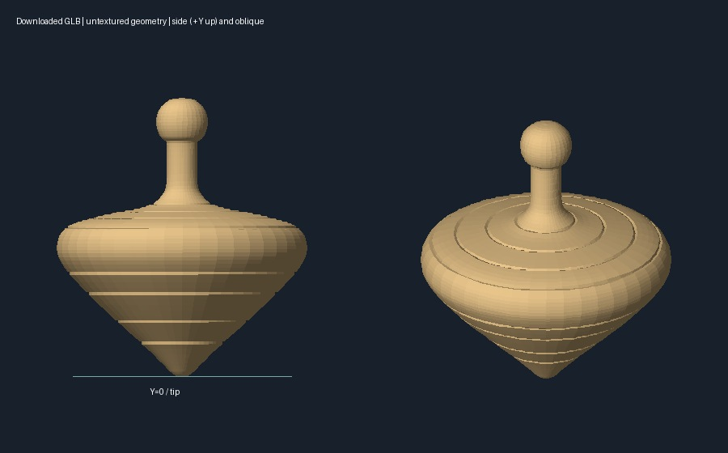
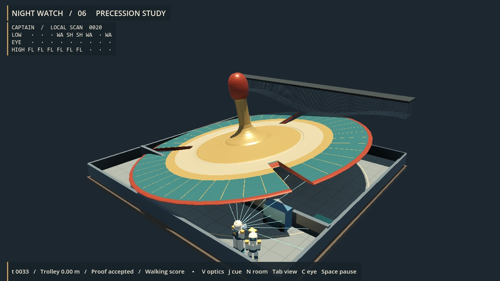
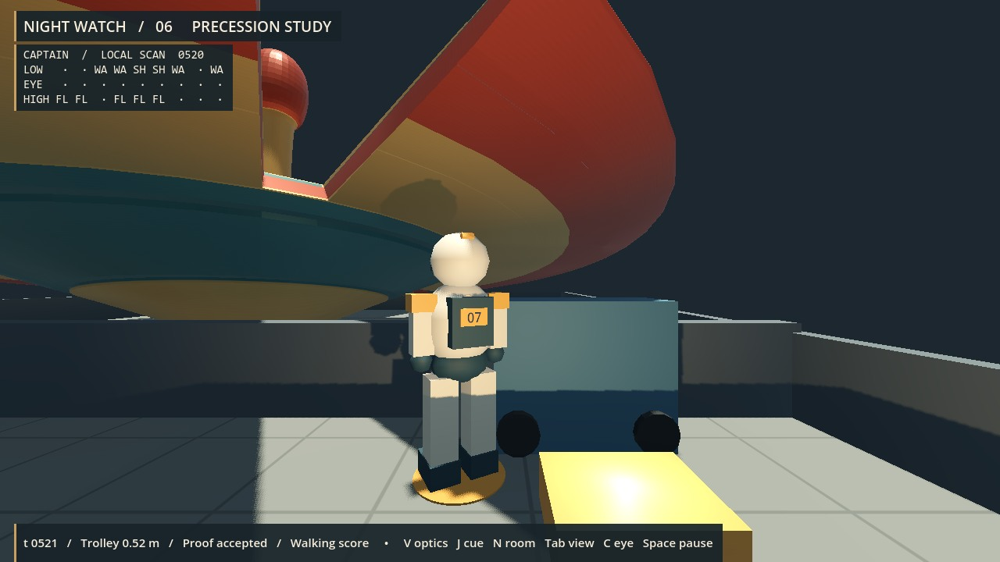

# 夜班美术馆 · 两关样板审查稿

**本轮闸口：03 和 06 做成可玩的独立切片；其他八间仅设计，等待实机评审。** 两间均从同伴已经入队的双人状态开始。现场可选择作品、看正常演出，或打开最后一次真实扫描。旧版十关回归只作为裁判基建对照，不计入新玩法成绩。

|关|实体与运动|玩家在空间中做什么；可观察的难点|
|---|---|---|
|01 独行 / 灯匣|穿孔立方体与内灯；旋转是游戏改编|走过真实孔影；灯匣以 14–16 m 的壳体罩住通道；偶尔背朝出口，读取墙上先到达的光斑。|
|02 独行 / 摆阵|两列悬摆横跨约 16 m，摆球扫过两列通路|在凹室驻足，估计摆球通过身体高度的时刻，逐段横切。|
|03 双人 / 合铃|波纹台座、黑色齿箱、双层径向自转白臂、红绳与铜铃|一人用体重压住回簧踏板，戴手套的同伴到花冠下扳闩；邻铃夹角与不同手册争用可操作窗口。开门后分别走到出口。|
|04 双人 / 木镜|受人位置驱动的整面反射墙，从入口一直排至出口|分开站位；一人牵引反光，另一人读取并操作原先不可见的把手。|
|05 双人 / 风骨|足列占满纵深，连杆步行兽跨两条横轨往复|一人进侧廊拨换向拨叉，另一人穿过交替落地的足列；拨叉有真实行程。|
|06 双人 / 日蚀|尖锥、倾斜且有缺口的飞轮、中轴与顶光；进动叠加自转|滑车横挡唯一门洞，须在有头部净空的时段从侧面把它推入停车位。角色自己穿过飞轮下方，沿外周走至出口。阴影和扫体占据不同空间。|
|07 三人 / 游衡|横跨房宽的多级悬臂、两侧吊盘与偏置配重|重量与力矩使盘面抬升；第三人进场改变平衡，需交替压板和牵引。|
|08 三人 / 清扫|近半间房长的机械臂沿传感区刮扫|把重块推入另一感应区改变清扫目标；队伍沿臂后路径移动。|
|09 三人 / 悬柱海|整片顶棚布置偏心凸轮、钢索与下降的棱柱|三人分别占据漂移的波峰；用脚下实位解算区域人数与换位顺序。|
|10 三人 / 擒纵|跨层减速列、阶梯间的齿槽漏光、贯通楼层的重力大摆|分据不同层的实物卡榫，凭最近一次跃齿判断读数延迟，然后步行穿过停下的齿圈抵达大厅。|

**四类独立的因果关系**：光路的最近遮挡决定可见性；运动实体的表面与人体相交决定净空；人体重量/位置驱动保持式锁；带机械记忆的闩、延迟指针和可移动遮挡物改变后续拓扑。后三人关另引入力矩与区域容量。每位角色保留 3–5 条简短条文。举证须指定目标 AST 节点、带时标和命中位置的真实射线读数、适用部件与短期空间范围。裁判验证反例与运动上界，局部替换节点；证据不覆盖的下一次行动仍受原条文约束。原手册单人安全是可达状态不变量；多人严格照办可以停滞。程序不得用“保守所以一定安全”作为证明。

**工程分层**：确定性裁判持有三角网格和运动变换；Godot 读取同一网格/姿态与已接受输入的回放。源作品截图用于指认，不作为关卡材质。两关需分别展示开 V 的现场、失败例与同伴实位轨迹。Sol 本轮只负责作品考据，后续写 bot 的盲测须用没有本轮裁判/解法上下文的新会话。

## 两间样板怎么验

每间展厅的地坪都是 18 × 18 m。沿观众路线看整件作品；切换到队长眼高，核对真正需要仰视、绕行或等待的位置。Godot 是观察比赛的窗口；参赛程序只在裁判内逐步收发数据。

**03 · 合铃。** 十根长臂撑开逾 16 m 的花冠，十根短臂守住花心的黄闩。相邻两铃同时低垂时，二者之间形成危险带。队长踩住绿板，同伴走近黄闩；同伴原手册禁止在花冠下碰闩，必须以同一只邻铃在两个时刻的实际命中证明局部例外。闩扣上后，出口门才接入最靠近门的两只长臂铃。门板的升程追随较低一只铃；两个人要等出足够肩高，分别走到门后那条窄出口线上。试着只把队长留在绿板上，或者只扳闩后等待，两种做法都不会得到通关。

 

**06 · 日蚀。** 从 Grab3D 的车削陀螺原始网格放样出直径 18.36 m、沿轴高 7.73 m 的整件转子。保留支点、锥腹、手柄与顶珠，另开三道贯穿缺口。种子 42 的第 0、100、200、400 步，从 120 × 120 个地坪网格中心向下发射垂直射线；扣掉缺口、只计室内落点，投影覆盖率分别为 76.11%、76.06%、76.33%、75.97%。

滑车挡住唯一门洞；同伴手册要求队长先到门对面监护。队长从现在站的一侧观察转子，取同一网格两次不同姿态的命中，推算滑车把手处的净空下界。裁判校验后只放宽这一条款：每步仍检查同伴、把手和滑车前方有人与否。飞轮扫低时停推，抬高时每次推 4 cm；最后二人从腾出的门洞步行抵达出口。亮斑适合采样，能否伸手要看锥腹的实际高度。

  

### 复现与验收边界

从仓库根目录运行，已安装项目指定 Godot 和 Node 依赖：

```powershell
npm ci --prefix tools/rule_arena
node tools/rule_arena/kinetic/arena.mjs run --stage 6 --seed 42 --out .runtime/kinetic/sample.json
node tools/rule_arena/kinetic/arena.mjs replay --in .runtime/kinetic/sample.json
& .runtime/godot/4.7.2/Godot_v4.7.2-stable_mono_win64_console.exe --path . res://scenes/rubber_whitebox/kinetic_pilot/Gallery.tscn -- --pilot-stage=6 --run-seed=42
node --test --test-concurrency=1 tools/rule_arena/arena.test.mjs tools/rule_arena/kinetic/kinetic.test.mjs
```

`V` 显示最后一次队长 3×9 扫描（暗处/未命中用点）；`C` 队长眼高；`Tab` 操作位镜头；`J` 跳到举证、操作或出门等关键帧；`Home` 回到起点；`N` 切换两关；空格暂停。实机图由项目 game MCP 抓取。竞赛带只记种子、版本、程序哈希与非零输入；回放网格和动件变换按需重建。

- 两间各 32 类可枚举布局/规则组合，每类均验证一条读取参赛接口的无慌乱步行解。生成类改变装置手性、周期、初相、踏板侧或局部规则等，基本平面固定。单人初始角落可覆盖全相位：花冠全部铃带在 9 m 线以内，陀螺对头肩构成威胁的外缘在 9.8 m 线以内，两份独行条文分别约束角色留在对应退避带。
- 正式裁判跑种子 42：03 为 966 步、06 为 676 步，每次一次有据修改，零算力超限；独立回放同一步抵达。两关实机开 V 连续播放，各两段 120 渲染帧后的 FPS 读数均为 60；截图和切镜过程读到 52–56。该采样用于诊断，逐帧稳定 60 仍待性能验收。
- 40 分钟属于 Sol 的**编程时间**。冻结后仅运行其提交的程序，沿用哈希承诺与揭盲；此轮没有进行正式 Sol 对抗。两关的参考策略使用公开展厅平面和局部读数，十关生成及总计 36,000 步目标留到样板审定后实施。

[作品来源与截图考据](research/README.md) · [选手协议与证据公式](../../../tools/rule_arena/kinetic/PROTOCOL.md)
