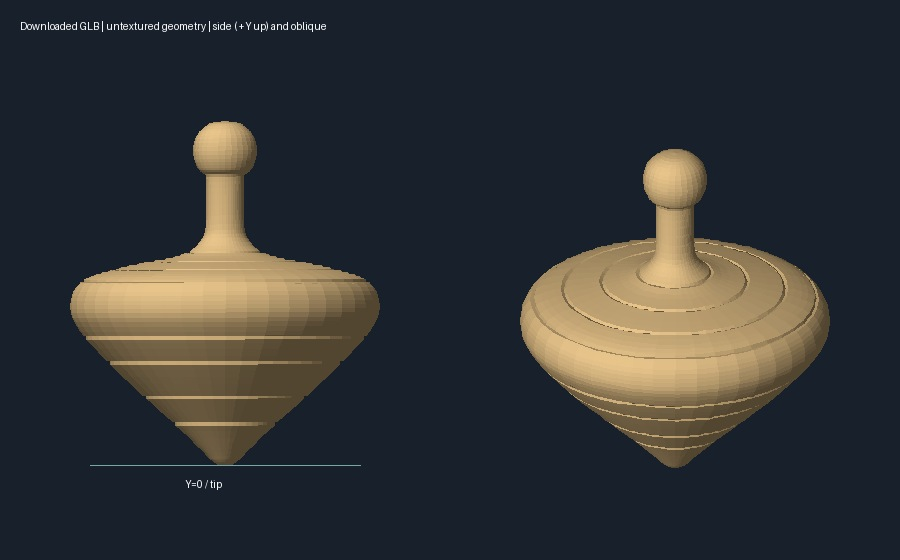

# 动力装置样板｜一手来源与画面考据

2026-11-21 · 織羽Oriha / Sol。范围：第 3 关铜铃花、第 6 关陀螺；额外作品研究用于提取运动与读形方法。

**实装资产。** 第 6 关读入 [Grab3D 的 Spinning Top](https://grab3d.com/models/toys/spinning-top/) 原始 GLB，许可证随文件入库。发布者声明为 Blender 程序建模；原模型有尖支点、车削腹线、手柄及顶珠。对原顶点分段放大、切开轮腹后，游戏使用同一套三角形判定遮光与头肩净空。剑桥馆藏用于核对运动形式。第 3 关的铜铃花依附件文字重建，未认定原作者。

实机与原模型对应见[两关审查稿](../README.md)。本地抓取的发布页截图 `.runtime/kinetic-source/source-page.png` 可对照原始网格；同目录另存原版 Blender 文件。

## 归属调查

- **红绳铜铃触手花｜原图未定位。** 指定附件只有文本，称其为「B 站爆火结课装置」「图中的」作品，没有图片、作者、院校、BV 号或发布时间。检索了「动态雕塑 红绳 铃铛 白色 触手 毕设」「白色 弯管 海葵 动态装置 铃铛 伞齿轮 结课」及英文 `kinetic sculpture white arms red strings bells mechanical flower`，未取得可追溯至作者或学校、且同时匹配黑色圆箱、白弯臂、红绳和圆铃的出处。目录中的三件作品分别提供轮廓、错相和发声参照，均非该原图。附件中的伞齿轮、双圈和臂数按需求规格处理；就算以后找到正面截图，也宜用作者的制作记录或拆解画面验证箱内结构。下一步优先要原图、视频片段或 BV 号；先核对外观和上传归属，再确认机构与展示授权。
- **巨大进动陀螺｜工程依据已定位，整室艺术归属未定位。** 剑桥 [Whipple 馆藏 3998](https://collections.whipplemuseum.cam.ac.uk/objects/9119/) 为 Newton and Company 的几何陀螺演示器，馆藏给出 1875–1900；正面截图可见木底座、黑色弯支架与悬置的黄铜旋体。它是科学仪器，图示支承构型与游戏的着地尖锥不同。另见 Harvard [Gyroscopic Motion](https://sciencedemonstrations.fas.harvard.edu/presentations/gyroscopic-motion) 的演示资料；用物理直觉辨认转子绕身轴转、倾斜身轴绕竖轴扫过方位，以及倾角的小幅摆动三层运动。以房间竖轴进动 → 局部倾斜（可叠加章动） → 局部身轴自转的层级建模；已设定的周期是游戏运动学参数，不拟合馆藏惯量。镂空、高灯、贴墙退避带与旋转阴影是项目设计；遮挡、碰撞、采样用同一盘姿态，切口应真正贯穿盘体。

## 三件附件之外的真实作品

| 一手记录 / 本地审查截图 | 截图亲见 | 可迁移的项目设计 |
|---|---|---|
| Len Lye，《Fountain III》，[Govett-Brewster 馆藏](https://govettbrewster.com/collection/77-2)，`fountain.png` | 页面正面可辨作品名、艺术家；首屏照片下半部超出视口，可见深底上放射展开的细长高光线束。 | **用于第 3 关主剪影。** 把外圈白弯臂的张开读成若干可跟踪的亮边，灯从侧后方擦出轮廓，红绳与铃在亮边之间留下可数的间隔。原作的细线束提供视觉参照，游戏采用刚性弯臂和末端垂摆。 |
| Elias Crespin，《L’Onde du Midi》，2020，[艺术家作品页](https://www.eliascrespin.net/work/londe-du-midi/)，`crespin.png` | 石柱与棋盘地面提供尺度；平行深色细杆构成悬浮长平面，可见密集的竖直吊线。页脚标注卢浮宫与涂漆铝、尼龙、电机、电脑和电子接口。截图记录了平展一帧。 | 用等距重复件做出可比较的相位标尺。第 6 关可在切口两侧布置宽窄不同的边缘标记，让玩家辨认「下一道豁口」；第 3 关也可用统一臂节距，使相邻高低差清楚。标记不得单独替代真正遮光的几何开口。 |
| Takis，《Musicale》，1977，[蓬皮杜馆藏 AM 2002-105](https://www.centrepompidou.fr/fr/ressources/oeuvre/ca7KLE)，`takis.png` | 作品题名、日期与技术栏清晰；馆藏列木板、扬声器、麦克风、电磁铁、吉他弦、金属针和尼龙线。作品图区域在本次捕获里呈深色，未据此判断布局和运动。 | 把发声和可观察的机械事件绑定。样板以射线可读的 `pulse` 标记真实铃摆事件；若补录音，可按同一物理步驱动。参考作品用电磁和弦，游戏用铃。 |

## 考据在样板中的落点

铜铃花共 20 根白臂：短臂铃守黄闩，长臂铃守出口。铃高和振动脉冲由同一摆动姿态读出，样板通过射线属性传递脉冲。参考 Crespin 的悬杆阵列沿展厅背墙展开：128 根杆、256 根吊线，首末杆相隔 17.65 m；每根都参与最近命中和遮挡。这一阵列用于演绎运动与材料节奏，两间样板可独立通关的机关为花冠与陀螺。

## 截图索引与权限

实拍网页渲染保存在本机仓库 `C:/Users/iii/Desktop/dual_ontology_world_reconstruct_2/.runtime/kinetic-research/`。`gyro.png` 对应 Whipple；其余三个取证文件与上表同名。使用本机 Chrome 无头页面截图，亲自查看 `review.jpg`、`works-review.jpg` 两张索引接触表。卢浮宫馆藏 URL 本机返回拦截页，`louvre.png` 仅是失败记录，作品取证改用艺术家页；`horn.png`（同意弹窗）和 `takis-zkm.png`（404）亦不列入证据。截图仅供本机审查，随档案交付的是链接和观察笔记；勿提交截图、发布原作大图或用作游戏贴图。
