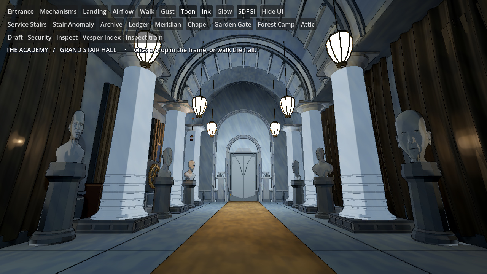

# 美术制作｜《蓝图王子》主导的第一人称三渲二

**《蓝图王子》（Blue Prince）是正式画面的主参考。** 用它校准第一人称镜头的尺度、房间之间的色彩差异、门框与道具的轮廓、光照的分面，以及由远及近的细节密度。《巴别塔圣歌》（Chants of Sennaar）补充建筑色面与远距离导向，主要用于楼梯、拱廊、跨层走道和远景。两套参考给出不同层级的决策：门板、灯、家具和房间曝光优先对照《蓝图王子》；多层空间挤在同一画面时，用《巴别塔圣歌》的色面关系拆开通路、边界和高差。

## 唯一画面基准：大厅 04

看门廊的三处关系：柱子朝光的一面与背光的一面有柔和分界；柱脚叠在浅墙上时由细线分开；最远的门仍能从暗拱里看清。房间可换布局与主色，复核时保留这三条。01 的连续明暗、02 的单独分色、03 的分色加线保留为历史比较，正式入口直接使用 04。

公共大厅、夜班房间与 `Expedition-01` 共用同一舞台 [AcademyStage](../../scenes/components/rendering/AcademyStage.gd)：环境（Filmic、饱和度 0.80、SSAO、SDFGI、柔光 Glow、空气雾）、视口参数（MSAA 4×、去色带、阴影图集）、`InkPass → HallInk` 默认强度墨线，以及第一人称视点（FOV 73°、眼高 1.57 m、0.0022 rad/px、俯仰 ±1.48）。[Hall04 环境资源](../../scenes/components/rendering/post/Hall04.tres)只留给独立实验场景。建筑主表面、热厨木作与人物共用 `SoftToonLight`，水面、玻璃和发光像素按各自物理用途处理。折返闸等机关沿用模型上的材质槽：柜体与面板改为低饱和蓝灰，钟面和纸张保持浅色，黄铜集中在把手、指针与窄边；机关转轴、碰撞与交互点随原构件保留。HUD 在房间视口之外合成：大厅画面铺满窗口，与出征同用左上状态卡、准星下方的交互提示、底部字幕条、角落暗角和羊皮纸文件（`UiTheme`）。

## 按玩家视距做画面

| 玩家位置 | 首先读到 | 制作方法 |
|---|---|---|
| 门槛 | 房间用途、主要装置、下一段方向 | 让主体、通行面和背景有清楚的明度关系；门框借内凹结构、窄边和地面接缝成形。暗部保留固有色。 |
| 走向装置 | 可走路径、分岔和目标 | 用连续的地面明面或重复的框架带视线；有高差时，用独立色面标出楼梯、平台或低层。 |
| 触手可及 | 把手、指针、铭牌及操作反馈 | 细节集中在手会碰的地方；用轮廓和位置先认功能，再用英文铭牌确认。操作后让机构的姿态或局部亮度说明变化。 |

**折返闸是首间对标样板。** 从入口读到前行口、返营口，以及二者之间的钟和制动柄。两个出口各用门框和地面走向定方向；近看读指针、铭牌和制动状态。暗褐柜体、连续金属高光和大段正面排字归入旧稿，保留钟、闸和返营选择。

## 材质、光与后处理

| 层 | 制作决定 | 接入位置 |
|---|---|---|
| 建筑与道具 | 每房先定主色、辅色与交互点色；用两到三块主要明暗组织体积。窗框和踏步保轮廓，砖缝和纹理降低远景对比。 | [surfaces](../../scenes/components/rendering/surfaces/)；直射光共用 `SoftToonLight.gdshaderinc` |
| 人物 | 写实 6.5 头身与房间共用 Toon 分色逻辑；脸靠额、颊、颏的大面交代转折。 | [人物标准](characters.md) |
| 边线与间接光 | Forward+、原分辨率。建筑优先用相邻色面分界，细线补重叠的轮廓、把手或门洞。保留 SDFGI 作空间补光，控制曝光以便在暗面找门。 | [post](../../scenes/components/rendering/post/)；[RogueRoomView](../../scenes/rogue_view/RogueRoomView.gd) |
| 状态与文字 | 室内氛围由房间决定，仅外窗引入时间光。HUD 独立于场景调色；报价与背包同时可读。 | [feedback](../../scenes/components/rendering/feedback/) |

## 实机放行

1. **入口全景**：固定机位拍彩色图与临时灰度检查图。遮住 HUD，识别主要机关、出口和可见高差；折返闸须一眼分清前行和返营的两个门位。若门在灰度下混入墙面，先改门洞明度和轮廓。
2. **操作近景**：走到机关前，检查铭牌、手柄和指针的剪影；操作后确认要去的出口仍能一眼找到。检查 6.5 头身人物在室内正常光与暗面下的剪影。
3. **首轮顺序**：先做折返闸，再用相同验收方法复查大厅与天文台。通过项目 MCP 在真实 Forward+ 拍摄，截图统一为 1080×720 JPEG。旧截图归入迭代记录。

图像出处与逐帧读图见[参考研究](../research/expedition/README.md)。

## 锁版渲染规范（2026-11-24 验收固定）

本轮实机验收已确认与《蓝图王子》（Blue Prince）一致的正式三渲二渲染风格为全项目锁版标准，后续所有关卡（含 `Expedition-01`、公共大厅与肉鸽房牌）必须严格沿用，不得回退为纯 PBR 素面或高饱和光晕：

- **建筑与道具着色器**：全部不透明建筑体块与常规道具统一使用 `res://scenes/blue_prince_lab/HallFinish.gdshader`（手绘水彩笔触噪点 + 木纹/石面/金属粗糙度分化 + `toon_on = true, toon_strength = 0.86`）；透明玻璃与特殊发光板（如 `GazePlate.gdshader`）按各自物理/规则用途保留专用着色器。
- **原分辨率细墨线**：视口挂载 `res://scenes/components/rendering/post/InkPass.gd`（`HallInk` 细线轮廓），配合角色中亮/中灰 1900 年代服装与中深栗棕发色（禁止纯黑吞没描边）。
- **色调与环境分级**：Filmic 色调映射、`adjustment_contrast = 1.08`、`adjustment_saturation = 0.80`（由 `AcademyStage.gd` 统一提供，大厅与关卡相同）；区域冷暖光雾与柔和灯源衰减统一由 `AcademyRenderProfile.gd` 驱动，室内氛围光与外窗时间光严格分离。
