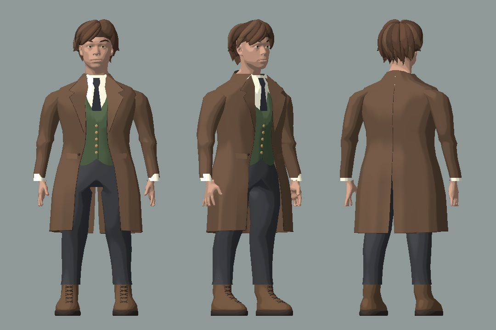

# 人物｜正式人形统一为写实 6.5 头身

**旧小人和编号摆件模型退出正式人物资产线。** 新制作、重做和正式验收一律使用 6.5 头身系列，覆盖大厅居民、出征伙伴、剧情人形及游戏内可识别的角色留影。保留现有角色 ID、职业、证词、招募与行动逻辑；按新骨架重制身体、服装与动作。旧资产只用于迁移对照，当前仍被场景引用的编号模型登记为待替换占位，整批迁移完成后清理正式入口中的引用。

## 统一制作标准

| 项目 | 约定 |
|---|---|
| 比例 | 中立直立、赤足。身高除以颏底到裸颅顶的高度为 **6.5**；发型、帽饰和鞋底不计。角色可有不同身高、年龄和体量，用肩宽、骨盆、脸型和动作作区分。提交测量记录。 |
| 造型与材质 | 依锁骨、肘、腰和膝重新安排衣片；发型、外套轮廓和主色承担远景辨识。按[正式美术](art.md)处理 Toon 明暗，检查脸、手、领口在正常室内与暗处的分面。 |
| 绑定与动作 | 活动角色交付站立、走路、转身、坐下、抬手操作的检查；核对脚底接地、手到交互点、衣领和袖口穿插。静态留影可以先交付静态版本。 |
| 关卡接入 | 逐个切换 [Roster](../../scenes/rogue_crossing/Roster.gd) 的角色映射，核对招募、编队、出征和折返后的身份一致。首批替换使用旧 ID 回归，最终全量检查旧小人模型及其材质的加载路径。 |

## 首件与迁移进度

**侦探是 6.5 头身首件。** 棕大衣、墨绿马甲，底模来自 Blender Studio Human Base Meshes v1.3.0 的 Realistic Male Body（CC0）。[生成器](../../tools/detective_study/build_detective.py)读取原始 `.blend`；测量记录为身高 177.00 cm、头高 27.23 cm、比值 6.5000。下图是静态人物预览，验收肩、衣摆和身体比例。

本轮文档只确立替换规范。侦探的新资产与加载器在本地实现中用于暗房静态留影，活动绑定和营地 16 名居民仍待迁移；玩家继续以第一人称游玩。下一件优先选择一个高频招募居民，走齐**测量 → 服装 → 动作 → 营地与出征实机 → 切换角色映射**，以此建立可复用的交付流程。
