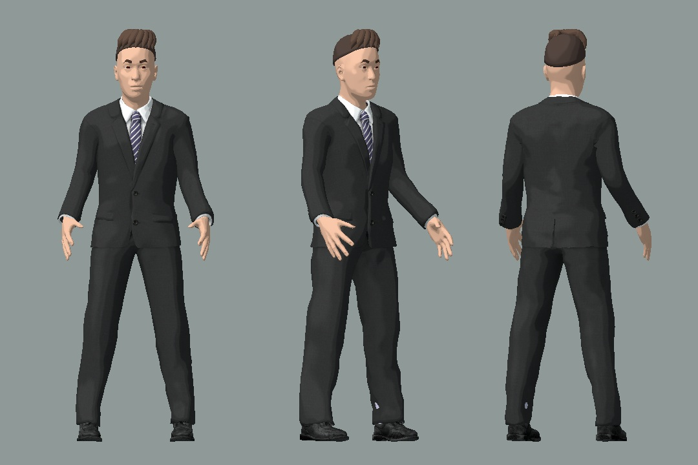

# 人物｜一套写实 6.5 头身制作管线

正式大厅、出征伙伴、沿途居民和暗房留影共用 [Roster](../../scenes/rogue_crossing/Roster.gd) → [ProductionCast](../../scenes/rogue_crossing/ProductionCast.gd) → **MPFB2 R-05 正装 GLB + CastDielectric Toon**。角色 ID、职业、证词、招募和行动规则沿用原数据；旧编号小人及其手办材质已退出运行与测试。

| 项目 | 约定 |
|---|---|
| 比例 | 中立直立、赤足。身高除以颏底到裸颅顶的高度为 **6.5**；发型、帽饰和鞋底不计。提交测量记录。统一缩放只改变身高。 |
| 造型与材质 | 依锁骨、肘、腰和膝重新安排衣片；发型、外套轮廓和主色承担远景辨识。按[正式美术](art.md)处理 Toon 明暗。 |
| 绑定与动作 | 同一骨架和播放协议统一站立、行走、跑步和短时操作。新增独立体型或坐姿时，核对脚底接地、手到交互点及衣领袖口穿插。 |
| 关卡接入 | 保留角色 ID；在营地招募和出征/折返回归中核对身份。所有最终导入的角色走同一个加载器，服装变体有自己的材质配方。 |

正式人物使用 [MPFB2 R-05 Formal](../../assets/characters/mpfb/r05_formal.glb)，即 Hall 04 对照中的 B。保留原版西装贴图、发型和站姿；16 名居民共享骨架，通过身高、服装色调和名牌区分。6.5 头身是制作验收目标，R-05 的赤足比例待复测。

主线角色（侦探、Hale、雀儿、卢西安、恶魔）改用独立成衣模型，见 [tools/cast](../../tools/cast/README.md)，通过 `ProductionCast.attach_hero` 加载。目前已接入大厅开场和大厅里的 Hale；出征中的 Hale 和第三人称侦探仍使用 R-05。

