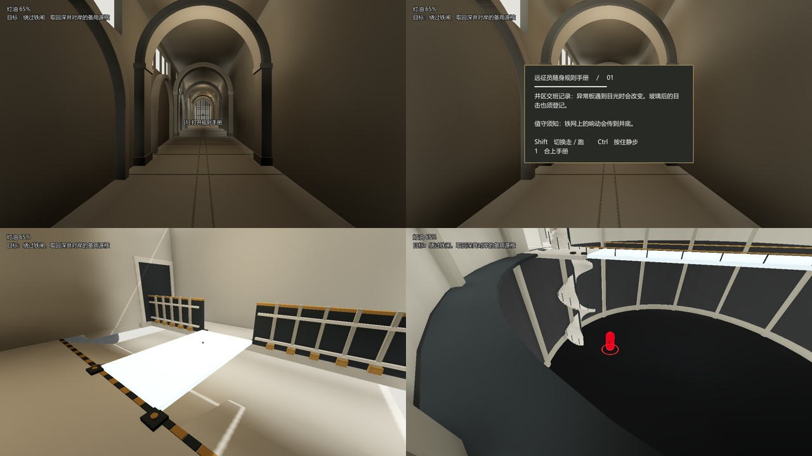

# 首次远征 · 白模与剖面验收

空间与美术参考：[1900 设计手册](reference/1900.html) · [本轮对照审图与检修夹层实机图](reference/audit.md)。

入口：新档公共大厅 → **First Expedition · Hale**。WASD 行走，鼠标观察，E 互动，Q 在井口派 Hale 去观察窗。F4 依次查看 A、B、C，再按一次回到原地；在任一审图机位按 F5，可原位比较完整外壳与剖切效果。

## 本版怎么玩

`1` 打开或合上随身手册，`←` / `→` 翻页；阅读期间暂停移动、灯油消耗和猎手计时。`Shift` 每按一次切换走／跑，`Ctrl` 按住静步。游戏窗口等玩家单击才捕获鼠标，`Esc` 释放。

| 拍点 | 玩家看到什么、能做什么 |
|---|---|
| A1 锁门 | 身后门响，Hale 交代前班因踏响铁网紧急封井，备用源核留在对岸；可按 `E` 确认隔离闸须到 B5 手动复位，或按 `Q` 让 Hale 走到闸边握住铁把手、连拉两下。开局准星提示按 `1`。 |
| B1/B2 观察 | 塌方截断直路，进 B5 只剩档案翼这条路。与 Hale 隔着观察玻璃同时看到板面会急剧翻红、响起玻璃共振。Hale 转身放下视线后，玩家仍能看到红光衰退。 |
| B3 证伪 | Hale 在 B2 门边抬手劝止，停在门外；玩家单独注视，红色波纹约 2.35 秒内向中心收束为琥珀。两次实证齐全即写入手册，单目穿过 3.2 × 1.8 m 板面后才抬门闩。两侧的坡只回入口岸。Hale 在门外探头，心声晚约 0.7 秒显示；发言者在底部堆叠，心声用无底板、深褐描边的浅色斜体。每条字幕按文本阅读量独立计时；翻开手册时结束当前剧情字幕。手册保留原守则，并附暗红色实测批注。 |
| B4/B5 选择与拉闸 | 亮廊直达 B5；暗廊地面可补灯油，为南栈桥留储备。两端斜坡通往 +0.60 m 的信号夹层：站在毡垫上敲击、停步听对侧两声回响，再到亮灯的接收器开锁，取用井底诱饵。拉动 B5 黄铜手柄后，能听到远处的铁链升闸，此处成为折返点。 |
| C1 观察源井 | 先听见井底异体的回响，再看见通体由异常板构成的桥。Hale 质疑守则禁止的路线；准星对准北窗按 `Q`，玩家用已验证的对照说服他。Hale 稍作犹豫后提灯跑上有连续扶手的螺旋梯，约 4 秒到北窗，任务栏显示赶路和到位状态；他到位后会提醒过桥。脚步声会引动猎手。 |
| C2 渡桥 | 可让 Hale 守桥、自己避开桥面视线；有节拍器时可瞄准井底按 `E` 投出一次诱饵；响两下后井底动静转向落点，争取 12 秒。南侧窄栈桥以灯油换绕路。 |
| C4 撤离 | 拔芯触发警报与追猎。取芯后看向左侧的螺旋梯，上层应急门有推杆和转轴。推开后沿南侧检修廊转弯下坡，隔墙警铃和井底撞击约六秒渐远，经内侧升闸接入 B5；Hale 沿二层北廊下楼，双方在主廊汇合，穿过升起的气密门，走进暖光门厅，面对锚定厅双扇门，全屏淡黑后浮出结算；失足或被扑倒，3 秒后从折返点重试。 |

当前实机原图：[开场](flow-entry.jpg) · [规则手册](flow-manual.jpg) · [B3 单人承重](flow-trial.jpg) · [井底猎手](flow-hunter.jpg)。以下剖面与旧机位保留作改模前后的比例对照。

交互键统一显示在准星下；实体地点使用有底板的牌匾。音效、拟音、分材质脚步和老建筑风声、井口气流和低音大提琴的源录音与许可见[资料表](../../../scenes/expedition_01/audio/README.md)。

## 图纸如何落到模型上

根据 `expedition-01-whitebox-spec.pdf` 的平面和尺寸确定通路、标高与碰撞。三张轴测图用于定位剖口、看得见的陈设和遮挡关系。屋面与近侧围护的隐藏只作用于审图画面；切边台阶只在剖面中显示。剖面中的青色视锥是说明图层。

| 区段 | 空间与剖切 | 实机图 |
|---|---|---|
| A 沉浸长廊 | 长 36 m，每 6 m 一跨。两端保留拱口，中跨只露远侧拱脚和弧段。近墙切低，仍能辨认通往档案翼的门。 | [长廊](arcade.jpg) · [玩家视角](entrance.jpg) |
| B 档案翼 | 侧门进入前室，经书架与观察玻璃接下沉试验区，再从暗廊地面、信号夹层或亮廊到释放闸。露出玻璃、琥珀板、塌方与闸具；顶盖在行走时恢复。 | [档案翼](archive.jpg) |
| C 源井 | 内径 28 m；井底 −10 m、主桥 0 m、观察环 +4.8 m、井口 +10 m。主桥 18 × 3.6 m。井壁由环扇组成，剖窗两侧保留全高墙翼，底缘保留一圈；西梯延到井底标高，桥跨下方留空，桥面层北侧断开，南侧仅有 1.25 m 宽的耗油栈桥。 | [剖开](caisson.jpg) · [同机位合壳](caisson-shell.jpg) |

## 第一人称核对

- [三段剖面总图](section-overview.jpg)。F6 在审图中轮换三个 1.57 m 眼高机位：[从 B2 观察测试板](b2-window.jpg)、[B5 拉杆与观察口](b5-release.jpg)、[从 C1 望向桥面](c1-span.jpg)。
- B3 坑底为 −0.60 m，左右各有一条 2.2 m 宽、约 20° 的出坑坡，两者均回入口岸。玩家与 Hale 分别贡献一道视线：无人注视时闪烁，一秒后撤除碰撞；单人注视渐变为稳定的琥珀色并承重；双人同看泛红、波动并报警。[B3 双人过载](b3-play.jpg) · [C1 第一人称](c1-play.jpg)。
- 玩家在全关步行 3.8 m/s、跑步 5.8 m/s，按 Ctrl 静步 2.2 m/s；鼠标在单击后捕获，Esc 释放。脚步与镜头按实际落地位移推进，Hale 按实际速度切换骨骼动画。
- C 段南栈桥每秒消耗 2.5 灯油，耗尽会回检查点。观察环三根实心砖柱相隔 120°，柱宽 1.6 m；Hale 从眼高检查主桥上的 3 × 3 × 3 个采样点，玻璃透视，砖柱遮挡。
- 物理回归检查南北弧段的落脚面、三个柱后盲点和北窗视线、B1 封堵、B3 板升降；玩家胶囊分别经南栈桥和主桥完成去程，经上层绿门完成撤离。

## 复现与差异

- `WalkTest.gd` 用玩家胶囊依次走过三个区段，检查试验板、补给、开闸、Hale 到位、过桥取芯、从源核前登左侧螺旋梯、绿门返回 B5、穿回长廊和交还信号。运行：`godot --headless --fixed-fps 60 --path . --script res://scenes/expedition_01/WalkTest.gd`；默认取两项补给后经主桥撤离；`-- --clock-only` 从反方向解夹层且只取节拍器；`-- --oil-only` 只取地面灯油后走南栈桥；`-- --south` 两项均跳过也走通南栈桥。
- 游戏 MCP：`on` 传 `{"scene":"expedition","eval_review":true}` 从 B4 西端开始；省略 `eval_review` 则从 A1 开始。`move_*` 走路，`expedition_look_left/right/up/down` 转向，`expedition_use` 交互，`observe` 返回灯油、回响、开锁和库存状态。
- 完整实机录制脚本：`godot --path . --rendering-method forward_plus --audio-driver Dummy --resolution 1280x720 --fixed-fps 30 --write-movie .runtime/expedition.avi --script res://tools/expedition/record_first_expedition.gd`。在游戏内驱动移动与按键，平滑朝向行进路线，交互前停住对准目标。脚本验证双人目光重叠和撤开、门边拦阻、单人稳定、手册批注、北窗报到、检修廊实景连通和余响、主廊汇合及纯黑后结算。Dummy 驱动让桌面扬声器保持静音，Godot 录像仍保留游戏混音。
- 绿漆应急门、南侧检修廊和 B5 岔口在同一空间内连通，全段可步行或奔跑；升降栅栏仅从检修廊一侧开启。锚定厅门前先淡黑，再出现结算文字，结算停留后才通知公共大厅切换场景。井底是失足恢复区。图中未给出背面施工尺寸的井盖与围护采用简化实体，环廊栏板、窗套和螺旋梯节距均为白模推定值。实机图用于进一步核对这些比例。

`HearingTest.gd` 可用上面的同一命令替换脚本名运行，检查静步、铁网声调查、静默消退、扑杀预警、诱饵和折返点状态。`ArchiveTest.gd` 单查绕过 B2 后能返回补做、独看不能提前写入双人结论，以及打断注视后计时重置。走图测试另查两条恢复坡、手册与走跑按键、B3 内心独白及不拾取补给的亮廊可达性。截图为 Forward+ 实机定位机位，六分钟节奏、开场是否能读懂以及脚步主观响度留给真人盲测。
