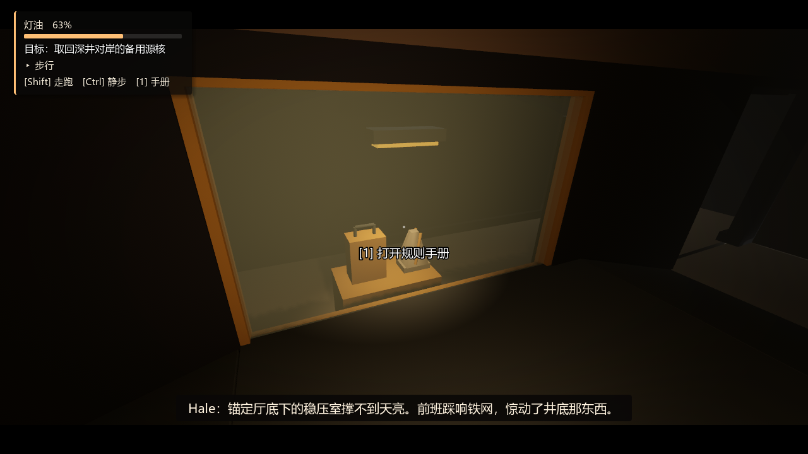

# Expedition 对照审图 · 1900 手册

依据：[用户提供的完整离线手册](1900.html)，SHA-256 `e3cbd226133b416f4fe263c44395e4fd4a06b40bef1cd7d7421b71d95010d35f`。范围：固定首次远征 A / B / C。阶段标题是制作审查的维度；原文里的行业案例和百分数不作本项目实测数据。

| 阶段 | 本轮观察与处置 |
|---|---|
| 0 范围 | 保留取核、撤离和固定地点。锚定厅的持久变化属于大厅流程，本轮未验收。 |
| 1 规则沙盒 | 双人隔窗恶化、单人维持注视、听觉诱饵已有独立测试；漏看 B2 再回窗补证、打断 B3 注视、静步与诱饵恢复均有回归。 |
| 2 平面 | 原 B4 已有从亮廊绕行的选择，暗廊内部却是一条直线。保留直行补给，增加两端接回原廊的检修层。两口均在 B3 门闩下游。 |
| 3 剖面 | 两端平地 → 2 m 斜坡 → +0.60 m 工作平台 → 另一侧下坡；保留角色胶囊连续通行。观察窗可窥见补给；玩家要回地面廊侧才能取物。 |
| 4 脚本 | 夹层与原暗廊共用灯油与亮度判定。两条通关回归分开：拿补给并指挥 Hale 过主桥；不取补给，经过夹层后以油换南栈桥。手册指定的 27 射线确定性评测，本轮没有得到 Expedition 对应的验收记录。 |
| 5 光与声 | 箱体原来吞没了补给模型。油罐提柄、节拍器斜杆现在高出台面，局部带罩灯只照工作面；管道不再挡住窗口中央。B4 目前仍以提灯、视窗与耗油导航；手册提出的纯黑、敲击沟通、声学软掩体是尚未实现的另一套玩法。 |
| 6 试玩 | 实际胶囊从两个入口走通检修层，核对标高、暗区和隔窗取物限制；两条路线分别到达撤离结算。初版将南段往返和主桥叠进一局，曾耗尽灯油；分路线回归不覆盖这种耐力玩法。首次到访者能否独立理解分岔仍待盲测。 |
| 7 美术与性能 | 用 Forward+ / SDFGI 检查实机视窗。期间下调窗台并挪开遮挡道具的立管。B 区仍有白模表面；原生分辨率全程帧时间、各段 draw calls 与遮挡收益尚待采样。 |
| 8 归档 | 存档原文与本机画面。新夹层尚未补入全翼带危险区标注的总览图。 |

复核入口：运行 `WalkTest.gd`（主桥），追加 `-- --south`（检修层与南栈桥）。实机机位：`ShotTest.gd -- <输出目录> <标签> <字体路径> loft`。
