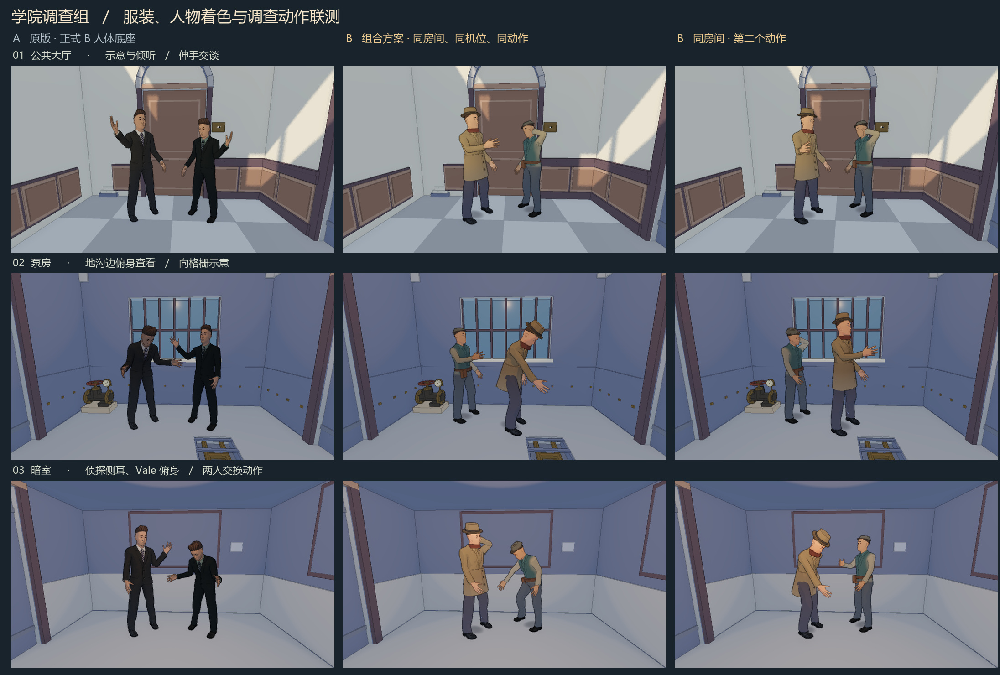
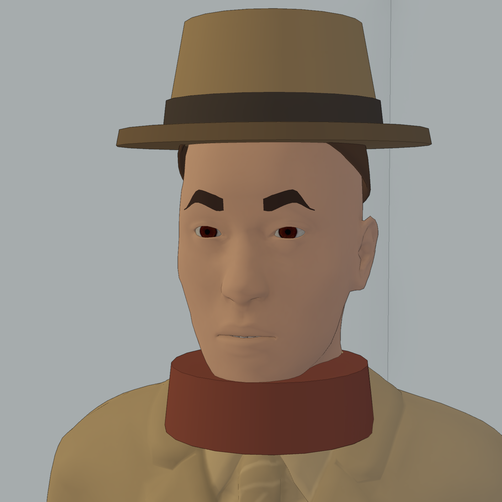
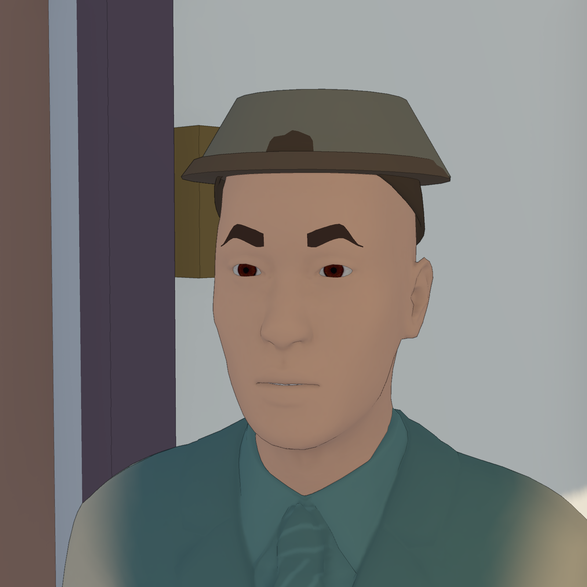

# 调查组：职业服装与清线人物联测

在 Structure Lab 按 `K` 加载三个主题开间，`P` 看双人，`N` 换开间。`5` 示意、`6` 俯身查看、`7` 侧耳，Vale 会配合侦探作出回应。图中两个版本均使用同一套 MPFB2 R-05 人体和建筑镜头；服装实验只在双人预览挂载。

- 礼帽、围巾和带扣外套下摆随侦探骨架转动；Vale 使用鸭舌帽、分色马甲、皮带与工具包。原始模型保持共享，底层面型相同。
- 上图记录了首轮实验：肤色通过绑定姿态的椭球法线混合和暖色分段光照呈现。衣料以绑定空间分区分色，叠加高度明度和受光照控制的窄边光；保留原眼贴图，移除实验眼材质的镜面高光。建筑材质、HallInk 与灯光保持原样。
- 双脚分别在地面投一层随足骨移动的软暗部。该实现适合当前平地展示；带台阶的行走需要地面采样。查看、倾听、示意叠加双骨手臂 IK；泵房以地沟近端为观察目标。
- 这次验证职业剪影、姿势与房间尺度；独立脸型、眼部手绘高光、衣领布料 AO 烘焙和精细手指姿势留给人物资产精修。

## 原肤色面部复核

现版服装保留，脸和手直接使用 R-05 的原始皮肤材质、贴图与法线。进入双人模式后按 `1` 固定待机，按 `H` 依次导出侦探、Vale 的 1600 × 1600 近景至 `.runtime/portraits/`。两张图共用大厅照明，以人物自身朝向取景。

