# 工具图解：关卡搭建、物品属性与关卡检视

本页截图都是实机窗口截的，可以重新生成：

```powershell
& .runtime/godot/4.7.2/Godot_v4.7.2-stable_mono_win64_console.exe --path . --rendering-method forward_plus --windowed --resolution 1600x900 -s res://tools/test/tool_tour_capture.gd
```

## 总览：一件物品从搭建到进游戏

| 步骤 | 工具 | 产出 |
|---|---|---|
| 1. 搭房间：墙、地面、门窗、楼梯、家具 | **ArchBuilder**（`BuildingSimulator.tscn`） | 建筑文档 JSON/YAML，可导出 Godot 场景 |
| 2. 摆物品并配置属性，包括可交互属性 | **组件库**（`ComponentLibrary.tscn`），从 ArchBuilder 的 Furniture 页进入 | 候选场景，物品上带 `Interactable` 节点 |
| 3. 写进关卡 | 关卡清单（`AcademyLevelBase`）的 `objects[]` / `interactables[]` | 运行时自动生成物品和交互点 |
| 4. 进游戏查看 | 关卡运行时（统一交互 UI）+ **F2 蓝图检视器** / `python tools/inspect_level.py` | 实机提示、设计清单、门禁结果 |

三个工具读的是同一份物品目录（`ComponentFactory.load_catalog()`）。物品只存数据，提示框由所在关卡的运行时统一绘制。

两个编辑工具共用一套现代简洁主题 `tools/building_construction/ToolTheme.gd`，按“主次三级”排版，眼睛先落在最常用的那一步：

| 层级 | 样式 | 用在哪 |
|---|---|---|
| 一级 · 主操作 | 蓝色实心大按钮，每个区域最多一个 | 这一页通常要做的下一步，如 `Draw Walls in 2D`、`Place Component in 2D`、`Make selectable`、`Save Candidate` |
| 二级 · 常规操作 | 灰底按钮 | `Undo / Redo`、`Edit Properties`、`Open Component Library` |
| 三级 · 低频操作 | 无底色的灰字 | `Close Loop`、`Preview at Coordinates`、`Show All`、机关测试按钮 |
| 危险操作 | 红字 | `Delete`、`Remove interaction` |
| 分组标题 | 灰色小号大写字 | DRAW、SELECTION、TRANSFORM、INTERACTION…… |

---

## 1. ArchBuilder：关卡搭建

打开 `res://tools/building_construction/BuildingSimulator.tscn`，按 F6 运行。


| 区域 | 位置 | 用法 |
|---|---|---|
| 左侧工具栏 | 最左 | **最常用的绘制工具**，大号竖排，右侧标着快捷键：`Select`(V)、`Wall`(W)、`Floor`、`Opening`(O)、`Furniture`(P)；低频的 `Railing` 放在 MORE 下面。当前工具整块高亮为蓝色 |
| 顶栏 | 最上方 | 左边是 `Undo / Redo`、`File ▾`（导入/保存 JSON、YAML，导出 Godot 场景）、`View ▾`（线框、剖面、显隐）；右边是 `Split / 2D / 3D` 视图切换和 `Tools ▾`（低频的 Generate Layout、Structure Lab） |
| 情境栏 | 视图上方 | `Snap` 吸附步长、`Center`(F) 居中，最右是光标坐标和所在房间 |
| 中间视图 | 中间 | 左边 2D 平面（点击落节点；回车或点回起点闭合；拖动移动；双击节点或按 E 编辑），右边同步的 3D 预览 |
| 右侧设置页 | 右上 | 常用的 `Walls / Openings / Furniture / Floors` 平铺，低频的 Stairs / Layout / Furnish / Rooms 收进 `More ▾`。**选工具会自动打开对应设置页**（选 Wall 就到 Walls 页）。每页最上面的蓝色按钮就是这页的主操作，参数在它下面 |
| SELECTION | 右下 | 大纲列出房间、墙和开口，选中后下方直接显示参数；`Edit Properties (E)` 弹出大窗口编辑，红色 `Delete` 删除。设置页和这块之间的分隔条可以上下拖动 |
| 状态栏 | 最底部 | 当前工具的操作提示、已放节点数，以及预览/应用的结果 |

常用快捷键：`Ctrl+Z` 撤销，`Delete` 删除，`F` 居中。

### Furniture 页：摆家具、进入组件库

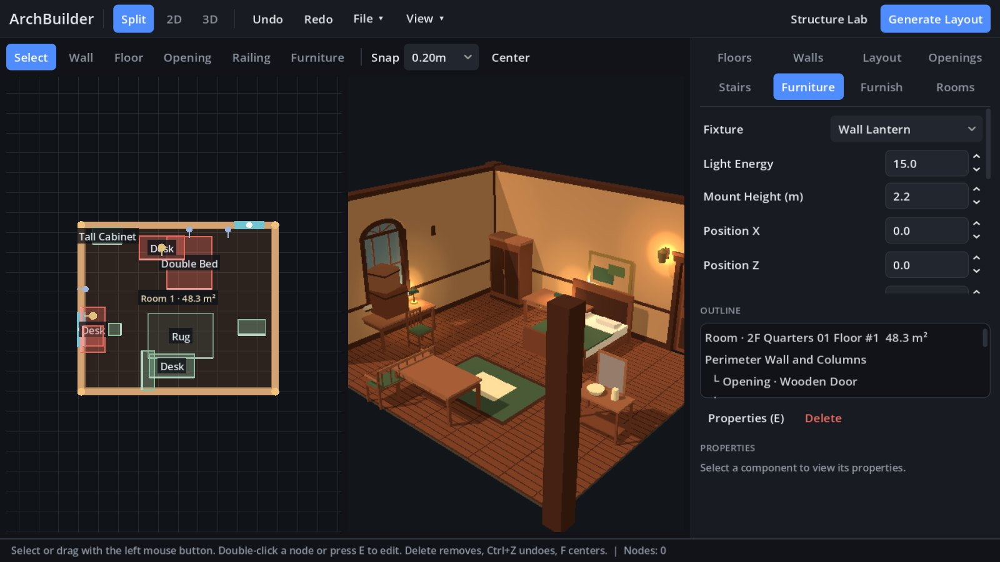

- 上半部分是更常用的 **COMPONENT LIBRARY**：列出共享目录里的全部组件，可用搜索框过滤。选中后点蓝色 `Place Component in 2D` 放到平面里，或点 **`Open Component Library`** 进入下面的物品属性工具。
- 下半部分是 **BUILT-IN FIXTURES**（原有家具和灯具）：`Fixture` 下拉框选家具，填灯光强度、安装高度和坐标，然后点 `Place Fixture in 2D` 在平面上点击放置，或点 `Preview at Coordinates` 按坐标预览。

---

## 2. 组件库：物品属性配置


| 区域 | 用法 |
|---|---|
| 左侧 · 搜索框 | 最上方，跨所有分类搜索物品名 |
| 左侧 · RECENT | 最近放过的物品（最多 6 个），点一下就能接着放同一件 |
| 左侧 · CATALOG | 下拉框选分类（如 Props and Equipment），列表选物品后，在 3D 视图里点击支撑面放置。`R` 旋转，`F` 换端或换栏杆侧；右键拖动环绕，`Shift`+右键拖动平移，滚轮缩放 |
| 左侧 · SCENE | `Esc` 取消放置、`Undo / Redo`、红色 `Delete`；下面是当前候选场景里的所有物品，点击即可选中 |
| 左侧 · FILE | 蓝色 `Save Candidate` 保存，`Open Candidate` 打开候选场景；`Show All` 一次性生成全部组件用来对比；`Screenshot` 截图 |
| 右侧 · 检视器 | 按使用频率从上到下：TRANSFORM（位置和旋转，每个向量一行 X/Y/Z）、**INTERACTION**、PARAMETERS（尺寸、层数等），最后才是低频的 MECHANISM（机关活动和测试按钮）。数值和开关是“左边名字、右边控件”的属性表 |

### Interaction 区：配置“这件物品能不能被选中、按 E 做什么”

上图选中的是木箱。它在目录里自带交互（`catalog.json` 的 `interaction` 块），所以检视器直接列出这些字段：

| 字段 | 含义 |
|---|---|
| `interactable_id` | 交互组 id，关卡里按它区分是哪件物品 |
| `title_zh / title_en` | 交互框标题（中文 / 英文） |
| `verb_zh / verb_en` | 动作名，如 翻找 / Search |
| `action_id` | 按 E 后发给关卡的动作 id，如 `search_container` |
| `dialogue_id` | 可选，触发时播放清单里的哪句台词 |
| `unlock_flag` | 可选，关卡设置这个旗标后才出现 |
| `enabled` | 是否启用 |
| `anchor_offset` | 提示锚点相对物品原点的偏移，例如抬到桌面高度 |
| `dist_selected / dist_activatable / dist_potential` | 三态距离：当前选择 / 可激活 / 潜在激活 |

文本字段改完按回车生效，数字和勾选框改了立即生效。改动会随 `Save Candidate` 一起保存。

### 让任意物品变成可交互

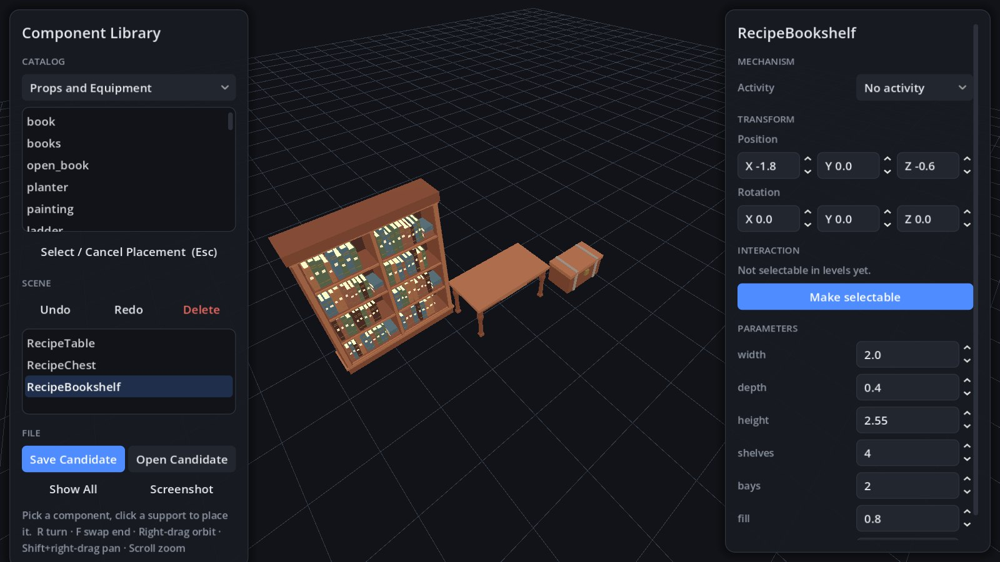

书架本身没有交互，INTERACTION 区显示“Not selectable in levels yet.”和一个蓝色 **`Make selectable`** 按钮。点一下就会给它挂上交互节点，然后按上表填字段即可。不需要时点红色 `Remove interaction` 移除。

> 物品只保存数据。哪个关卡加载它，就由哪个关卡的 `AcademyLevelRuntime` 负责显示提示，并处理 `action_id`。

---

## 3. 物品进游戏后的样子

关卡清单里写的物品（`objects[]`，可带 `interaction: {from_catalog = true, action_id = ...}`）和交互点（`interactables[]`），都会生成 `AcademyInteractable` 节点。交互 UI 只读取这些节点发布的数据。

| C+ 集合式（右下角语境条） | 底特律分散式（物品上的菱形热点） |
|---|---|
| 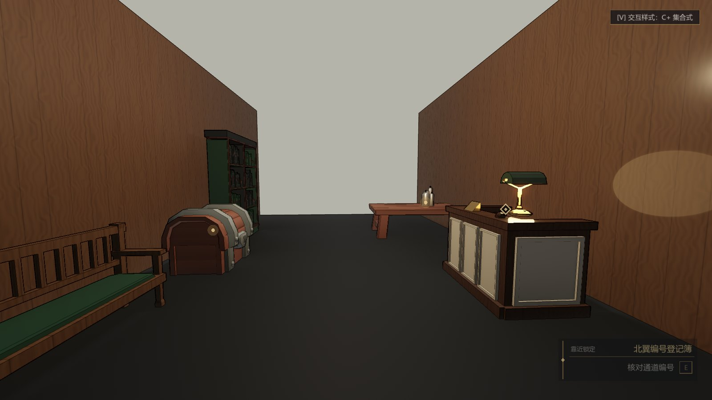 | 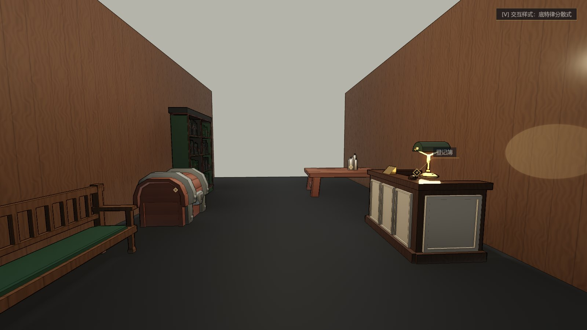 |

同一份场景数据，按 **V** 键在两种样式之间切换。左边的木箱就是用 `from_catalog` 挂上交互的目录物品。走近、并且准星对准时，它会进入“当前选择”状态，按 **E** 执行；同一件物品有多个动作时，用滚轮或 `1-4` 切换。

公共大厅用的是同一套运行时：

| 大厅 · C+ | 大厅 · 底特律 |
|---|---|
|  |  |

---

## 4. 关卡检视

### F2 蓝图检视器（游戏内）

基于 `AcademyLevelBase` 的关卡在运行时按 **F2**，或在 Q 轮盘里选“开关设计检视”：

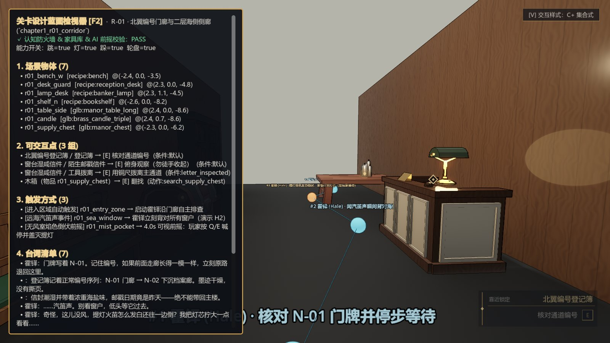

左侧面板依次列出：校验结果（认知防火墙 / 家具库 / AI 前摇）、能力开关、1. 场景物体、2. 可交互点（包括物品自带的交互）、3. 触发方式、4. 台词清单、5. AI 动作路线。场景里同时会画出队友 AI 路线、路径点和动作标签；橙色点表示“误踩规则前摇”。

### 单命令检视 + 统一架构门禁（命令行）

```powershell
python tools/inspect_level.py --scene r01
```

`--scene` 可选 `hall`、`r01`、`expedition`。输出依次是：当前关卡、运行管线、能力开关、**依赖唯一门禁**、**统一架构门禁**（有违规时逐条列出文件和行号）、门拓扑、物体、可交互候选（带三态）、AI 路线。加 `--json` 输出原始数据。

完整的分层规则见 [统一契约](../design/unified-level-ui-and-render-contract.md)。

---

## 5. 工作原理

### ArchBuilder：一份建筑文档，两个视图

```text
 鼠标/键盘 ──► 工具（Wall/Floor/Opening…）
                  │ 只改草稿
                  ▼
   ArchitectState.fork_candidate() ──► 草稿 draft（data 的深拷贝）
                  │ 预览（门窗、布局、自动布置时弹确认框）
                  ▼
   accept_candidate(draft) ── 校验后替换 data，remember() 记一步撤销
                  │
       ┌──────────┴──────────┐
       ▼                     ▼
 ArchitectBlueprint     rebuild()：按条目生成 3D
 （2D 平面，直接画 data） Floor / Wall / Stair / Railing / 家具
```

| 环节 | 做什么 | 代码位置 |
|---|---|---|
| 唯一数据源 | 整栋建筑就是一份 JSON 字典 `state.data`：`layers`（楼层与地面多边形、房间面）、`walls`（节点 + 门窗开口）、`stairs`、`railings`、`props`。保存 JSON/YAML 就是把它原样写出 | `ArchitectState.gd` |
| 草稿再提交 | 每次编辑都先 `fork_candidate()` 复制出草稿，改草稿；`accept_candidate()` 确认草稿基于的还是当前版本后才替换。门窗、自动布局、自动布置这类大改动会先弹预览框，你选“应用”或“丢弃”，丢弃后原数据一字不变 | `edit_build()` / `preview_build()` / `close_build_preview()` |
| 撤销 | `remember()` 把整份数据序列化成文本压入历史（最多 40 步），`Ctrl+Z` 就是取回上一份文本 | `ArchitectState.remember()` / `undo()` |
| 房间识别 | 每次变更后 `sync_rooms()` 用墙线围合关系算出房间面和面积，平面图上的 “Room 1 · 48.3 m²” 就来自这里；自动布置和门窗连通检查都用它 | `RoomTopology.gd` |
| 2D 视图 | 平面图不存任何东西，每帧直接画 `data`：吸附、拖动节点时先改一份临时状态，松手才提交 | `ArchitectBlueprint.gd` |
| 3D 视图 | `rebuild()` 遍历数据，每个条目用自己的生成器建模；按条目内容算签名，只重建改动过的部分，所以拖动时不卡 | `rebuild()` / `sync_part()` |
| 家具 | 原有灯具走 `ArchitectProps`；目录组件走 `ComponentFactory.create_entry()`，和组件库、关卡用的是同一份目录 | `build_prop()` |

### 组件库：在真实 3D 场景里拼装物品

```text
 catalog.json ──► ComponentFactory.load_catalog()
       │  选中条目
       ▼
 create_entry()：实例化组件脚本 ─► 写入目录默认参数 ─► 有 interaction 块就挂 Interactable
       │  在 3D 视图点击
       ▼
 ComponentAssembly.place()：射线找到支撑面 → 吸附网格 → 按挂载规则（落地 / 贴墙 / 栏杆接楼梯 / 管道接口）对位
       │
       ▼
 BuilderCandidates 节点树 ──► 每次改动 pack 成 PackedScene 存进历史 ──► Save Candidate 写成 .tscn
```

| 环节 | 做什么 |
|---|---|
| 物品就是脚本 | 目录里每个条目指向一个 `Node3D` 组件脚本，模型由脚本参数程序化生成。改宽度、层数这类参数，脚本会立即重建网格 |
| 检视器自动生成 | 选中物品后，检视器读取脚本的导出变量（`@export`），按类型生成控件：数字→数值框，布尔→开关，枚举→下拉框，字符串/数组→文本框。新增一个 `@export` 变量就会自动出现在面板里，不用改工具 |
| 交互只是数据 | `Make selectable` 给物品加一个 `AcademyInteractable` 子节点，检视器编辑的也是它的导出变量。工具不画任何游戏内提示；进关卡后由 `AcademyLevelRuntime` 读取这些数据统一显示 |
| 机关联动 | `MECHANISM` 下拉框给物品挂 `MechanismSocket`，再选输出目标，例如按钮控制门 |
| 撤销与保存 | 每次改动都把整个候选节点树打包成 `PackedScene` 存进历史（最多 100 步）；`Save Candidate` 把同一个包写到 `candidates/BuildingCandidate.tscn`，交互节点会一起保存 |

### 两个工具的关系

| | ArchBuilder | 组件库 |
|---|---|---|
| 管什么 | 建筑壳体和布局：墙、地面、门窗、楼梯、家具摆放 | 单件物品的拼装和属性，包括可交互属性 |
| 数据形态 | JSON/YAML 文档，可导出 Godot 场景 | Godot 场景（`.tscn`） |
| 物品来源 | 同一份 `catalog.json` | 同一份 `catalog.json` |
| 进游戏 | 关卡清单引用房间与家具 | 物品上的 `Interactable` 由关卡运行时统一显示 |

## 6. 现状：关卡结构接入进度

2026-11-28 盘点：关卡**家具**大多已走统一家具库（`AcademyFurnitureCatalog` → `ComponentFactory`），但**建筑结构**（墙、地面、门窗、拱顶）基本都是各关卡自己用代码或其他格式搭的，没有读 ArchBuilder 文档。

| 关卡 | 结构从哪来 | 家具从哪来 | 读 ArchBuilder 文档 |
|---|---|---|---|
| 公共大厅（FirstWatch 营地） | **已迁入（2026-11-28）**：`scenes/levels/structures/public_nave.tscn` 里的 154 个可编辑构件（拱顶、柱、窗间、山墙玫瑰窗、高侧窗、地面、灯、傅科摆、家具），见第 7 节 | 统一家具库，作为 `HallFurniture3D` 节点摆在场景里 | 是（场景即数据） |
| 战役房间（foyer、lecture、clinic 等） | **已迁入**：`scenes/levels/structures/*.tscn`（墙、地面、锚点为节点，由 XML 一次性转换） | XML 物件按 GUID 画占位剪影 | 是（场景即数据） |
| 厨房（kitchen） | 读 `content/archbuilder/hot-kitchen.json`，`HotKitchen.gd` 自己挤出墙体与门窗 | 只取文档里的家具锚点，器物手写 | **是**（唯一一个） |
| Expedition-01 | `ExpeditionKit.gd` / `Masonry.gd` 代码拼方块 | 主要手写，只有书架走家具库 | 否 |
| 第一章 R01 | `Chapter1R01Level.gd` 里一块地板两面墙的占位 | 关卡清单 `objects[]` 走家具库 | 否 |

可复用的桥接代码：`HotKitchen.gd` 的文档读取与墙体挤出、`RoomBlockout.gd` 用 `WallPathGeometry.build` 生成外壳。

## 7. 在 Godot 编辑器里编辑公共大厅

大厅不再由代码生成：打开 `scenes/levels/structures/public_nave.tscn`，`PublicHallGothic` 节点下就是整座大厅的构件。选中任何一个，在检视器里改参数、用移动手柄挪位置，保存后进游戏即生效。

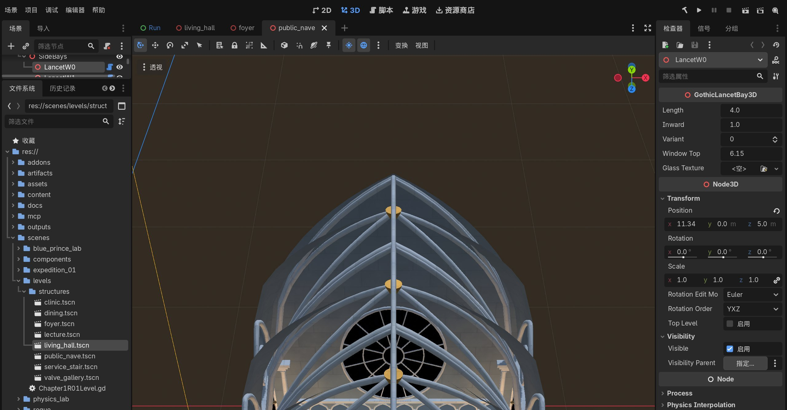

| 分组 | 构件（`scenes/components/hall/`） | 可调参数举例 |
|---|---|---|
| `Nave` | `GothicVault3D` 拱顶、`GothicPier3D` 束柱 ×12、`GothicLancetBay3D` 窗间、`GothicOpenArch3D` 侧廊拱、`GothicBlindArcade3D` 盲拱廊、`GothicGableWall3D` 山墙与玫瑰窗、`GothicOculus3D` 高侧圆窗 | 尺寸、开间数、朝向、彩窗贴图与分格、窗顶高度、门洞距墙端距离、玫瑰窗高度 |
| `Floor` | `NavePaving3D` 分格石带、`HallRug3D` 走道与地毯 | 尺寸、避让区、厚度、包边材质 |
| `FoucaultPendulum` | `FoucaultPendulum3D`（含地面刻度盘） | 悬挂高度、刻度盘格数、是否漂移、编辑器里预览摆动 |
| `Lighting` | `HallLantern3D` 吊灯、`HallFloorLamp3D` 落地灯、`HallLight3D` 光池 / 日光补光 / 常亮补光 | 亮度、范围、白天/夜晚亮度 |
| 各功能区 | `HallFurniture3D`（家具库配方或 GLB）、`HallCot3D`、`HallBox3D` | 配方、参数、材质预设、占地（自动生成碰撞并阻挡寻路） |
| `Anchors` | `LevelAnchor3D`：`spawn`、`cot`、`north_gate`、`lectern` | 位置（出生点、醒来床位、北门、值班书案） |

验证：`tools/test/hall_parity_test.gd` 把场景与原程序化大厅逐个比对，2259 个网格、1212 个碰撞体、28 盏灯、23 个占地全部一致（唯一差异是书架书脊颜色的循环顺序，原版依赖引擎运行时的节点编号）。改造前后实机对比：

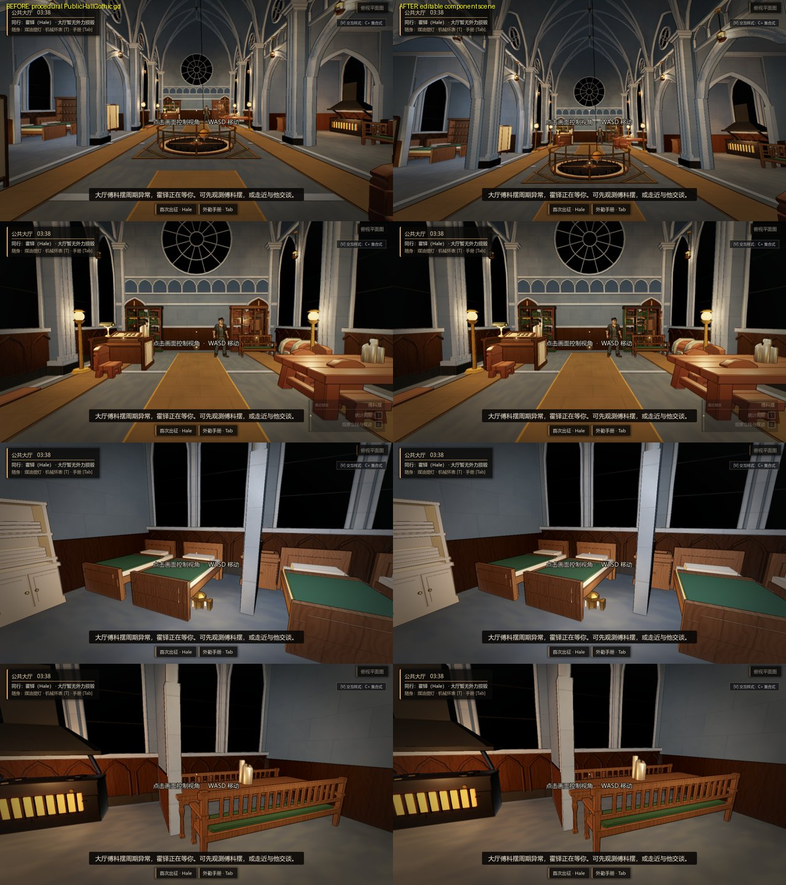

## 8. 在 Godot 编辑器里搭关卡：平面、3D 手柄、柱拱组合、触发器与动画

所有构件都继承 `StructurePiece3D`（`scenes/components/structure/`），3D 视口、Godot 自带的 **2D 标签**和检视器改的是同一组导出参数，保存即生效；每次拖动都是一步撤销。

### 三种编辑方式

| 方式 | 怎么用 | 说明 |
|---|---|---|
| 3D 视口 | 直接点构件（点到它生成的任何网格都会选中构件本身）；选中后出现橙色轮廓与手柄 | 墙/拱/楼梯/柱廊两端、地面顶点、门窗位置、柱半径、触发器/站位角点都能拖；手柄在水平面上移动，吸附结构网格和邻居的吸附点（按住 Alt 关闭）；用移动工具挪整个构件时，端点靠近邻居 0.2 m 内会自动贴上（`LevelStructure3D.editor_magnet`） |
| 2D 标签 | 打开含 `LevelStructure3D` 的场景后切到 2D：平面图直接画在 2D 视口上（1 m = 20 像素，X 向右、Z 向下）；左键选/拖/框选，滚轮缩放和中键平移沿用 Godot 自己的；在 2D 里点选会停留在 2D | 2D 工具栏多出「关卡平面」一组按钮：网格 0.05–1 m、吸附开关，工具：选择 V、墙 W（连续画）、地面 F（拖矩形）、门 D、窗 N（点在墙上）、柱 C、拱 A、柱廊 L、楼梯 S、触发器 T、站位 B、移动体 M、锚点 K；Del 删除、R / Shift+R 旋转 90°、Ctrl+D 复制、Ctrl+单击边加顶点或单击顶点/门窗删除、G 吸附开关、Esc 或右键结束画墙 |
| 检视器 | 选中后改参数 | 所有尺寸、剖面、材质键、动作列表都在这里 |

Godot 的 2D 编辑器本身只显示 2D 节点，关卡结构是 3D 节点，所以平面图由插件画上去（`addons/archbuilder/plan_view.gd`）。平面图上的显示与 3D 不同（例如门画成开启弧线、楼梯画踏步线、移动体用虚线画出打开后的位置），这是有意的：两边是同一份节点数据的两种视图。

### 新构件

| 构件 | 作用 | 主要参数 |
|---|---|---|
| `StructureColumn3D` 柱 | 柱础、柱身、柱头与碰撞；圆心是吸附点 | 样式（圆/方/八角/束柱）、半径、高度、柱础/柱头高度、材质键 |
| `StructureArch3D` 拱 | 两点之间的拱，可带门柱与拱肩填充 | 剖面（圆/尖/弧/平）、起拱高、矢高、拱圈厚、墙厚、门柱、填充到 |
| `Colonnade3D` 柱廊 | 一个节点生成一排柱子和拱 | 开间数、柱样式/半径/高、拱剖面/矢高比、拱圈、墙厚、填充 |
| `StructureAssembly3D` 结构组 | 把任意构件组合成一个，挑选成员属性暴露为自己的「参数/名字」 | 在「关卡结构」面板选成员与属性→暴露；同名参数一起驱动；「存为组件场景」保存到 `scenes/components/assemblies/` 并换成实例，各实例保留自己的参数值 |
| `SmartStair3D` 楼梯、`LevelStation3D` 站位 | 现在也是 `StructurePiece3D`，有平面手柄 | 起止点、宽度；占地尺寸 |
| `LevelTrigger3D` 触发器 | 区域进入/离开、按 E 交互、关卡开始时、由脚本触发 | 区域尺寸、触发对象组（默认 `player`）、只触发一次、动作列表；清单字段（条件、效果、`action_id`、台词 id） |
| `LevelMover3D` 移动体 | 把它下面的节点在静止姿态与打开姿态之间移动：闸门、升降台、旋转门 | 打开偏移/旋转、时长、缓动、单次或往返循环、自动播放；`preview` 滑条在编辑器里预览，保存时自动复位 |

### 触发器动作（检视器里 `actions` → 新建）

| 动作 | 做什么 |
|---|---|
| `SetPropertyAction` | 设置节点属性（支持 `position:y` 这类子属性；值写成 `1.5`、`true`、`Vector3(0, 2, 0)`） |
| `TweenPropertyAction` | 把属性在一段时间内动画到目标值（可相对、可等待完成） |
| `PlayAnimationAction` | 播放 AnimationPlayer 里的动画（用 Godot 自带的动画面板制作） |
| `MoverAction` | 打开 / 关闭 / 切换 / 播放一个移动体 |
| `CallMethodAction` | 调用节点方法 |
| `LevelEventAction` | 发 `action_id` 给关卡（`AcademyLevelBase._on_level_action`）、设置解锁标记、播放已声明的台词 |

动作按顺序执行，每个可设延迟。触发器会自动进入关卡清单（`AcademyLevelBase` 把结构里的 `LevelTrigger3D` 合并进 `triggers[]`，照常过 `AcademyLevelAudit` 和 F2 蓝图），结构根节点同时发出 `trigger_fired(trigger_id, action_id, ctx)`。

### 性能与点选的修复

| 问题 | 原因 | 修复 |
|---|---|---|
| 3D 视口里点物体没反应 | Godot 只给「属于当前场景」的节点建可点选的 gizmo；构件运行时生成的网格没有 owner | 插件把生成的网格过继给所属构件（`structure_adopt.gd`）：点网格即选中构件；场景树里不显示，也不会被保存 |
| 切换场景标签卡顿约 0.9 秒 | 场景离开树时，每个构件都重建一次邻居索引（154 个构件 × 5500 个节点） | 改为在下一次重建时统一处理，整个场景离开时什么都不做：0.9 s → 4 ms |
| 每次点选都卡一下 | 面板在每次选择变化时遍历整个结构生成统计 | 改为每帧最多刷新一次，只显示缓存的统计 |

验证：`tools/test/structure_editor_test.gd`（柱、拱、柱廊、结构组参数、楼梯/站位/门窗/地面顶点手柄、触发器动作链、移动体、清单审计、点选过继、退出耗时），以及下方实机截图。

实机截图（真实编辑器窗口，`--archbuilder-editor-capture`）：

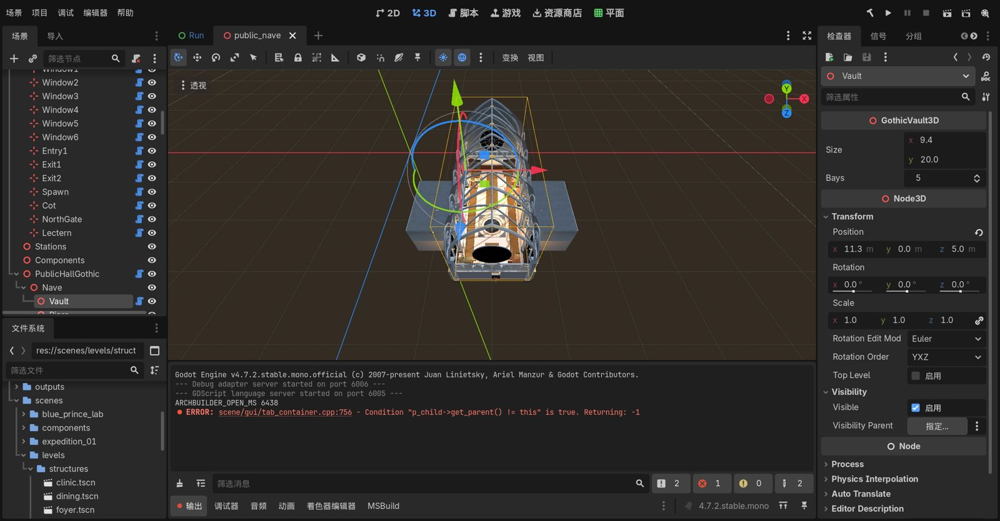

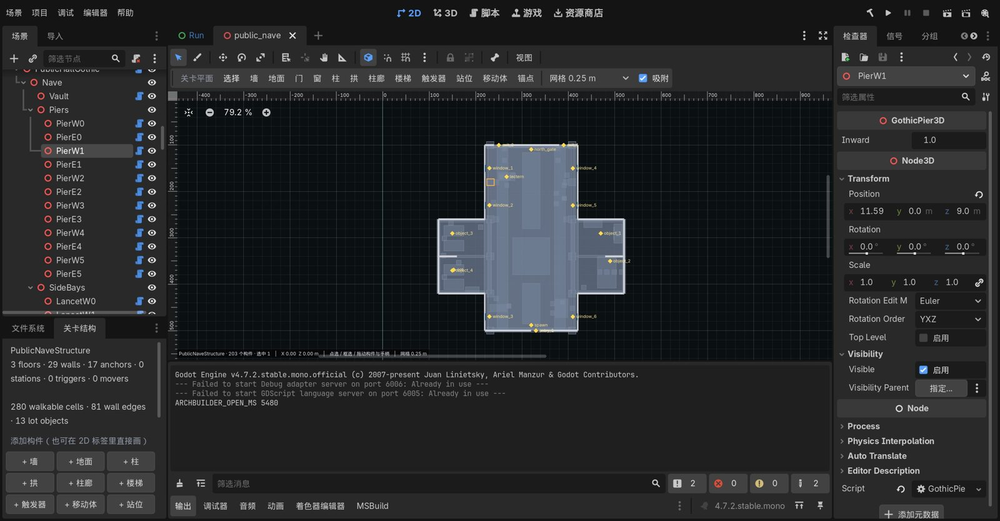

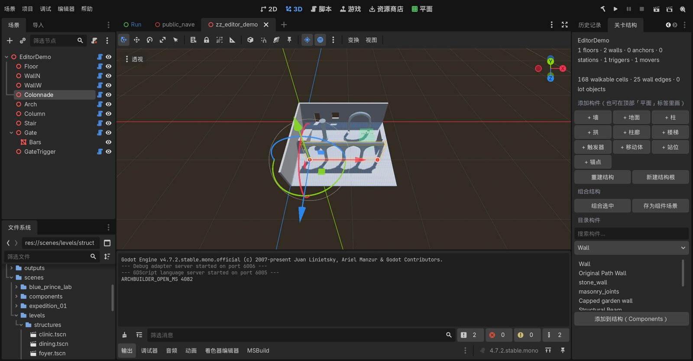

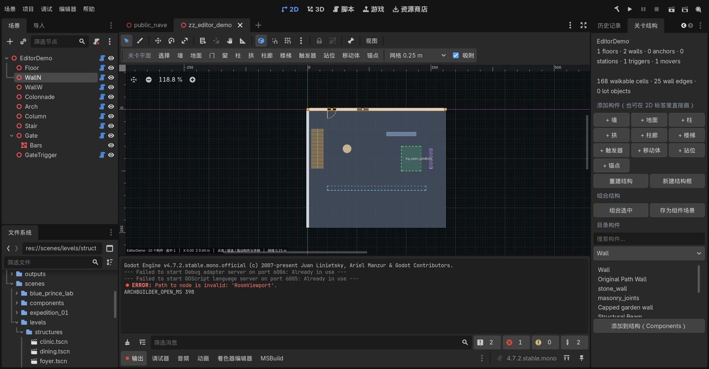
