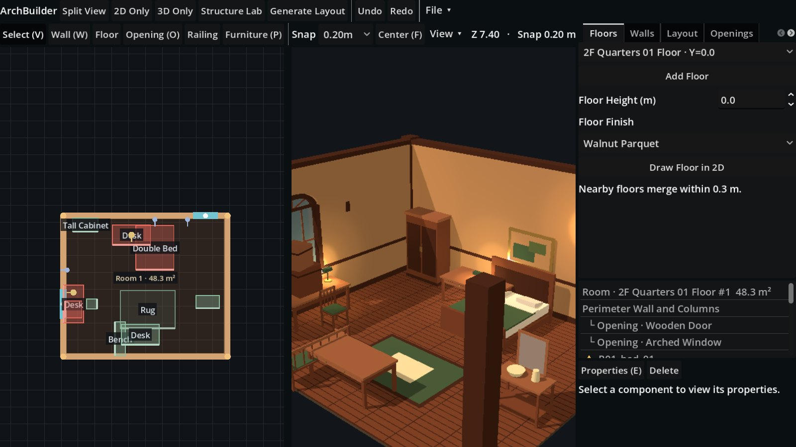
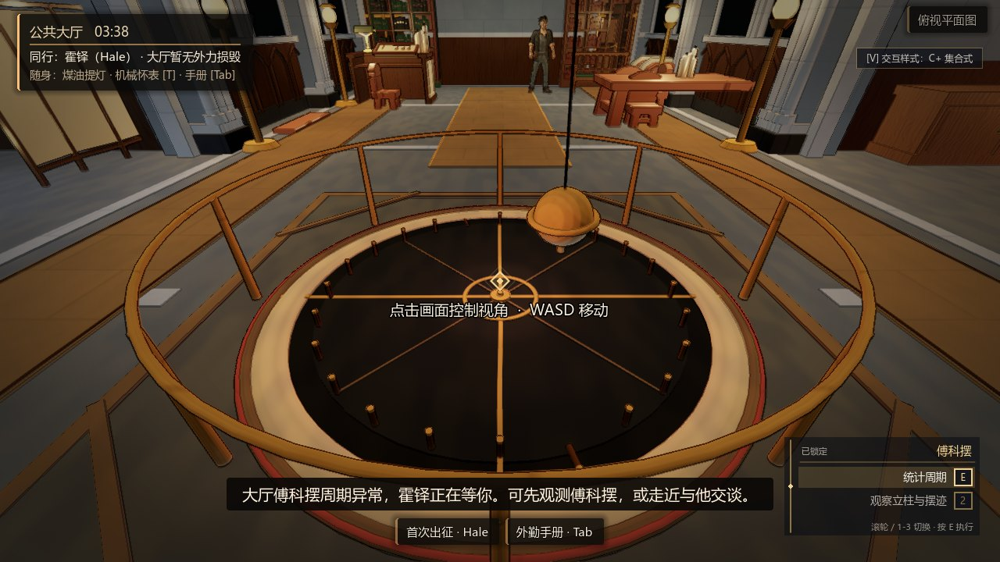
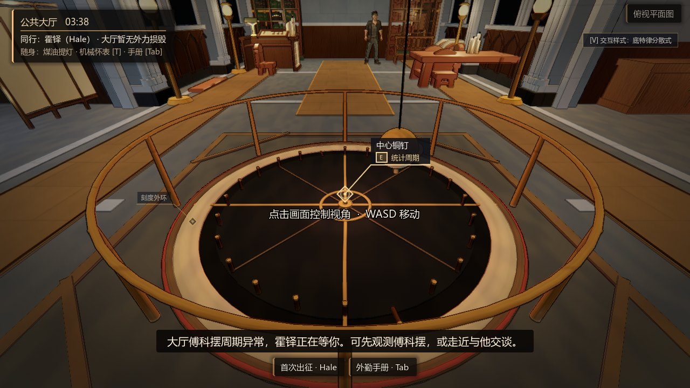

# 工具图解：关卡搭建、物品属性与关卡检视

本页截图都是实机窗口截的，可以重新生成：

```powershell
& .runtime/godot/4.7.2/Godot_v4.7.2-stable_mono_win64_console.exe --path . --rendering-method forward_plus --windowed --resolution 1600x900 -s res://tools/test/tool_tour_capture.gd
```

## 总览：一件物品从搭建到进游戏

| 步骤 | 工具 | 产出 |
|---|---|---|
| 1. 搭房间：墙、地面、门窗、楼梯、家具 | **ArchBuilder**（`BuildingSimulator.tscn`） | 建筑文档 JSON/YAML，可导出 Godot 场景 |
| 2. 摆物品并配置属性，包括可交互属性 | **组件库**（`ComponentLibrary.tscn`），从 ArchBuilder 的 Furniture 页进入 | 候选场景，物品上带 `Interactable` 节点 |
| 3. 写进关卡 | 关卡清单（`AcademyLevelBase`）的 `objects[]` / `interactables[]` | 运行时自动生成物品和交互点 |
| 4. 进游戏查看 | 关卡运行时（统一交互 UI）+ **F2 蓝图检视器** / `python tools/inspect_level.py` | 实机提示、设计清单、门禁结果 |

三个工具读的是同一份物品目录（`ComponentFactory.load_catalog()`）。物品只存数据，提示框由所在关卡的运行时统一绘制。

---

## 1. ArchBuilder：关卡搭建

打开 `res://tools/building_construction/BuildingSimulator.tscn`，按 F6 运行。



| 区域 | 位置 | 用法 |
|---|---|---|
| 顶栏 | 最上方 | `Split View / 2D Only / 3D Only` 切换视图；`Structure Lab` 打开结构实验室；`Generate Layout` 自动布局；`File ▾` 导入/保存 JSON、YAML，或导出 Godot 场景 |
| 工具栏 | 第二行 | `Select (V)` 选择、`Wall (W)` 画墙、`Floor` 画地面、`Opening (O)` 开门窗洞、`Railing` 栏杆、`Furniture (P)` 摆家具；`Snap` 设置吸附步长，`Center (F)` 居中 |
| 左侧 2D 平面 | 左半边 | 点击落节点；回车或点回起点闭合；拖动可移动；双击节点或按 E 编辑 |
| 中间 3D 预览 | 中间 | 和平面同步生成，可以直接看墙洞、采光和家具尺度 |
| 右侧标签页 | 右上 | Floors / Walls / Layout / Openings / Stairs / Furniture / Furnish / Rooms，分别设置楼层高度、材质、门窗、楼梯、家具和房型预设 |
| 大纲与属性 | 右下 | 列出房间、墙和开口；选中后点 `Properties (E)` 改参数，点 `Delete` 删除 |

常用快捷键：`Ctrl+Z` 撤销，`Delete` 删除，`F` 居中。

### Furniture 页：摆家具、进入组件库


- 上半部分是原有家具：下拉框选家具，填灯光强度、安装高度和坐标，然后点 `Preview Furniture at Coordinates` 预览，或点 `Place Original Furniture in 2D` 在平面上点击放置。
- 下半部分是 **Native Component Library**：列出共享目录里的全部组件。选中后点 `Place Component in 2D` 放到平面里，或点 **`Open Component Library`** 进入下面的物品属性工具。

---

## 2. 组件库：物品属性配置


| 区域 | 用法 |
|---|---|
| 左上 · 分类与物品列表 | 下拉框选分类（如 Props and Equipment），列表选物品后，在 3D 视图里点击支撑面放置。`R` 旋转，`F` 换端或换栏杆侧；右键拖动环绕，`Shift`+右键拖动平移，滚轮缩放 |
| 左中 · Undo / Redo / Delete | 撤销、重做、删除 |
| 左中 · 场景大纲 | 当前候选场景里的所有物品（如 RecipeTable / RecipeChest / RecipeBookshelf），点击即可选中 |
| 左下 | `Save Candidate` / `Open Candidate` 保存或打开候选场景；`Show All Components` 一次性生成全部组件，用来对比；`Save Screenshot` 截图 |
| 右侧 · 检视器 | 选中物品后显示：机关活动（No activity 等）、Position / Rotation、**Interaction**，以及物品自身的参数（尺寸、层数等） |

### Interaction 区：配置“这件物品能不能被选中、按 E 做什么”

上图选中的是木箱。它在目录里自带交互（`catalog.json` 的 `interaction` 块），所以检视器直接列出这些字段：

| 字段 | 含义 |
|---|---|
| `interactable_id` | 交互组 id，关卡里按它区分是哪件物品 |
| `title_zh / title_en` | 交互框标题（中文 / 英文） |
| `verb_zh / verb_en` | 动作名，如 翻找 / Search |
| `action_id` | 按 E 后发给关卡的动作 id，如 `search_container` |
| `dialogue_id` | 可选，触发时播放清单里的哪句台词 |
| `unlock_flag` | 可选，关卡设置这个旗标后才出现 |
| `enabled` | 是否启用 |
| `anchor_offset` | 提示锚点相对物品原点的偏移，例如抬到桌面高度 |
| `dist_selected / dist_activatable / dist_potential` | 三态距离：当前选择 / 可激活 / 潜在激活 |

文本字段改完按回车生效，数字和勾选框改了立即生效。改动会随 `Save Candidate` 一起保存。

### 让任意物品变成可交互


书架本身没有交互，Interaction 区只显示一个 **`Make selectable`** 按钮。点一下就会给它挂上交互节点，然后按上表填字段即可。不需要时点 `Remove interaction` 移除。

> 物品只保存数据。哪个关卡加载它，就由哪个关卡的 `AcademyLevelRuntime` 负责显示提示，并处理 `action_id`。

---

## 3. 物品进游戏后的样子

关卡清单里写的物品（`objects[]`，可带 `interaction: {from_catalog = true, action_id = ...}`）和交互点（`interactables[]`），都会生成 `AcademyInteractable` 节点。交互 UI 只读取这些节点发布的数据。

| C+ 集合式（右下角语境条） | 底特律分散式（物品上的菱形热点） |
|---|---|
|  |  |

同一份场景数据，按 **V** 键在两种样式之间切换。左边的木箱就是用 `from_catalog` 挂上交互的目录物品。走近、并且准星对准时，它会进入“当前选择”状态，按 **E** 执行；同一件物品有多个动作时，用滚轮或 `1-4` 切换。

公共大厅用的是同一套运行时：

| 大厅 · C+ | 大厅 · 底特律 |
|---|---|
|  |  |

---

## 4. 关卡检视

### F2 蓝图检视器（游戏内）

基于 `AcademyLevelBase` 的关卡在运行时按 **F2**，或在 Q 轮盘里选“开关设计检视”：


左侧面板依次列出：校验结果（认知防火墙 / 家具库 / AI 前摇）、能力开关、1. 场景物体、2. 可交互点（包括物品自带的交互）、3. 触发方式、4. 台词清单、5. AI 动作路线。场景里同时会画出队友 AI 路线、路径点和动作标签；橙色点表示“误踩规则前摇”。

### 单命令检视 + 统一架构门禁（命令行）

```powershell
python tools/inspect_level.py --scene r01
```

`--scene` 可选 `hall`、`r01`、`expedition`。输出依次是：当前关卡、运行管线、能力开关、**依赖唯一门禁**、**统一架构门禁**（有违规时逐条列出文件和行号）、门拓扑、物体、可交互候选（带三态）、AI 路线。加 `--json` 输出原始数据。

完整的分层规则见 [统一契约](../design/unified-level-ui-and-render-contract.md)。
