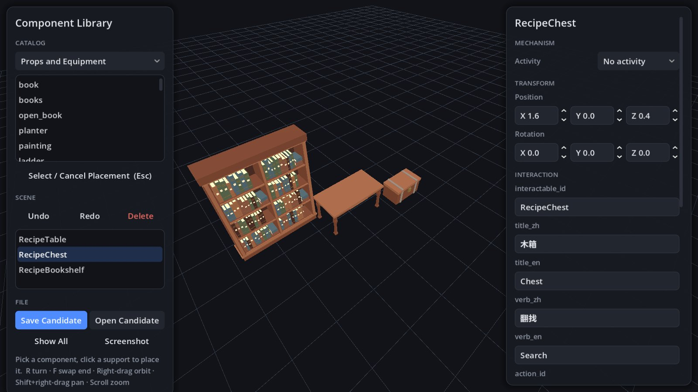

# 工具图解：关卡搭建、物品属性与关卡检视

本页截图都是实机窗口截的，可以重新生成：

```powershell
& .runtime/godot/4.7.2/Godot_v4.7.2-stable_mono_win64_console.exe --path . --rendering-method forward_plus --windowed --resolution 1600x900 -s res://tools/test/tool_tour_capture.gd
```

## 总览：一件物品从搭建到进游戏

| 步骤 | 工具 | 产出 |
|---|---|---|
| 1. 搭房间：墙、地面、门窗、楼梯、家具 | **ArchBuilder**（`BuildingSimulator.tscn`） | 建筑文档 JSON/YAML，可导出 Godot 场景 |
| 2. 摆物品并配置属性，包括可交互属性 | **组件库**（`ComponentLibrary.tscn`），从 ArchBuilder 的 Furniture 页进入 | 候选场景，物品上带 `Interactable` 节点 |
| 3. 写进关卡 | 关卡清单（`AcademyLevelBase`）的 `objects[]` / `interactables[]` | 运行时自动生成物品和交互点 |
| 4. 进游戏查看 | 关卡运行时（统一交互 UI）+ **F2 蓝图检视器** / `python tools/inspect_level.py` | 实机提示、设计清单、门禁结果 |

三个工具读的是同一份物品目录（`ComponentFactory.load_catalog()`）。物品只存数据，提示框由所在关卡的运行时统一绘制。

两个编辑工具共用一套现代简洁主题 `tools/building_construction/ToolTheme.gd`：深色平面、单一蓝色强调色、圆角控件。蓝色实心按钮是当前页面的主操作，红色文字按钮是删除类操作，灰色小号大写字是分组标题。

---

## 1. ArchBuilder：关卡搭建

打开 `res://tools/building_construction/BuildingSimulator.tscn`，按 F6 运行。


| 区域 | 位置 | 用法 |
|---|---|---|
| 顶栏 | 最上方 | `Split / 2D / 3D` 分段按钮切换视图；`Undo / Redo`；`File ▾` 导入/保存 JSON、YAML，或导出 Godot 场景；`View ▾` 线框、剖面、显隐。右侧 `Structure Lab` 打开结构实验室，蓝色 `Generate Layout` 自动布局 |
| 工具条 | 第二行 | 一组互斥的绘制工具，当前工具高亮为蓝色：`Select`(V)、`Wall`(W)、`Floor`、`Opening`(O)、`Railing`、`Furniture`(P)，快捷键见悬停提示；`Snap` 设置吸附步长，`Center`(F) 居中；最右侧实时显示光标坐标和所在房间 |
| 左侧 2D 平面 | 左半边 | 点击落节点；回车或点回起点闭合；拖动可移动；双击节点或按 E 编辑 |
| 中间 3D 预览 | 中间 | 和平面同步生成，可以直接看墙洞、采光和家具尺度 |
| 右侧页签 | 右上 | 8 个页签平铺成 2×4 按钮，一眼可见：Floors / Walls / Layout / Openings / Stairs / Furniture / Furnish / Rooms，分别设置楼层高度、材质、门窗、楼梯、家具和房型预设。每页的蓝色按钮就是这一页最常用的一步 |
| OUTLINE / PROPERTIES | 右下 | 大纲列出房间、墙和开口；选中后下方直接显示参数，点 `Properties (E)` 弹出大窗口编辑，红色 `Delete` 删除 |
| 状态栏 | 最底部 | 当前工具的操作提示、已放节点数，以及预览/应用的结果 |

常用快捷键：`Ctrl+Z` 撤销，`Delete` 删除，`F` 居中。

### Furniture 页：摆家具、进入组件库


- 上半部分是原有家具和灯具：`Fixture` 下拉框选家具，填灯光强度、安装高度和坐标，然后点 `Preview Furniture at Coordinates` 预览，或点 `Place Original Furniture in 2D` 在平面上点击放置。
- 下半部分是 **NATIVE COMPONENT LIBRARY**：列出共享目录里的全部组件，可用搜索框过滤。选中后点 `Place Component in 2D` 放到平面里，或点蓝色 **`Open Component Library`** 进入下面的物品属性工具。

---

## 2. 组件库：物品属性配置



| 区域 | 用法 |
|---|---|
| 左侧 · CATALOG | 下拉框选分类（如 Props and Equipment），列表选物品后，在 3D 视图里点击支撑面放置。`R` 旋转，`F` 换端或换栏杆侧；右键拖动环绕，`Shift`+右键拖动平移，滚轮缩放；`Esc` 取消放置 |
| 左侧 · SCENE | `Undo / Redo`，红色 `Delete`；下面是当前候选场景里的所有物品（如 RecipeTable / RecipeChest / RecipeBookshelf），点击即可选中 |
| 左侧 · FILE | 蓝色 `Save Candidate` 保存、`Open Candidate` 打开候选场景；`Show All` 一次性生成全部组件用来对比；`Screenshot` 截图 |
| 右侧 · 检视器 | 选中物品后按分组显示：MECHANISM（机关活动）、TRANSFORM（位置和旋转，每个向量一行 X/Y/Z）、**INTERACTION**、PARAMETERS（尺寸、层数等）。数值和开关是“左边名字、右边控件”的属性表 |

### Interaction 区：配置“这件物品能不能被选中、按 E 做什么”

上图选中的是木箱。它在目录里自带交互（`catalog.json` 的 `interaction` 块），所以检视器直接列出这些字段：

| 字段 | 含义 |
|---|---|
| `interactable_id` | 交互组 id，关卡里按它区分是哪件物品 |
| `title_zh / title_en` | 交互框标题（中文 / 英文） |
| `verb_zh / verb_en` | 动作名，如 翻找 / Search |
| `action_id` | 按 E 后发给关卡的动作 id，如 `search_container` |
| `dialogue_id` | 可选，触发时播放清单里的哪句台词 |
| `unlock_flag` | 可选，关卡设置这个旗标后才出现 |
| `enabled` | 是否启用 |
| `anchor_offset` | 提示锚点相对物品原点的偏移，例如抬到桌面高度 |
| `dist_selected / dist_activatable / dist_potential` | 三态距离：当前选择 / 可激活 / 潜在激活 |

文本字段改完按回车生效，数字和勾选框改了立即生效。改动会随 `Save Candidate` 一起保存。

### 让任意物品变成可交互


书架本身没有交互，INTERACTION 区显示“Not selectable in levels yet.”和一个蓝色 **`Make selectable`** 按钮。点一下就会给它挂上交互节点，然后按上表填字段即可。不需要时点红色 `Remove interaction` 移除。

> 物品只保存数据。哪个关卡加载它，就由哪个关卡的 `AcademyLevelRuntime` 负责显示提示，并处理 `action_id`。

---

## 3. 物品进游戏后的样子

关卡清单里写的物品（`objects[]`，可带 `interaction: {from_catalog = true, action_id = ...}`）和交互点（`interactables[]`），都会生成 `AcademyInteractable` 节点。交互 UI 只读取这些节点发布的数据。

| C+ 集合式（右下角语境条） | 底特律分散式（物品上的菱形热点） |
|---|---|
|  |  |

同一份场景数据，按 **V** 键在两种样式之间切换。左边的木箱就是用 `from_catalog` 挂上交互的目录物品。走近、并且准星对准时，它会进入“当前选择”状态，按 **E** 执行；同一件物品有多个动作时，用滚轮或 `1-4` 切换。

公共大厅用的是同一套运行时：

| 大厅 · C+ | 大厅 · 底特律 |
|---|---|
|  |  |

---

## 4. 关卡检视

### F2 蓝图检视器（游戏内）

基于 `AcademyLevelBase` 的关卡在运行时按 **F2**，或在 Q 轮盘里选“开关设计检视”：


左侧面板依次列出：校验结果（认知防火墙 / 家具库 / AI 前摇）、能力开关、1. 场景物体、2. 可交互点（包括物品自带的交互）、3. 触发方式、4. 台词清单、5. AI 动作路线。场景里同时会画出队友 AI 路线、路径点和动作标签；橙色点表示“误踩规则前摇”。

### 单命令检视 + 统一架构门禁（命令行）

```powershell
python tools/inspect_level.py --scene r01
```

`--scene` 可选 `hall`、`r01`、`expedition`。输出依次是：当前关卡、运行管线、能力开关、**依赖唯一门禁**、**统一架构门禁**（有违规时逐条列出文件和行号）、门拓扑、物体、可交互候选（带三态）、AI 路线。加 `--json` 输出原始数据。

完整的分层规则见 [统一契约](../design/unified-level-ui-and-render-contract.md)。

---

## 5. 工作原理

### ArchBuilder：一份建筑文档，两个视图

```text
 鼠标/键盘 ──► 工具（Wall/Floor/Opening…）
                  │ 只改草稿
                  ▼
   ArchitectState.fork_candidate() ──► 草稿 draft（data 的深拷贝）
                  │ 预览（门窗、布局、自动布置时弹确认框）
                  ▼
   accept_candidate(draft) ── 校验后替换 data，remember() 记一步撤销
                  │
       ┌──────────┴──────────┐
       ▼                     ▼
 ArchitectBlueprint     rebuild()：按条目生成 3D
 （2D 平面，直接画 data） Floor / Wall / Stair / Railing / 家具
```

| 环节 | 做什么 | 代码位置 |
|---|---|---|
| 唯一数据源 | 整栋建筑就是一份 JSON 字典 `state.data`：`layers`（楼层与地面多边形、房间面）、`walls`（节点 + 门窗开口）、`stairs`、`railings`、`props`。保存 JSON/YAML 就是把它原样写出 | `ArchitectState.gd` |
| 草稿再提交 | 每次编辑都先 `fork_candidate()` 复制出草稿，改草稿；`accept_candidate()` 确认草稿基于的还是当前版本后才替换。门窗、自动布局、自动布置这类大改动会先弹预览框，你选“应用”或“丢弃”，丢弃后原数据一字不变 | `edit_build()` / `preview_build()` / `close_build_preview()` |
| 撤销 | `remember()` 把整份数据序列化成文本压入历史（最多 40 步），`Ctrl+Z` 就是取回上一份文本 | `ArchitectState.remember()` / `undo()` |
| 房间识别 | 每次变更后 `sync_rooms()` 用墙线围合关系算出房间面和面积，平面图上的 “Room 1 · 48.3 m²” 就来自这里；自动布置和门窗连通检查都用它 | `RoomTopology.gd` |
| 2D 视图 | 平面图不存任何东西，每帧直接画 `data`：吸附、拖动节点时先改一份临时状态，松手才提交 | `ArchitectBlueprint.gd` |
| 3D 视图 | `rebuild()` 遍历数据，每个条目用自己的生成器建模；按条目内容算签名，只重建改动过的部分，所以拖动时不卡 | `rebuild()` / `sync_part()` |
| 家具 | 原有灯具走 `ArchitectProps`；目录组件走 `ComponentFactory.create_entry()`，和组件库、关卡用的是同一份目录 | `build_prop()` |

### 组件库：在真实 3D 场景里拼装物品

```text
 catalog.json ──► ComponentFactory.load_catalog()
       │  选中条目
       ▼
 create_entry()：实例化组件脚本 ─► 写入目录默认参数 ─► 有 interaction 块就挂 Interactable
       │  在 3D 视图点击
       ▼
 ComponentAssembly.place()：射线找到支撑面 → 吸附网格 → 按挂载规则（落地 / 贴墙 / 栏杆接楼梯 / 管道接口）对位
       │
       ▼
 BuilderCandidates 节点树 ──► 每次改动 pack 成 PackedScene 存进历史 ──► Save Candidate 写成 .tscn
```

| 环节 | 做什么 |
|---|---|
| 物品就是脚本 | 目录里每个条目指向一个 `Node3D` 组件脚本，模型由脚本参数程序化生成。改宽度、层数这类参数，脚本会立即重建网格 |
| 检视器自动生成 | 选中物品后，检视器读取脚本的导出变量（`@export`），按类型生成控件：数字→数值框，布尔→开关，枚举→下拉框，字符串/数组→文本框。新增一个 `@export` 变量就会自动出现在面板里，不用改工具 |
| 交互只是数据 | `Make selectable` 给物品加一个 `AcademyInteractable` 子节点，检视器编辑的也是它的导出变量。工具不画任何游戏内提示；进关卡后由 `AcademyLevelRuntime` 读取这些数据统一显示 |
| 机关联动 | `MECHANISM` 下拉框给物品挂 `MechanismSocket`，再选输出目标，例如按钮控制门 |
| 撤销与保存 | 每次改动都把整个候选节点树打包成 `PackedScene` 存进历史（最多 100 步）；`Save Candidate` 把同一个包写到 `candidates/BuildingCandidate.tscn`，交互节点会一起保存 |

### 两个工具的关系

| | ArchBuilder | 组件库 |
|---|---|---|
| 管什么 | 建筑壳体和布局：墙、地面、门窗、楼梯、家具摆放 | 单件物品的拼装和属性，包括可交互属性 |
| 数据形态 | JSON/YAML 文档，可导出 Godot 场景 | Godot 场景（`.tscn`） |
| 物品来源 | 同一份 `catalog.json` | 同一份 `catalog.json` |
| 进游戏 | 关卡清单引用房间与家具 | 物品上的 `Interactable` 由关卡运行时统一显示 |
