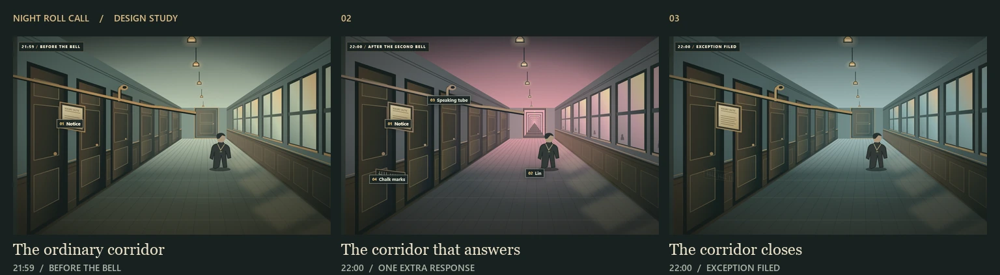

# 夜点名 · 调研与美术参考板

2026-11-18 核对。按「取什么 → 在本作怎么用」整理；外部图片与视频留在来源页面供研究。本原型的走廊、公告、台账、立体声铃与管道敲击均为原创实现。

## 典型范例 → 原型取舍

| 范例与来源 | 观察点 | 转译／取舍 |
| --- | --- | --- |
| Sandfall Interactive，[《33 号远征队》初次公开说明与预告](https://www.expedition33.com/post/news-expedition-33-announce) | 先交代卢明城每年的仪式、绘母写下年龄、远征队出发。 | 宣传入口用“今晚值班，点名多一声”；岛史和契约留待玩家已经投入集体生活时揭示。 |
| [《动物园规则怪谈》文本档案镜像](https://rule-wiki.wikidot.com/old%3Azoo)；[中国作家网刊载的文本研究](https://www.chinawriter.com.cn/n1/2023/0221/c404027-32627956.html) | 读公共告示、员工条款与手写字条之间的差异；看它们各自服务的对象。 | 公告固定值班程序，粉笔记录和人证可以核查；后续让学生、不同院系与代管者各有立场。 |
| KOTAKE CREATE，[《8 号出口》官方截图与规则](https://store.steampowered.com/app/2653790/The_Exit_8/) | 在重复的环境里，极清楚的行动指令让玩家调动自己的空间记忆。 | 同机位、同物件、可对比的尽端；保留熟悉的房间，选择权落在登记和对同学的责任。 |
| Night Signal Entertainment，[《Home Safety Hotline》官方截图与预告](https://store.steampowered.com/app/2357910/Home_Safety_Hotline/) | 以岗位职责组织阅读与推断，玩家要为判断结果负责。 | 把纸面文本做成可填写的值班簿；每条条目都联系到能再见到的同学或地点。 |
| Color Gray Games，[《The Case of the Golden Idol》官方截图](https://store.steampowered.com/app/1677770/The_Case_of_the_Golden_Idol/) | 观察场景，再结构化表达事件的解释。 | 两种证据交叉核查；正篇沿现有案卷和复演来表达结论，减少让玩家猜系统预设词句。 |
| Lovecraft，[《Supernatural Horror in Literature》原文](https://www.hplovecraft.com/writings/texts/essays/shil.aspx)；PeppersGhost，[《Taboo / SCP-4000》原文](https://scp-wiki.wikidot.com/taboo) | 未知在日常秩序边缘产生压力；叙述的命名方式也能成为规则的一部分。 | 把已知范围和责任写清；“记到一声”和“认定一个人存在”可以触发不同后果。 |
| Montraluz，[《Dreamcore》官方截图／预告](https://store.steampowered.com/app/2453060/Dreamcore/) | 看 Dreampools 的开口、重复单元、色温层次；关闭颜色想象后，建筑关系仍能成立。 | 远门重复与褪色侧窗；把视觉记忆寄托在本作的木门、窗格、搪瓷、煤气灯上。 |
| Tensori，[《POOLS》官方截图与预告](https://store.steampowered.com/app/2663530/POOLS/) | 观察空间声、脚步和建筑本身怎样维持注意力。 | 双敲两次，返回声部变远、偏到另一侧；同场保留文字与现场痕迹辅助。 |
| 赤烛游戏，[《返校》官方截图与预告](https://store.steampowered.com/app/555220/Detention/) | 看校园地理、当地时代物件怎样给怪谈提供特定地点与历史。 | 做架空学园自己的名牌和通知格式，保留各院真实日常；让熟悉感来自具体生活细节。 |
| [《Lost in Liminal Space》刊载论文](https://scholarworks.iu.edu/journals/index.php/cl/article/download/41598/43424/121004)检索相关案例 | 原始图像、网络帖与衍生作品会建立不同的空间体验；阈限空间可在空场时成立。 | 试做有人的近景与下班后的空镜；保留同一件刚被使用过的东西，测试哪张更像凌晨学园。 |

## 建筑、道具、色彩取样

| 可看素材 | 建模或绘制时观察 | 使用标记 |
| --- | --- | --- |
| [Beehive School 一层走廊，HABS OH-689](https://commons.wikimedia.org/wiki/File:FIRST_FLOOR,_FRONT_HALLWAY_LOOKING_EAST_-_Beehive_School,_4345_Lee_Road,_Cleveland,_Cuyahoga_County,_OH_HABS_OHIO,18-CLEV,36-9.tif)；[国会图书馆馆藏](https://www.loc.gov/pictures/item/oh0462.photos.126060p) | 看走廊消失点、护墙、门框的节拍；做为值前照片的构图参考。 | 素材页标记美国公有领域。保留 HABS／Library of Congress 馆藏标识。 |
| [English Avenue School 历史测绘，HABS GA-298](https://www.loc.gov/resource/hhh.ga1183.sheet/?st=list) | 看二层平面、剖面、室内立面；校准门高、窗高、水平饰条和楼梯与走廊之间的比例。 | 馆藏的复制与权限逐图看条目；本轮只作结构参考。 |
| [香港圣类斯中学七楼廊道，Szeluemens](https://commons.wikimedia.org/wiki/File:HK_SYP_聖類斯中學_St_Louis_School_open_day_Nov_2017_IX1_7th_floor_corridor_interior_n_visitors_04.jpg) | 看栏杆、窗与廊道出现的位置和现代使用痕迹；用于给旧学园的日常构图找同类例子。 | CC BY-SA 4.0；本轮只作观察参考。 |
| [史密森尼美国历史博物馆：Speaking Tube](https://americanhistory.si.edu/collections/object/nmah_853894)；[Royal Museums Greenwich：Speaking Trumpet](https://www.rmg.co.uk/collections/objects/rmgc-object-69076) | 看扩口、管身、口缘，画出能接触与敲击的区分面。 | 馆藏图像按各站条款，本轮只作形态参考。 |
| [塔科马市历史保护材料，Image #20](https://cms.tacoma.gov/cedd/TacomaCulture/Historic/2012/documents/LPC_Packet_031412.pdf) | 观察传声口的螺丝底板、喇叭、拔片，及其和门框的比例。建模可用这些真实结构，比把管子画得更花有效。 | 现场细节参考。 |
| 仓库内的旧学园美术原稿、现有二楼 `2F-cross-M` | 沿用本作已有的黄铜／木／煤气灯体系、人物服装剪影和空间尺度。 | 项目基线；MCP 定点观察 `c3fca4914f3bd8c2 / step-0001`。 |

### 原型直接产出的美术试样

- **例行样张**：走廊正视透视、橡木护墙与旧铜管；保持浅绿窗光，终点是一扇普通门。用于建立玩家记得住的轴线。
- **回声样张**：同样的门、灯、窗和同学位置；终点洞口里出现重复门框，玻璃中出现多余的影子。灰玫瑰和洗淡的紫提供回忆质感。
- **联署样张**：把建筑收回正常长度，留下冷下来的夜色。让人读到“今晚把一件事处置了，学园还在继续运转”。
- **道具与声音样张**：纸告示与台账、墙上粉笔、喇叭形管口；双铃和同节拍异向回声为实时合成，原型无需外部请求。

试玩直接打开 [index.html](index.html)。规则回归：在仓库根目录运行 `node --test docs/prototypes/night-rollcall/study.test.cjs`。
