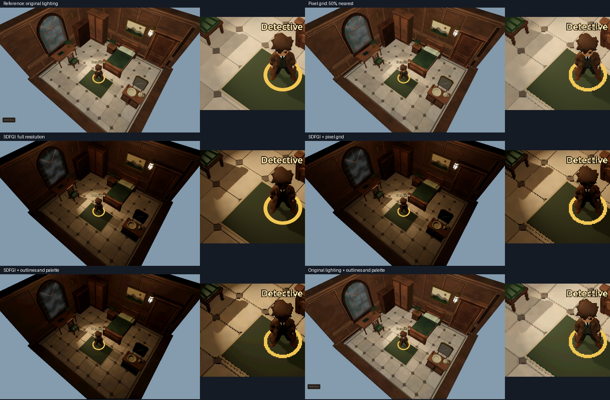
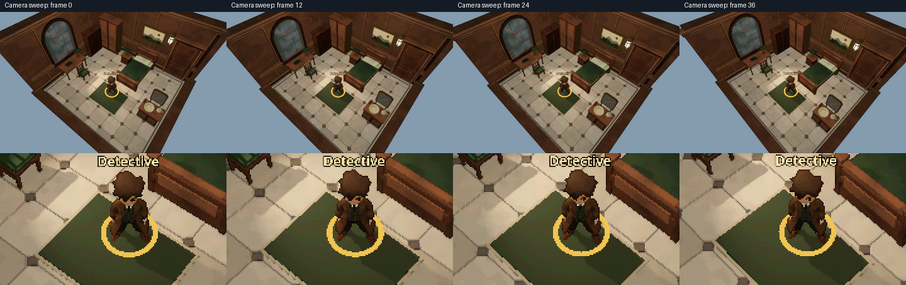

# R05：低模像素渲染与间接光路线验证

2026-11-18 · 开发定点验证 · Windows / Godot 4.7.2 .NET / Forward+ Vulkan / RTX 3070

## 选型

保留官方 Godot 和现有建筑光照。正式接入优先评估 **原照明 + 50% 内部 3D 分辨率 + 最近邻 + 可调轮廓和量化**；SDFGI 作为按房间调试的可选项。硬件光追留作独立研发：本机 `RenderingDevice` 报告 `SUPPORTS_RAYTRACING_PIPELINE=true`，当前实验执行的是栅格、SDFGI 和像素着色器，未创建光追管线或发射硬件光线。

现有房间 `SubViewport` 仍为 1440×900；3D 内部为 720×450。像素档关闭 MSAA/TAA，当前透视相机与输入坐标空间沿用原项目。透明深度/法线描边在 3D 内部执行，透明名牌随后绘制；最近邻还原网格，LDR Canvas 材质按原格子量化并施加轻 Bayer 抖动，独立的 2D HUD 在其外部。原型的 Bayer 格按本次 2×比例设计，正式接入时需覆盖非整倍尺寸。`Label3D` 仍随 3D 采样，玩家关键文字与证物提示宜使用分辨率独立的 UI。

SDFGI 配置为 4 层 cascades、最小单元 0.25 m、开启遮蔽、关闭天空注入；现有窗、灯、材质与色调映射维持原样。静态建筑适合单独验证 SDFGI，角色和动态道具的遮挡与发光仍需按项目约束处理。低分辨率减少了 3D 屏幕采样；SDFGI 的空间数据仍占 GPU 资源。

## 实机结果

R05 复用正式房间、家具、灯、角色与主相机；固定晴天 08:00。原照明的像素样式保留了桌面、地砖亮部与家具分离度。深度/法线轮廓主要体现在人物外缘、窗框和地砖接缝，Bayer 纹理在地毯和渐变区可见。SDFGI 增强了床、柜的明暗分区，同时显著压暗桌边、衣柜和墙角。固定取样区 `(360,400)–(820,650)` 的 8-bit 灰度均值由 114.75 降为 59.34（全分辨率、只切换 SDFGI）；这是截图亮度对照，未将差值归因于特定反射路径。

| 档位 | 稳态窗口 / 样本 | 帧时间 P95 | 引擎报告 GPU 资源中位数 |
| --- | ---: | ---: | ---: |
| 原画 | 6–12 s / 360 | 17.14 ms | 379 MB |
| 仅像素网格 | 27–33 s / 361 | 17.34 ms | 229 MB |
| 仅 SDFGI | 41–46 s / 300 | 17.22 ms | 779 MB |
| SDFGI + 像素网格 | 51–56 s / 300 | 17.23 ms | 612 MB |
| SDFGI + 像素风格 | 46–51 s / 300 | 17.21 ms | 616 MB |
| 原光照 + 像素风格 | 16–20 s / 240 | 17.28 ms | 229 MB |

表格来自 60 FPS 限帧下 `frames.csv` 的短稳态区间，计时从各会话监控启动开始。切档和冷启动不在该表；这组数据用于确认样机能运行和观察资源差异，性能余量与跨房帧尖峰另测。GPU 资源为引擎统计值。照片中左下的 `WASD Move` 属于独立 2D 提示，按游戏原有时序淡出；在开启像素着色时仍捕获到了可读的提示。

原光照像素档以既有透视相机扫过 0.16 rad（约 9.2°），记录第 0/12/24/36 帧。名牌完整，窗框和床沿的阶梯随格子跳变；本轮保留相机原逻辑，没有世界网格相机吸附。暂停的照明夹具中 `move_right` 未移动角色；扫镜是本轮动态证据，不计为导航验证。接入正式游戏前，优先在 B-P 厨房补测小证物可读性、点击投射、透明材质和角色跟镜，再在跨房切换中测 GPU 帧时。只有逐房照明与预算合格才推荐开启 SDFGI。

## 复现与资料

- 游戏 MCP：`focus_open(scope="design", target="lighting", tester="…")`。`focus_step` 的 `diagnostic` 使用 `next_case`/`previous_case` 循环六档，`reload` 回参考档，`render_camera_sweep` 做 1.2 秒往返扫镜。正式启动与其他测试入口不启用这些模式。
- 原始 MCP 帧：`0b644e447b62b6b2` 的 `step-0001`–`0004` 为前四档；`79cf89ae0ff07e86` 的 `step-0002` / `0003` 为最终无 GI / 有 GI 风格档；`cc2d611a6790dc03` 的 `step-0002` 是扫镜，`step-0003` 是回参考档。原图与收据由本机 MCP 保留；上图是便于对照的派生图。验证使用当时工作目录里的现有建筑资产，含其在测改动；未发布正式分段判项。
- 外部参考：[Godot SDFGI 文档](https://docs.godotengine.org/en/stable/tutorials/3d/global_illumination/using_sdfgi.html)、[Fahien 光追管线示例仓库](https://github.com/Fahien/godot-raytracing-gdscript-demo)、[NVIDIA 实验引擎分支](https://github.com/NVIDIA-RTX/godot/tree/nvidia-pt-dlss)。原型使用官方引擎 API 与本仓库自写着色器，未引入外部代码或库。
