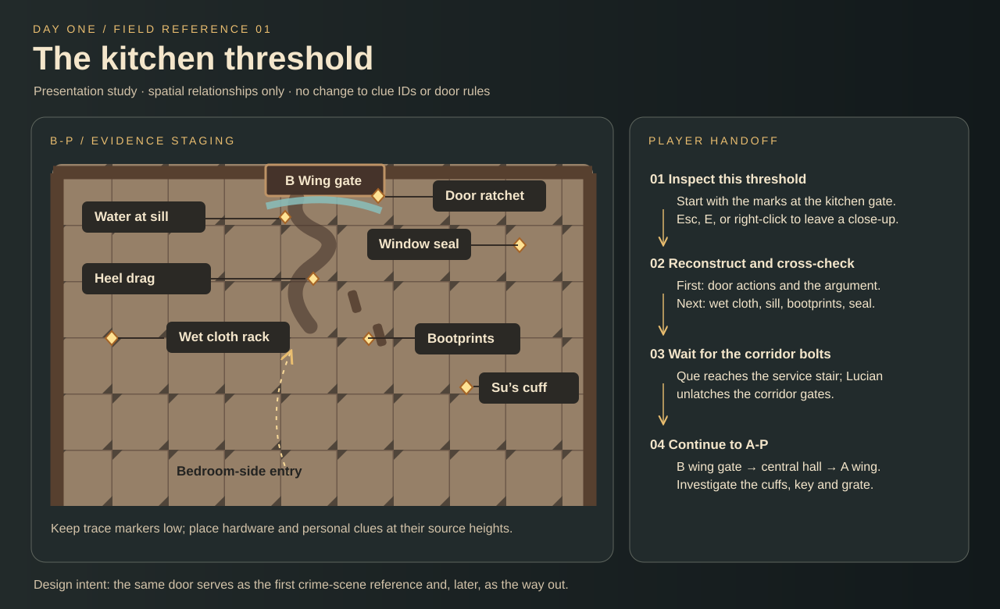

# 开场、乙区厨房与大门：定点复测

- 开场实机 R05：仰卧呼吸 → 撑坐 → 环顾 → 低头看手背抓痕 → 挪到床边落脚 → 前倾起身 → 交还移动控制。证据：`2eb7bcffad915119`，`step-0002/0003/0015/0017`。
- 近景可用 Esc、E、鼠标右键或原返回键退出。Esc 提前退出拖痕仍为 0/7（`da558dc7ab939963`，`step-0002/0003`）；采完按 E 回到房间为 1/7（`718361f1a0cccfa1`，`step-0004`，动作前及第 8、25、45 帧）。右键由无画面回归覆盖。
- 厨房由门槛引导查看拖痕、水迹和靴印，其他标记贴近对应道具。首题复演：苏泠向外推门，侦探抓腕拉回，沈鼎屈膝塞湿布，霍铎抬手反扣棘轮。分帧见 `a8b3ceb7e6cc67e7`，`step-0003/0005/0006/0007`；最后一段仍可改善手和锁的接触可读性。复演夹具预置首题证物，用于验证播放及画面。
- 原设计顺序：R05 → 走廊 → 乙区厨房（08:00 `ded_drag`、08:10 `c_door`、08:35 `ded_cloth`、08:45 `c_wetcloth`）→ 09:15 `d1_route`（雀儿走勤务暗井脱困，卢西安拨开门闩，侦探可从乙区大门经中翼去甲区）→ 09:40 甲区 `ded_cuffs`。楼梯节点夹具已验证新英文指引（`4dc42de3e2c3a2a3`）。

证物无画面回归 67 项通过；MCP Python 58 项通过。旧 `first_four_questions_flow.gd` 进入厨房后停在 `d1_wake`，尚未触发首题；厨房经中翼到甲区的连续游玩待验收。实时证据见 `artifacts/review/focused.html`。
