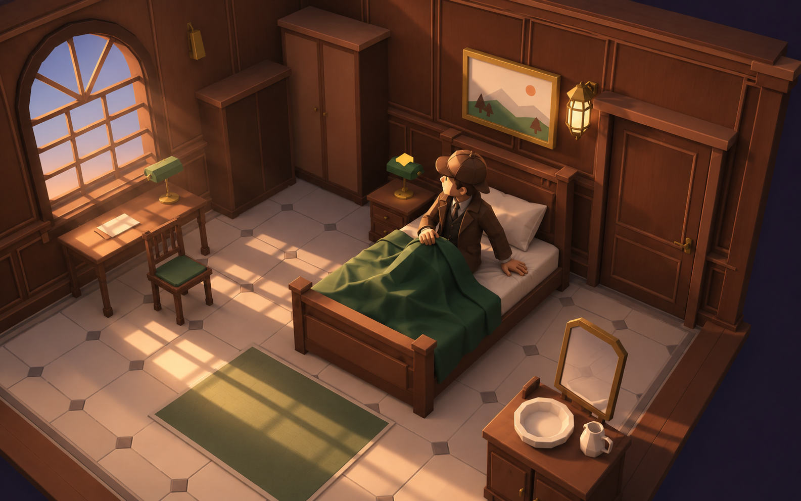
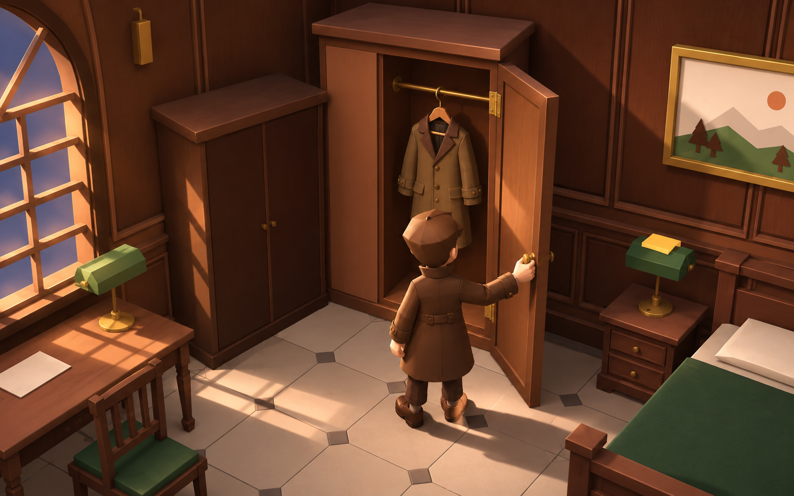
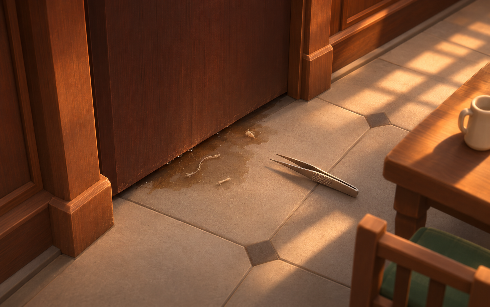
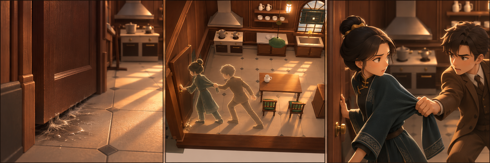
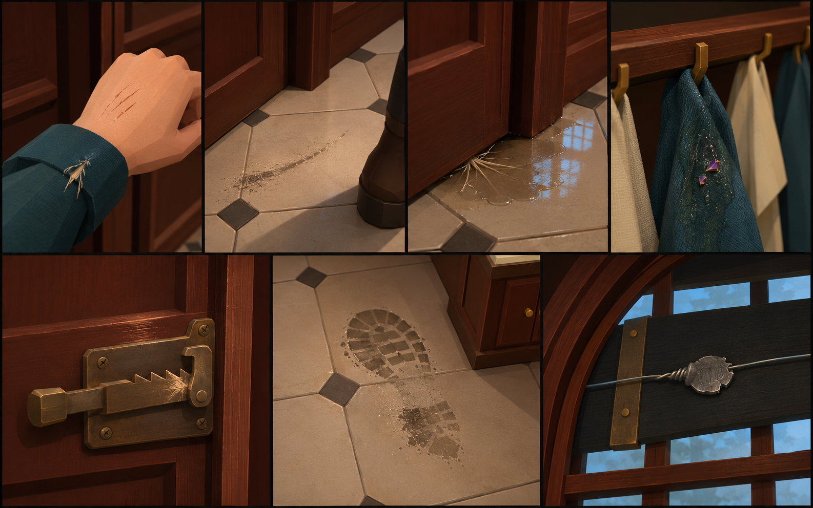

# 第一章视觉参考索引

生成时间：2026-11-16。下列四张由项目内既有参考图输入，使用授权 CLI 的 `edit` 和模型 `gpt-image-2.6-sunburst` 生成。输入已是生成参考，不是实时截图；图片用于镜头构图与动作讨论。模型生成的几何、人物比例与原场景会有偏差，验收需另行比较同版本真实截图。尚无评分。

## 卧室醒来

输入：[R05-morning-v1.png](R05-morning-v1.png)。构图：原房间三分之二侧俯视；床、肩、支撑手与床垫接触完整入画；晨光从窗框进入。
SHA-256：`24bb0bc6f8786d0b8b00a5deb03944ef4b72dc15de1ab1f78ff39f00ed73e62d`

生成提示词：Use case: stylized-concept. Asset: first chapter original bedroom waking sequence target, 3D game. Preserve the input room architecture, furniture, bed and wood-paneled miniature low-poly game aesthetic. Camera gently approaches the original bed at three-quarter angle: detective sits up in bed, one hand supporting torso against mattress and head turns toward window. Keep body, hands, bedding and mattress contact legible; no body intersections. Quiet early morning; directional sunlight only through existing window, believable soft shadows. A cinematic still from the original room. No text, labels, UI, glowing markers, blank white backgrounds, extra figures.

## 卧室衣柜

输入：[R05-morning-v1.png](R05-morning-v1.png)。构图：镜头保留门扇、铰链、柜内大衣及角色位置；图中增加的柜体仅是模型生成变化。
SHA-256：`c4cefcca64b4cea7229b4a286d7ca7f49797c2ac2701d6c3151df5fc84b3b101`

生成提示词：Use case: stylized-concept. Asset: first chapter original bedroom wardrobe interaction target for an existing stylized low-poly 3D game. Preserve input bedroom architecture, wood surfaces and morning light. Move the in-room camera closer to the original wardrobe, framing its doorway and floor context, as the wood hinged door swings open naturally from the original hinge. Reveal a neatly hung coat inside. Warm directional sunlight enters only through the window. Show clear physical contact and unobstructed frame. No text, UI, glowing icons, blank white background, extra room or compositing.

## 厨房水渍纤维

输入：[kitchen-morning-v1.png](kitchen-morning-v1.png)。构图：原门底、门框、地砖与水渍一同入画；约45°俯视，纤维与镊子清晰。
SHA-256：`0fcf22b9a7a373001dc8db5690f10ffbf1b9dcb31ce02bdfb07a8129ed24ddc9`

生成提示词：Use case: stylized-concept. Asset: first chapter investigation visual target for the existing game. Preserve the input image room materials, low-poly miniature art direction and soft morning lighting. Compose an in-room closeup looking down 45 degrees at the base of the wooden kitchen door: a small realistic wet stain and a few beige linen fibers are clearly visible on the existing stone tile and under the actual door leaf, with a discreet pair of tweezers. Keep the spatial connection among door frame, stain and floor visible. Warm light enters through the existing window; cinematic and legible, natural shadows. No text, labels, UI, glowing orbs, disconnected walls, or blank white frame.

## 推演三阶段

输入：[kitchen-morning-v1.png](kitchen-morning-v1.png)。构图：左侧证物与门锚定；中间分离虚影动作；右侧手、袖与受力方向。右侧人物比例更偏插画，仅用于动作构图。
SHA-256：`eab76875c9d2f9fd9faa388e06fd0c52ea1770ca618d92f9091cf2d4b27008fa`

生成提示词：Use case: stylized-concept, visual reference for an original-room 3D detective game reconstruction. Preserve the miniature kitchen, existing characters, their outfits and morning light. Create a single wide 3-panel storyboard, left-to-right: 1 camera anchors on wet fibers by the bottom of the existing kitchen door, 2 translucent separated character silhouettes physically reenact the door movement, 3 a close view of a hand gripping a sleeve clearly shows the force direction while their faces carry restrained alarm. Keep each panel in the original kitchen with architecture readable. Keep body contact clear, avoid overlapping silhouettes and extra characters. Muted warm wood, restrained ghost translucency. No words, captions, UI, arrows or diagrams.

## 已有相关参考

- [卧室晨光](R05-morning-v1.png)、[走廊晨光](corridor-morning-v1.png)、[厨房晨光](kitchen-morning-v1.png)。
- [标题](../title_correct_root.png)、[书本界面](../book_correct_root.png)、[表情](../expressions_correct_root.png)、[时段与雾](../lighting_workbench_correct_root.png)、[建筑构件](../building_workbench_correct_root.png)。
- 推演三阶段图是构图草图，需针对实际版本分别采集三阶段画面并量化比较。

## Astra 本轮视觉复核（2026-11-16）

本轮逐张打开上述四张成图，并查看当前工程的厨房全景与湿布实机截图。以下记录描述图面内容与后续制作取舍，未进行实机通过评分。

| 文件 | 已看到的有效构图 | 制作时需要处理的具体差异 |
| --- | --- | --- |
| bedroom-wake-v1.png | 床沿、床垫、右手支撑与坐起姿势清楚；窗光投影方向统一。 | 侦探穿完整外套坐在被中；应按剧情核对起床服装。人物和材质细度高于本轮提供的厨房实机。 |
| bedroom-wardrobe-macro-v1.png | 柜内大衣、门铰链、开门手和地面站位同时可见。 | 柜门打开后的净空、柜体位置需根据卧室实机确定；本轮只有厨房实机可供空间比较。 |
| kitchen-water-macro-v1.png | 门底湿区、麻纤维、门框和地砖形成连续空间；斜射光可读出纤维。 | 地砖与木材细度较高，镊子为生成图新增物；实机可优先采用纤维数量、湿区边缘与相机角度。 |
| reconstruction-three-stages-v1.png | 左格锚定门底；中格两个人物动作分离；右格抓袖接触与布料拉伸清楚。 | 右格人物明显偏动漫插画，和实机角色外观不一致；中格更适合用来讨论站位与接触顺序。 |

本轮实机全景来源：`.runtime/input-client/5de15828c9fe9339/000001-0.png`。图中后墙由左至右为炉灶、杯架、拱窗与水槽，桌面位于中部，原门与布架在左侧。湿布微距来源：同目录 `000002-0.png`；前景角色头部覆盖布面中心偏右，目标微痕尚未获得清晰画面。新的七格参考以这两张实机截图为输入。

## 厨房七件证物原场景微距参考（Astra）

成图：[kitchen-seven-evidence-grid-v1.png](kitchen-seven-evidence-grid-v1.png)，1586 × 992 像素。完整最终提示词：[kitchen-seven-evidence-grid-v1.prompt.txt](kitchen-seven-evidence-grid-v1.prompt.txt)。

七格按上排四格、下排三格排列。依次为袖口裂口与手背抓痕、鞋跟拖拽痕、门底湿麻纤维、挂钩湿布紫金结晶、门上反扣棘轮、靴印、窗上铅封。全部采用原房间的木板、门、地砖、布架或拱窗作为定位背景。暖色室内照明与冷色窗光并存。

图面复核：七格数量正确，均无文字标签；前景没有角色头部遮挡。第一格把裂口和抓痕放在同一个连续手腕视角；第二格的细弧拖痕与第六格完整靴底印可直接区分；第三格保留门底、门框与湿区；第四格放大布料纤维和紫金晶粒，挂钩与邻近布料仍可见；第五格可读出齿、棘爪与磨痕；第七格保留拱形木框、封窗板、细线和铅封。布架在生成图中变成明确挂钩式结构，门锁与铅封细节也是按证物描述补出的目标形态；其尺寸、固定点与机械朝向需在实机中逐项对齐。整体材质比原截图更细腻，实施时可优先采用微痕形状和构图比例。

生成方式：授权 fallback CLI，直接调用 `C:/Users/iii/.codex/skills/.system/imagegen/scripts/image_gen.py edit`，`py -3.10`，图像模型 `gpt-image-2.6-sunburst`，`--quality high --size auto --no-augment`，两张实机截图按全景、湿布微距顺序输入。提供方配置在进程内读取，未写入产物。首次指定 `3072x2048` 被现有 CLI 的模型尺寸校验拒绝，调整为 `auto` 后一次 API 调用成功，耗时 41.3 秒。输出为原始返回 PNG，未做放大或图像拼接。

来源与 SHA-256：

- 全景实机：`.runtime/input-client/5de15828c9fe9339/000001-0.png`；`6dc0b5499f4da76a75db0625d1b9316b7af0e673ca98d3d10903bc43e999cd06`。
- 湿布实机：`.runtime/input-client/5de15828c9fe9339/000002-0.png`；`50dbbc8d0065f3f70878e5dc8a6f1002d6e775269c3ed33e7e300077027e2c65`。
- 七格成图：`ff10412e382a39a0ecdbf3ed79779bc4257586aaf92c4854bd13fce689548532`。

本轮新增七格图片与提示词，并补充此索引。图片用于目标参考，实机镜头、交互、证物实现与通过评分由对应真实画面和测试记录确认。
