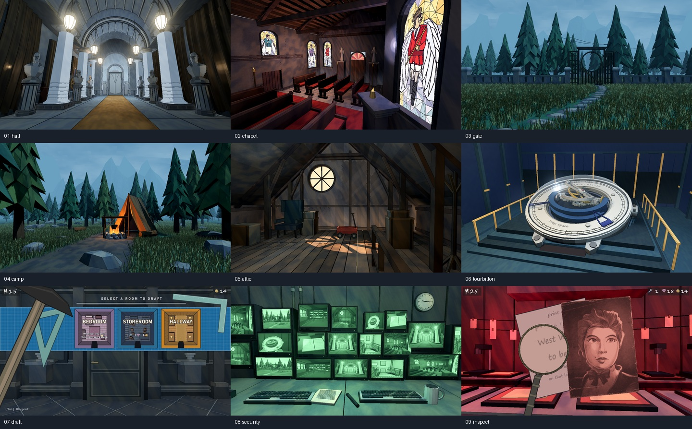

# Grand Stair Hall — architectural reference lab

An optional architectural reconstruction of the *Blue Prince* Grand Hall entrance image: a centered view down a cool blue-gray barrel vault, tapered circular columns and stepped arch ribs, pools of warm light, a muted gold runner, and a door at the far end. The stair, mechanical bay, academy crest and terraced three-axis exhibit belong to this prototype. Reference: [official game gallery](https://store.steampowered.com/app/1569580/Blue_Prince/) and [Grand Hall frame](https://shared.akamai.steamstatic.com/store_item_assets/steam/apps/1569580/ss_7f4511e2454604568f545436f36674451fed6353.600x338.jpg). Game assets are generated in the project.

## Open the hall

From the repository root:

```powershell
& .runtime/godot/4.7.2/Godot_v4.7.2-stable_mono_win64.exe --path . -- --architecture-lab
```

- `1` entrance, `2` cabinet and gears, `3` landing, `4` banner and lamp, `5` Meridian, `6` optional A26 print exhibit, `7` Service Stairs, `8` Stair Anomaly, `9` Archive, `0` Ledger. Click a mechanism to operate it, or click the open ledger on the archive desk to read it.
- `F` to walk the Grand Stair Hall at eye level; WASD, mouse look, `E` to use an object within reach. `Esc` returns to the entrance view. The seeded expedition and its existing camera remain the default when the lab flag is absent.
- `G` turns the shared draft on or off. `H` toggles the HUD. `Toon`, `Ink`, `Glow`, and `SDFGI` toggle independent layers at the same camera and scene state. `--lab-gi` chooses SDFGI on launch.

| Assembly | Physics / runtime source |
| --- | --- |
| Vault and walls | `HallShell.gd`: stone sections, rib wedges, smooth radial column profiles, curved full-height drapery, real window apertures and wall/floor collision. `HallFinish.gdshader` generates stone and woven runner detail. Exterior directional light enters through the east apertures; the pendants and oil lamp are separate interior sources. |
| Banner | Pinned cloth, gravity, drag and constraints. |
| Oil lamp | Damped, wind-driven pendulum with a warm shadow-casting light on the moving body. |
| Gear train | Extruded tooth profiles; 30:22 counter-rotation and locked tooth phase. |
| Room door and cabinet | Animated hinge bodies carry their own collision and trim. |
| Stair | 10 treads at 0.38 m run × 0.165 m rise. The tread mesh is stepped; the walk collider uses a continuous grade and the landing has its own floor and guards. |
| Meridian 03 | Low-poly reconstruction of the Halter Deep Space dial, case and three-axis mechanism. See the [look studies and budgets](studies/README.md). |
| Optional A26 print exhibit | Launch with `--hall-a26-preview` after running `tools/blue_prince_lab/build_a26_exhibit.py` with the original archive. This local CC BY-NC comparison asset is separate from the shipped Meridian geometry. |

## Nine reference cameras

Use the gallery buttons to select a camera. Enable SDFGI and press `H` to hide the lab controls; the paper interfaces remain interactive. The draft sheet is a visual study and does not change the seeded route.



| Camera | Geometry to compare against the supplied frame |
| --- | --- |
| Entrance | Foreground column feet and pendants frame the stepped transverse ribs. The end wall has nested portals, two hand pedestals, and a working door with projecting bevelled panels. |
| Chapel | A close leaded figure on the right; stepped sills, a high window over the opposite door, exposed timber trusses and two ranks of upholstered pews. |
| Garden Gate | Round iron opening and side grilles, capped low wall, irregular path stones, firs and three layers of ridgelines. |
| Forest Camp | Foreground conifers frame an open tent, guy ropes, fire ring, hanging pot and a curved approach. |
| Attic | Boarded gable, solid rafters and eight-spoke round window. A warm exterior source casts the window bars across individual floorboards; a separate cool interior fill keeps the chair and red wagon legible. |
| Meridian | An 8.3 m dial tilted 18° over a stepped landing. The same movement sits under walkable glass in eligible Public Hall and Observatory lots. |
| Draft | A solid panelled door and tiled floor behind a blueprint strip. Hover over the illustrated room cards; click to choose; Tab folds the sheet. |
| Security | Nineteen modelled CRT cabinets, two keyboards with individual keys, a wall clock and a mug. Eight feeds are stills from our own scenes; the phosphor sweep is animated. |
| Inspect | Developing trays and hanging prints in red safelight. Move the lens over the portrait or handwritten note; the wheel changes magnification from 1.25× to 3.5×. |

The exterior uses cullable 5 m MultiMesh patches. Nine one-triangle leaves share a tuft mesh; the GPU bends the tips, and the path, hearth and tent keep their clearance. The camp has 20,692 tufts; the gate has 22,634. Twelve staggered flame tongues and a varying light sit within two courses of modelled stones. The pigment shader adds broad strokes and small bristle marks to existing geometry.

**ArchBuilder:** place the seven reference pieces by their English labels in the component catalog: *Upholstered chapel pew*, *Leaded chapel bay*, *Eight-spoke attic window*, *Iron moon gate*, *Capped garden wall*, *Canvas ridge tent*, and *Layered spruce*. These use the same GLBs as the gallery and have matching mesh collision; the spruce is scaled per placement in the two outdoor plates. The window's local origin is its centre, the other modules use floor level.

The geometry generator is `tools/blue_prince_lab/reference/build.py` (Python, NumPy and Pillow). Run it from the repository root to rebuild the GLBs and seven assembly scenes and layered paper art; preserve their `.import` settings for vertex pigment. `tools/blue_prince_lab/reference_e2e.py` records all nine HUD-free 1280×720 frames and camera states under `.runtime/reference-plates/`. Run `--headless --path . --script tools/blue_prince_lab/reference_parts_test.gd` for factory placement and aperture/collision checks.

For the interaction checks run `tools/blue_prince_lab/reference_motion_e2e.py` with the project Python; add `--frames` to record ten samples each of the watch and camp through the live bridge. `tools/blue_prince_lab/meridian_well_test.gd` exercises installation, collision and removal in the native room renderer. `print_study.py` paints the inspectable photo from the supplied reference using registered paper corners, tonal sampling and oriented brush strokes; the source screenshot is not packaged. To replace CRT feed artwork, pass eight project viewport PNGs to `tools/blue_prince_lab/reference/feeds.py` in atlas order.

## Look development

The entrance camera is at 1.07 m with a 14° upward pitch and a 68° vertical field of view. At 1280×720 the threshold lands at normalized y≈0.736, the far-left runner edge at x≈0.470, and the nearest left pendant at x≈0.302. The rise line is 5.10 m. Column shafts have 32 circular sides with radial smooth normals and geometric ring mouldings; the transverse ribs still use six hard-surface radial courses with axial depths of 0.88–1.30 m. The end portals retain the stepped jambs. Broad cool fill and a low-frequency pale wash on the inner stone replace the concentrated spotlight. The curtain mesh is a draped grid with phase-shifted folds and smooth normals.

`HallToon.gdshaderinc` bands the per-light normal response with softened transitions and leaves distance and shadow attenuation continuous. The pale stone floor also gets a weak broad specular lobe. `HallFinish.gdshader` adds low-frequency mineral mottling and runner wear. `HallInk.gdshader` uses distance-dependent coverage and stricter depth and normal cutoffs in the distance; it samples the pre-ink HDR scene to weaken contours around bright lantern glass. Additive Glow is enabled in this lab. Mortar, ribs and panel separations remain present in geometry or materials. Optional SDFGI is probe-based indirect lighting; the lab uses deliberate interior keys and fill by default.

## Regenerate editable geometry in Blender 4.2

```powershell
& .runtime/godot/4.7.2/Godot_v4.7.2-stable_mono_win64_console.exe --headless --path . --quit-after 15 -- --architecture-lab --hall-recipe=.runtime/hall-recipe.json --lab-components=.runtime/hall-components.json
blender --background --factory-startup --python-exit-code 1 --python tools/blue_prince_lab/build_geometry_nodes.py -- .runtime/hall-recipe.json .runtime/hall-components.json .runtime/academy-hall.blend
```

The Blender asset uses **Cube → Instance on Points** with per-point dimensions for masonry, **Extrude Mesh** for arched segments, radial profile courses for the circular columns, and curved grid surfaces for the pleats. Its component collections assemble the generated Godot mesh sources as editable Geometry Nodes objects. The Blender file captures the assembled rest pose; the component generators, wind, hinges, materials and physics run in Godot. The `.blend` and intermediate receipts stay under `.runtime/`.

## Verification

```powershell
$Godot = '.runtime/godot/4.7.2/Godot_v4.7.2-stable_mono_win64_console.exe'
foreach ($test in 'banner_test','gear_check','lamp_check','door_test','stairs_check') {
    & $Godot --headless --path . -s "res://tools/blue_prince_lab/$test.gd"
}
& .runtime/python/Scripts/python.exe tools/blue_prince_lab/hall_e2e.py
& .runtime/python/Scripts/python.exe tools/blue_prince_lab/look_studies_e2e.py --clean
```

The Python checks use the live game MCP bridge and its real Forward+ viewport. `hall_e2e.py` checks the entrance projections, compares Toon-only, Toon + Ink, Glow off, continuous diffuse, and SDFGI, operates the gears, door and cabinet (and the print exhibit with `--a26-preview`), checks cloth and pendulum deflection from the same gust, and walks through the opened doorway and up the stairs. PNGs and an `architecture-report.json` are written under `.runtime/rogue-mcp/`.
